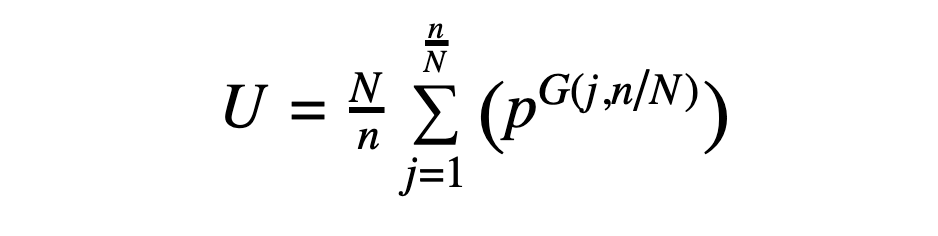
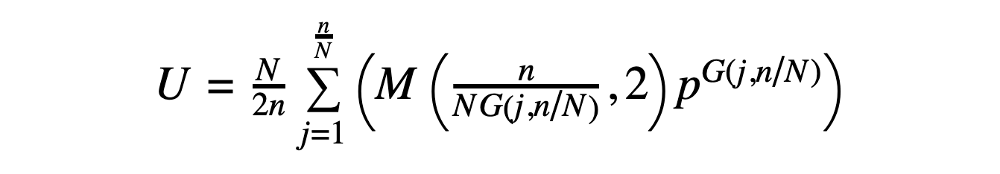

# Aplicación para contar secuencias de péptidos cíclicos (count_cycpep_sequences)

Volver a [[Application Documentation]].

Creada el 16 de agosto de 2019 por Vikram K. Mulligan, Flatiron Institute (vmulligan@flatironinstitute.org).  Enfoque derivado por Todd Yeates, University of California Los Angeles (yeates@mbi.ucla.edu).<br/><br/>
<b><i>Si usas esta aplicación, por favor cita:</i><br/>
Mulligan VK, Kang CS, Sawaya MR, Rettie S, Li X, Antselovich I, Craven T, Watkins A, Labonte JW, DiMaio F, Yeates TO, and Baker D. (2019).  Computational design of internally-symmetric peptide macrocycles with switchable folds.  Manuscript in prepration.</b><br/>

[[_TOC_]]

## Descripción

A menudo es útil poder contar el número de secuencias posibles para un problema de diseño o de síntesis química dado.  Dado un péptido lineal de **n** residuos con **p** posibilidades en cada posición, hay **p<sup>n</sup>** secuencias únicas posibles.  Sin embargo, en un péptido cíclico de N a C, contar el número de secuencias únicas se vuelve más complicado.  Una primera aproximación sería dividir por la longitud de la secuencia (**p<sup>n</sup>/n**), pero así se seguirían contando más de una vez las secuencias con simetría interna.  Todavía más difícil es contar cuando uno se limita a secuencias con simetría interna, como la simetría cíclica (C2, C3, C4...) o la rotacional impropia (S2, S4, S6...).

Esta aplicación ofrece una forma cómoda de calcular el número de secuencias posibles a partir de la longitud de la secuencia **n**, las posibilidades en cada posición **p** y el tipo de simetría.

## Algoritmos

### Algoritmo de fuerza bruta

El enfoque de fuerza bruta, dado un péptido de **n** residuos con simetría de orden **N** (CN o SN) y **p** posibilidades en cada posición, consiste en recorrer todas las permutaciones lineales de la secuencia (actualizando de una manera que conserve la simetría, si **N** > 1).  Para cada secuencia considerada, se genera la permutación cíclica de menor rango (según un operador de comparación arbitrario) y luego se consulta una lista ordenada de las secuencias ya encontradas.  Si la secuencia no está en la lista, se añade y se continúa con la siguiente secuencia.  Al final, se cuentan las secuencias encontradas.

Este enfoque funciona, como es lógico, muy mal cuando hay muchas posibilidades de secuencia (millones o más).  Escala mal tanto en tiempo de CPU como en uso de memoria.  Su única ventaja es la sencillez conceptual.  Solo sirve para comprobar la validez de los enfoques analíticos y por eso no está activado por defecto.

### Algoritmo analítico para simetrías cíclicas (incluido el caso asimétrico)

Dado un péptido con simetría CN (donde **N** = 1 en el caso asimétrico), el número de secuencias posibles viene dado por la siguiente expresión, derivada de la aplicación del [lema de Burnside](https://en.wikipedia.org/wiki/Burnside%27s_lemma):



En lo anterior, **U** es el número de secuencias únicas con simetría CN (donde las permutaciones cíclicas de una secuencia se consideran la misma secuencia), **N** es el orden de simetría, **n** es el número de residuos del péptido y **p** es el número de posibilidades en cada posición.  Ten en cuenta que la expresión es, en última instancia, función de **n/N**, el número de residuos de la unidad asimétrica; esto significa que un 10-mero con simetría C2 (con 5 residuos en la unidad asimétrica) tiene el mismo número de posibilidades que un 15-mero con simetría C3 (también con 5 residuos en la unidad asimétrica).  La expresión **G(j,N/n)** representa el máximo común divisor de **j** y **N/n**.

### Algoritmo analítico para simetrías rotacionales impropias:

Dado un péptido con simetría SN (donde **N** = 2, 4, 6...) y una secuencia que puede dividirse en "lóbulos" de unidad simétrica que se repiten con inversión de la secuencia (de modo que los L-aminoácidos pasan a ser D-aminoácidos de un lóbulo al siguiente y viceversa), el número de secuencias posibles viene dado por la siguiente expresión:



En lo anterior, **U** es el número de secuencias únicas con simetría SN (donde, de nuevo, las permutaciones cíclicas de una secuencia se consideran la misma secuencia), y **N**, **n**, **p** y **G(j,N/n)** se definen como antes.  La expresión **M(x,y)** representa la operación módulo.

## Opciones

|                        Opción |                  Valor por defecto  |Tipo|  Descripción            |    
|-------------------------------|---------------------------|----|-------------------------|
|               symmetry_number |                         1 |   Int| El orden de simetría.  Por ejemplo, 3 para simetría C3.  El valor por defecto, 1, corresponde al caso asimétrico. |
|               mirror_symmetry |                     false |   Bool| Si es true, el tipo de simetría es SN (S2, S4, S6, etc.). Si es false, se considera simetría cíclica simple (C2, C3, C4, etc.).  False por defecto. |
|            do_numerical_count |                     false |   Bool| Si es true, se intenta hacer la enumeración a mano, en lugar de usar las expresiones derivadas del lema de Burnside.  Ten en cuenta que escala mal para péptidos más largos. False por defecto. |
|                peptide_length |                         8 |   Int| El número de residuos del péptido.  Por defecto es 8, de forma arbitraria. |
|          options_per_position |                        20 |   Int| El número de opciones permitidas en cada posición. Por ejemplo, si se consideraran los bins ABEGO, habría cinco opciones; si se consideraran los 20 aminoácidos canónicos, habría 20 opciones. Por defecto 20. |
|               achiral_options |                         0 |   Int| El número de opciones que son su propia imagen especular (p. ej., GLY, AIB), si se considera la simetría especular.  Ten en cuenta que el número total de opciones por posición menos el número de opciones asimétricas debe ser un número par, si la simetría está activada.  Por defecto 0. |
|           write_out_sequences |                     false |   Bool| Si es true, se escribirán las secuencias enumeradas numéricamente. False por defecto, ya que esto puede producir cantidades astronómicas de secuencias. |
|            SN_semi_analytical |                     false |   Bool| Si es true, se usa un método semianalítico para la simetría SN (rotacional impropia).  Si es false, se usa un método totalmente analítico.  False por defecto. |

## Salida de ejemplo

El siguiente ejemplo muestra la línea de comandos y una salida de ejemplo para calcular el número de secuencias de un 36-mero con simetría S6, tomando como posibilidades en cada posición los 19 L-aminoácidos canónicos y sus 19 contrapartes D-aminoácidos especulares (38 posibilidades en total):

```
> ./bin/count_cycpep_sequences.default.macosclangrelease -symmetry_number 6 -mirror_symmetry true -peptide_length 36 -options_per_position 38

core.init: Checking for fconfig files in pwd and ./rosetta/flags 
core.init: Rosetta version: 2019.33.post.dev+163.vmullig.countcycpepuniquesequences.d88e8403005 d88e8403005550a82389b56fbe33bb4950896124 git@github.com:RosettaCommons/main.git 2019-08-16T17:53:01
core.init: command: ./bin/count_cycpep_sequences.default.macosclangrelease -symmetry_number 6 -mirror_symmetry true -peptide_length 36 -options_per_position 38
basic.random.init_random_generator: 'RNG device' seed mode, using '/dev/urandom', seed=1766054521 seed_offset=0 real_seed=1766054521
basic.random.init_random_generator: RandomGenerator:init: Normal mode, seed=1766054521 RG_type=mt19937
core.init: Resolved executable path: /Users/vmulligan/rosetta_devcopy/Rosetta/main/source/./bin/count_cycpep_sequences.default.macosclangrelease
core.init: Looking for database based on location of executable: /Users/vmulligan/rosetta_devcopy/Rosetta/main/database/
apps.public.cyclic_peptide.count_cycpep_sequences: Starting count_cycpep_sequences application.
apps.public.cyclic_peptide.count_cycpep_sequences: Application created 13 August 2019 by Vikram K. Mulligan, Flatiron Institute (vmulligan@flatironinstitute.org).
apps.public.cyclic_peptide.count_cycpep_sequences: The associated manuscript is in prepration, and may be cited as "Mulligan VK, Kang CS, Sawaya MR, Rettie S, Li X, Antselovich I, Craven T, Watkins A, Labonte JW, DiMaio F, Yeates TO, and Baker D. (2019).  Computational design of internally-symmetric peptide macrocycles with switchable folds.  Manuscript in prepration.".
apps.public.cyclic_peptide.count_cycpep_sequences: 1/12 * ( 38^2 + 38^2 + 38^6 )
apps.public.cyclic_peptide.count_cycpep_sequences: Analytically, counted 250911606 unique sequences for a 36 residue cyclic peptide with S6 symmetry, with 38 possibilities at each position, 0 of which are achiral.
apps.public.cyclic_peptide.count_cycpep_sequences: Completed count_cycpep_sequences application.  Exiting with no errors (status zero).
```

A continuación se muestra el cálculo de todas las secuencias posibles de un 4-mero cíclico asimétrico, con 3 posibilidades por posición.  En este caso se realizan tanto la evaluación analítica como la de fuerza bruta, y se escriben todas las secuencias de la evaluación de fuerza bruta.  (Ten en cuenta que a cada posibilidad de aminoácido se le asigna un número, empezando por 1, ya que no se imponen suposiciones sobre las identidades de los aminoácidos considerados.  Por eso vemos secuencias como "1 3 2 2" en lugar de "A F L L")

```
> ./bin/count_cycpep_sequences.default.macosclangrelease -peptide_length 4 -do_numerical_count -write_out_sequences -options_per_position 3

core.init: Checking for fconfig files in pwd and ./rosetta/flags 
core.init: Rosetta version: 2019.33.post.dev+165.vmullig.countcycpepuniquesequences.3882a1ebab6 3882a1ebab6b3ce70c53178fe277899db8a79e8c git@github.com:RosettaCommons/main.git 2019-08-16T18:42:45
core.init: command: ./bin/count_cycpep_sequences.default.macosclangrelease -peptide_length 4 -do_numerical_count -write_out_sequences -options_per_position 3
basic.random.init_random_generator: 'RNG device' seed mode, using '/dev/urandom', seed=-646956502 seed_offset=0 real_seed=-646956502
basic.random.init_random_generator: RandomGenerator:init: Normal mode, seed=-646956502 RG_type=mt19937
core.init: Resolved executable path: /Users/vmulligan/rosetta_devcopy/Rosetta/main/source/./bin/count_cycpep_sequences.default.macosclangrelease
core.init: Looking for database based on location of executable: /Users/vmulligan/rosetta_devcopy/Rosetta/main/database/
apps.public.cyclic_peptide.count_cycpep_sequences: Starting count_cycpep_sequences application.
apps.public.cyclic_peptide.count_cycpep_sequences: Application created 13 August 2019 by Vikram K. Mulligan, Flatiron Institute (vmulligan@flatironinstitute.org).
apps.public.cyclic_peptide.count_cycpep_sequences: The associated manuscript is in prepration, and may be cited as "Mulligan VK, Kang CS, Sawaya MR, Rettie S, Li X, Antselovich I, Craven T, Watkins A, Labonte JW, DiMaio F, Yeates TO, and Baker D. (2019).  Computational design of internally-symmetric peptide macrocycles with switchable folds.  Manuscript in prepration.".
apps.public.cyclic_peptide.count_cycpep_sequences: U = 1/4 * ( 3^1 + 3^2 + 3^1 + 3^4 )
apps.public.cyclic_peptide.count_cycpep_sequences: Analytically, counted 24 unique sequences for a 4 residue cyclic peptide with no symmetry, with 3 possibilities at each position.
apps.public.cyclic_peptide.count_cycpep_sequences: Iterating through all sequences to count.  (Note that this can be extremely slow for large peptides.)
apps.public.cyclic_peptide.count_cycpep_sequences: Observed sequences:
apps.public.cyclic_peptide.count_cycpep_sequences: 1 1 1 1
apps.public.cyclic_peptide.count_cycpep_sequences: 1 1 1 2
apps.public.cyclic_peptide.count_cycpep_sequences: 1 1 1 3
apps.public.cyclic_peptide.count_cycpep_sequences: 1 1 2 2
apps.public.cyclic_peptide.count_cycpep_sequences: 1 1 2 3
apps.public.cyclic_peptide.count_cycpep_sequences: 1 1 3 2
apps.public.cyclic_peptide.count_cycpep_sequences: 1 1 3 3
apps.public.cyclic_peptide.count_cycpep_sequences: 1 2 1 2
apps.public.cyclic_peptide.count_cycpep_sequences: 1 2 1 3
apps.public.cyclic_peptide.count_cycpep_sequences: 1 2 2 2
apps.public.cyclic_peptide.count_cycpep_sequences: 1 2 2 3
apps.public.cyclic_peptide.count_cycpep_sequences: 1 2 3 2
apps.public.cyclic_peptide.count_cycpep_sequences: 1 2 3 3
apps.public.cyclic_peptide.count_cycpep_sequences: 1 3 1 3
apps.public.cyclic_peptide.count_cycpep_sequences: 1 3 2 2
apps.public.cyclic_peptide.count_cycpep_sequences: 1 3 2 3
apps.public.cyclic_peptide.count_cycpep_sequences: 1 3 3 2
apps.public.cyclic_peptide.count_cycpep_sequences: 1 3 3 3
apps.public.cyclic_peptide.count_cycpep_sequences: 2 2 2 2
apps.public.cyclic_peptide.count_cycpep_sequences: 2 2 2 3
apps.public.cyclic_peptide.count_cycpep_sequences: 2 2 3 3
apps.public.cyclic_peptide.count_cycpep_sequences: 2 3 2 3
apps.public.cyclic_peptide.count_cycpep_sequences: 2 3 3 3
apps.public.cyclic_peptide.count_cycpep_sequences: 3 3 3 3
apps.public.cyclic_peptide.count_cycpep_sequences: Numerically, counted 24 unique sequences for a 4 residue cyclic peptide with no symmetry, with 3 possibilities at each position.
apps.public.cyclic_peptide.count_cycpep_sequences: Completed count_cycpep_sequences application.  Exiting with no errors (status zero).
```

Ten en cuenta que, en lo anterior, puede que haya que sustituir "default.macosclangrelease" por tu compilación, sistema operativo y compilador (_p. ej._ "cxx11thread.linuxgccrelease").

## Limitaciones conocidas

Actualmente, la evaluación analítica no funciona para la simetría rotacional impropia cuando hay posibilidades posicionales aquirales (_es decir_, que no cambian su identidad de un lóbulo de simetría a un lóbulo especular, como la glicina o el ácido 2-aminoisobutírico).  Para estos casos, el evaluador analítico devolverá 0 y, por ahora, solo el evaluador de fuerza bruta devolverá una respuesta con sentido.  Es probable que en el futuro añadamos compatibilidad con este caso.

## Véase también

* [Lema de Burnside](https://en.wikipedia.org/wiki/Burnside%27s_lemma) en Wikipedia.
* [Lema de Burnside](http://mathworld.wolfram.com/Cauchy-FrobeniusLemma.html) (también llamado lema de Cauchy-Frobenius) en Wolfram Mathworld.
* [[Predicción sencilla de la estructura de péptidos cíclicos|simple_cycpep_predict]].