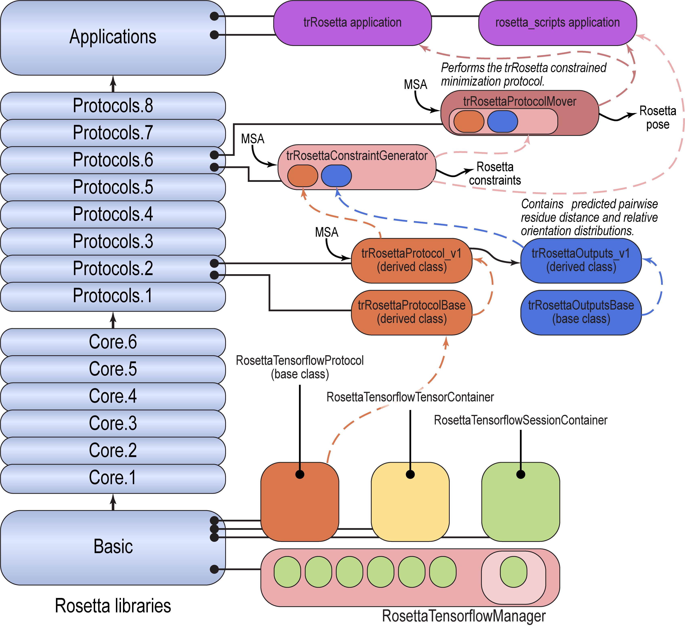

# trRosetta: predicción de estructura de proteínas mejorada con redes neuronales

Documentación añadida el 4 de febrero de 2021 por Vikram K. Mulligan, Flatiron Institute (vmulligan@flatironinstitute.org).

[[_TOC_]]

## Propósito de la aplicación

La aplicación trRosetta usa la red neuronal trRosetta descrita en Yang _et al_. (2020) _Proc Natl Acad Sci USA_ 117(3):1496-1503 (doi 10.1073/pnas.1914677117) para generar restricciones de distancia y orientación entre residuos para una secuencia de estructura desconocida, a partir de un alineamiento múltiple de secuencias.  Después, la aplicación usa el minimizador de Rosetta para encontrar la conformación de la cadena principal que sea coherente con las restricciones.  Esto permite una predicción de estructura más rápida y precisa que la aplicación clásica AbintioRelax.  Reproduce el protocolo en Python descrito en Yang _et al._, pero ofrece ventajas en velocidad y uso de disco, distribución automática de trabajos mediante el distribuidor de trabajos de Rosetta y algunas opciones adicionales.

### Requisitos de compilación

La aplicación trRosetta requiere que Rosetta esté enlazado con las bibliotecas de la API de C de Tensorflow.  Para compilar con soporte de Tensorflow:

1.  Descarga las bibliotecas precompiladas de Tensorflow 1.15 para tu sistema operativo desde uno de los siguientes enlaces.  (Ten en cuenta que las versiones para GPU requieren controladores CUDA; consulta https://www.tensorflow.org/install/lang_c para más información.)
     * Linux/CPU: https://storage.googleapis.com/tensorflow/libtensorflow/libtensorflow-cpu-linux-x86_64-1.15.0.tar.gz
     * Linux/GPU: https://storage.googleapis.com/tensorflow/libtensorflow/libtensorflow-gpu-linux-x86_64-1.15.0.tar.gz
     * Windows/CPU: https://storage.googleapis.com/tensorflow/libtensorflow/libtensorflow-cpu-windows-x86_64-1.15.0.zip
     * Windows/GPU: https://storage.googleapis.com/tensorflow/libtensorflow/libtensorflow-gpu-windows-x86_64-1.15.0.zip
     * MacOS/CPU: https://storage.googleapis.com/tensorflow/libtensorflow/libtensorflow-cpu-darwin-x86_64-1.15.0.tar.gz
     * MacOS/GPU: No hay ninguna disponible.

2.  Descomprime el archivo en un directorio adecuado (aquí se usa ~/mydir/ como ejemplo) y añade las siguientes variables de entorno:
     * Linux, Windows:
          * LIBRARY_PATH=$LIBRARY_PATH:~/mydir/lib
          * LD_LIBRARY_PATH=$LD_LIBRARY_PATH:~/mydir/lib
     * MacOS:
          * LIBRARY_PATH=$LIBRARY_PATH:~/mydir/lib
          * DYLD_LIBRARY_PATH=$DYLD_LIBRARY_PATH:~/mydir/lib

3.  Edita tu archivo user.settings (Rosetta/main/source/tools/build/user.settings) y descomenta (es decir, quita el símbolo de almohadilla del comienzo de) las siguientes líneas:
```python
        import os
                'program_path'  : os.environ['PATH'].split(':'),
                'ENV' : os.environ,
```

4.  Compila Rosetta, añadiendo extras=tensorflow (solo para CPU) o extras=tensorflow_gpu (para GPU) a tu comando scons.  Por ejemplo:
```
        ./scons.py -j 8 mode=release extras=tensorflow bin
```

Ten en cuenta que la línea `'ENV'` del archivo user.settings debe estar en la sección «override».  Si se ha movido a otra sección, puede que obtengas un error `KeyError:'LESS'` durante la compilación. 

### Una nota sobre la nomenclatura

Aunque «omega» y «phi» se usan habitualmente para referirse al tercer y al primer diedro de la cadena principal de un aminoácido alfa, y «theta» se usa para referirse al segundo diedro de la cadena principal de un aminoácido beta, en el contexto de los protocolos relacionados con trRosetta estas letras griegas adquieren nuevos significados.  Aquí, «omega» se refiere al ángulo diedro entre residuos formado por los átomos CA y CB de un primer residuo y los átomos CB y CA de un segundo residuo.  «Theta» se refiere al ángulo diedro entre residuos formado por los átomos N, CA y CB de un primer residuo y el átomo CB de un segundo residuo.  Y «phi» se refiere al ángulo entre residuos formado por los átomos CA y CB de un primer residuo y el átomo CB de un segundo residuo.

## Algoritmo de trRosetta

La aplicación trRosetta toma dos entradas: una secuencia (en formato FASTA) y un alineamiento múltiple de secuencias (en formato .a3m).  Los alineamientos múltiples de secuencias pueden generarse con el servidor web HHBlits (https://toolkit.tuebingen.mpg.de/tools/hhblits); para ver un ejemplo de MSA en formato .a3m, consulta la documentación de [[trRosettaProtocolMover|trRosettaProtocol]].  Después, la aplicación trRosetta lleva a cabo los siguientes pasos:

1.  El alineamiento múltiple de secuencias se convierte en un tensor 3D de tipo one-hot (posición de la secuencia x secuencia x identidad del aminoácido), que se proporciona a la red neuronal trRosetta.

2.  Se ejecuta la red neuronal trRosetta, que aplica una serie de capas convolucionales 2D para transformar las entradas en un conjunto de tensores de salida.  Estos incluyen un tensor 3D de distribución de probabilidad de distancias entre residuos (res1 x res2 x distancias entre residuos agrupadas en bins), dos tensores 3D de probabilidad de torsión entre residuos para los diedros entre residuos omega y theta (consulta la nota anterior) y una distribución 3D de probabilidad de ángulos entre residuos para el ángulo entre residuos phi (consulta la nota anterior).

3.  Se construye una representación en modo centroid de la secuencia y se aleatoriza su conformación inicial.  Los modos de aleatorización incluyen:
    * El protocolo «classic» de Yang _et al_.  Para cada residuo de aminoácido, los ángulos diedros phi y psi de la cadena principal se fijan al azar en uno de estos pares: (-140, 153), (-72, 145), (-122, 117), (-82, -14), (-61, -41) o (57, 39), con probabilidades ponderadas para favorecer las estructuras secundarias probables.  No se tienen en cuenta las preferencias conformacionales de los distintos tipos de aminoácidos, y todos los ángulos omega de la cadena principal se fijan en 180 grados (_es decir_, no se muestrean enlaces peptídicos cis).  **Este protocolo es el predeterminado.**
    * El protocolo «ramachandran».  Los diedros phi y psi de cada aminoácido se extraen de la distribución de probabilidad de ese aminoácido con el [[mover RandomizeBBByRamaPrePro|RandomizeBBByRamaPreProMover]].  Los residuos que preceden a prolinas usan distribuciones distintas (_es decir_, se usan las distribuciones de probabilidad de la función de energía rama_prepro).  Los enlaces peptídicos cis se muestrean con baja probabilidad (por defecto el 0.05 % de las veces), salvo en las posiciones previas a prolina, donde se muestrean con probabilidad moderada (por defecto el 5 % de las veces, para coincidir con las estadísticas del PDB).
    * El protocolo «bins».  La conformación de la cadena principal se inicializa con el [[mover InitializeByBins|InitializeByBinsMover]], que fija la conformación de cada par de aminoácidos eligiendo bins conformacionales de la cadena principal según estadísticas del PDB que indican la probabilidad de ver el residuo i en el bin X y el residuo i+1 en el bin Y.  Los valores exactos de phi y psi de la cadena principal se extraen de la distribución de Ramachandran dentro de cada bin, y los enlaces amida cis se muestrean en proporción a las estadísticas del PDB.  Consulta la documentación de ese mover para más detalles.

4.  El [[trRosettaConstraintGenerator]] se usa para convertir las distribuciones de distancia, omega, theta y phi entre residuos en restricciones de par de átomos, diedro, diedro y ángulo, respectivamente.

5.  El [[MinMover]] se usa para llevar la cadena principal desde su conformación inicial aleatoria hasta una conformación coherente con las restricciones.  Sea cual sea el protocolo de minimización, la minimización alterna rondas de minimización en el espacio de torsiones y en el espacio cartesiano, con una función de energía que combina la función de puntuación centroid con términos de penalización de restricciones.  Los protocolos de minimización disponibles incluyen:
    * El protocolo «classic0», que primero minimiza usando solo restricciones de corto alcance, luego minimiza usando restricciones de corto + medio alcance y luego minimiza usando todas las restricciones.
    * El protocolo «classic1», que primero minimiza usando restricciones de corto + medio alcance y luego minimiza usando todas las restricciones.
    * El protocolo «classic2», que minimiza de inmediato usando todas las restricciones.  **Este protocolo es el predeterminado.**

6.  El Pose se convierte en un modelo de todos los átomos.

7.  Se aplica el [[protocolo FastRelax|FastRelaxMover]] con las restricciones presentes, alternando la minimización en el espacio de torsiones y en el cartesiano con el protocolo «dualspace» de Conway _et al_. (2014) _Protein Sci_ 23(1):47-55 (doi 10.1002/pro.2389).  Esto refina la geometría de la cadena principal y de las cadenas laterales.

8.  Se escribe un Pose final en disco.  Se incluyen estadísticas como el RMSD respecto a la estructura nativa (tras las fases de refinamiento centroid y de todos los átomos) y el tiempo de ejecución.

## Opciones

```
                        Option |                  Setting  |Type|  Description                  
--------------------------------------------------------------------------------------
                               |                           |    |
                    in:file:   |                           |    | 
                         fasta |                           | (F)| Fasta-formatted sequence file
                        native |                           |   F| Native PDB filename
		in:detect_disulfides   |                           |   B| If true, detects potential
		                       |                           |    | disulfides after centroid phase
							   |                           |    | (default true)
                               |                           |    |
                  trRosetta:   |                           |    | 
                      msa_file |                           |   F| Filename for a multiple 
                               |                           |    |  sequence alignment file, 
                               |                           |    |  in a3m format.  Dashes 
                               |                           |    |  indicate gap sequences, 
                               |                           |    |  and lowercase characters 
                               |                           |    |  will be removed (and 
                               |                           |    |  flanking regions ligated).
      use_distance_constraints |                           |   B| Should distance constraints 
                               |                           |    |  generated by the trRosetta 
                               |                           |    |  neural network be used 
                               |                           |    |  during structure 
                               |                           |    |  prediction?  Default true.
         use_omega_constraints |                           |   B| Should omega dihedral 
                               |                           |    |  constraints generated by 
                               |                           |    |  the trRosetta neural 
                               |                           |    |  network be used during 
                               |                           |    |  structure prediction?  
                               |                           |    |  Note that this is NOT the 
                               |                           |    |  backbone omega dihedral 
                               |                           |    |  angle, but an 
                               |                           |    |  inter-residue dihedral 
                               |                           |    |  defined by 
                               |                           |    |  CA1-CB1-CB2-CA2.  Default 
                               |                           |    |  true.
         use_theta_constraints |                           |   B| Should theta dihedral 
                               |                           |    |  constraints generated by 
                               |                           |    |  the trRosetta neural 
                               |                           |    |  network be used during 
                               |                           |    |  structure prediction?  
                               |                           |    |  Note that this is an 
                               |                           |    |  inter-residue dihedral 
                               |                           |    |  defined by N1-CA1-CB1-CB2. 
                               |                           |    |  Default true.
           use_phi_constraints |                           |   B| Should phi angle constraints 
                               |                           |    |  generated by the trRosetta 
                               |                           |    |  neural network be used 
                               |                           |    |  during structure 
                               |                           |    |  prediction?  Note that 
                               |                           |    |  this is NOT the backbone 
                               |                           |    |  phi dihedral angle, but an 
                               |                           |    |  inter-residue angle 
                               |                           |    |  defined by CA1-CB1-CB2.  
                               |                           |    |  Default true.
distance_constraint_prob_cutoff |                     0.05 |   R| The minimum cumulative 
                               |                           |    |  probability for 
                               |                           |    |  residue-pair distance 
                               |                           |    |  constraints, below which 
                               |                           |    |  no constraint is added.  
                               |                           |    |  Default 0.05.
  omega_constraint_prob_cutoff |                      0.55 |   R| The minimum cumulative 
                               |                           |    |  probability for 
                               |                           |    |  residue-pair omega 
                               |                           |    |  dihedral (CA1-CB1-CB2-CA2) 
                               |                           |    |  constraints, below which 
                               |                           |    |  no constraint is added.  
                               |                           |    |  Default 0.55.
  theta_constraint_prob_cutoff |                      0.55 |   R| The minimum cumulative 
                               |                           |    |  probability for 
                               |                           |    |  residue-pair theta 
                               |                           |    |  dihedral (N-CA1-CB1-CB2) 
                               |                           |    |  constraints, below which 
                               |                           |    |  no constraint is added.  
                               |                           |    |  Default 0.55.
    phi_constraint_prob_cutoff |                      0.65 |   R| The minimum cumulative 
                               |                           |    |  probability for 
                               |                           |    |  residue-pair phi angle 
                               |                           |    |  (CA1-CB1-CB2) constraints, 
                               |                           |    |  below which no constraint 
                               |                           |    |  is added.  Default 0.65.
    distance_constraint_weight |                         1 |   R| A multiplier that can be 
                               |                           |    |  used to alter the 
                               |                           |    |  trRosetta distance 
                               |                           |    |  constraint weights.  
                               |                           |    |  Default 1.0.
       omega_constraint_weight |                         1 |   R| A multiplier that can be 
                               |                           |    |  used to alter the 
                               |                           |    |  trRosetta omega constraint 
                               |                           |    |  weights.  (Note that omega 
                               |                           |    |  is the CA1-CB1-CB2-CA2 
                               |                           |    |  dihedral angle, not the 
                               |                           |    |  usual backbone diheral 
                               |                           |    |  angle.)  Default 1.0.
       theta_constraint_weight |                         1 |   R| A multiplier that can be 
                               |                           |    |  used to alter the 
                               |                           |    |  trRosetta theta constraint 
                               |                           |    |  weights.  Theta 
                               |                           |    |  constraints the 
                               |                           |    |  N1-CA1-CB1-CB2 dihedral.  
                               |                           |    |  Default 1.0.
         phi_constraint_weight |                         1 |   R| A multiplier that can be 
                               |                           |    |  used to alter the 
                               |                           |    |  trRosetta phi (angle) 
                               |                           |    |  constraint weights.  (Note 
                               |                           |    |  that phi is the 
                               |                           |    |  CA1-CB1-CB2 angle, not the 
                               |                           |    |  usual backbone dihedral 
                               |                           |    |  angle.)  Default 1.0.
     write_constraints_to_file |                           |   S| If provided, trRosetta 
                               |                           |    |  constraints are written to 
                               |                           |    |  the specified filename.  
                               |                           |    |  No write occurs if not 
                               |                           |    |  provided or if set to an 
                               |                           |    |  empty string.
        only_write_constraints |                     false |   B| If true, the the 
                               |                           |    |  trRosettaProtocolMover or 
                               |                           |    |  trRosetta application 
                               |                           |    |  skips the structue 
                               |                           |    |  prediction phase, and ONLY 
                               |                           |    |  writes constraints to a 
                               |                           |    |  file.  Must be used in 
                               |                           |    |  conjunction with a 
                               |                           |    |  filename specified with 
                               |                           |    |  the -trRosett
                               |                           |    |  a
                               |                           |    |  :write_constraints_to_file 
                               |                           |    |  option.  False by default.
   backbone_randomization_mode |                   classic |   S| The manner in which the 
                               |                           |    |  polypeptide backbone is 
                               |                           |    |  initially randomized.  Can 
                               |                           |    |  be 'classic' (the manner 
                               |                           |    |  of the original Yang et 
                               |                           |    |  al. paper), 'ramachandran' 
                               |                           |    |  (randomizing biased by the 
                               |                           |    |  Ramachandran preferences 
                               |                           |    |  of each residue, or 'bins' 
                               |                           |    |  (randomizing biased by the 
                               |                           |    |  probability of seeing 
                               |                           |    |  residue type i in backbone 
                               |                           |    |  bin X and residue type i+1 
                               |                           |    |  in backbone bin Y).  
                               |                           |    |  Default 'classic'.
    backbone_minimization_mode |                  classic2 |   S| The protocol to use for 
                               |                           |    |  minimizing the backbone 
                               |                           |    |  given the constraints.  
                               |                           |    |  Options are: 'classic0' 
                               |                           |    |  (minimize using 
                               |                           |    |  short-range constraints, 
                               |                           |    |  then minimize using 
                               |                           |    |  medium-range constraints, 
                               |                           |    |  then minimize using 
                               |                           |    |  long-range constraints), 
                               |                           |    |  'classic1' (minimize using 
                               |                           |    |  short- and medium-range 
                               |                           |    |  constraints, then minimize 
                               |                           |    |  using long-range 
                               |                           |    |  constraints), or 
                               |                           |    |  'classic2' (minimize using 
                               |                           |    |  all constraints).  
                               |                           |    |  Defaults to 'classic2'.
   cis_peptide_prob_non_prepro |                    0.0005 |   R| The probability of sampling 
                               |                           |    |  a cis peptide bond at 
                               |                           |    |  positions that do not 
                               |                           |    |  precede proline.  Note 
                               |                           |    |  that cis omega sampling 
                               |                           |    |  only happens in 
                               |                           |    |  'ramachandran' backbone 
                               |                           |    |  randomization mode, not in 
                               |                           |    |  'classic'.  (In 'bins' 
                               |                           |    |  mode, the bin transition 
                               |                           |    |  probabilities govern cis 
                               |                           |    |  sampling.)  Defaults to 
                               |                           |    |  0.0005; must be a value 
                               |                           |    |  from 0.0 to 1.0.
       cis_peptide_prob_prepro |                      0.05 |   R| The probability of sampling 
                               |                           |    |  a cis peptide bond at 
                               |                           |    |  positions that precede 
                               |                           |    |  proline.  Note that cis 
                               |                           |    |  omega sampling only 
                               |                           |    |  happens in 'ramachandran' 
                               |                           |    |  backbone randomization 
                               |                           |    |  mode, not in 'classic'.  
                               |                           |    |  (In 'bins' mode, the bin 
                               |                           |    |  transition probabilities 
                               |                           |    |  govern cis sampling.)  
                               |                           |    |  Defaults to 0.05; must be 
                               |                           |    |  a value from 0.0 to 1.0.
                     scorefxn0 |        trRosetta_cen0.wts |   F| Weights file for 
                               |                           |    |  scorefunction used during 
                               |                           |    |  initial (stage 0) 
                               |                           |    |  minimization by the 
                               |                           |    |  trRosettaProtocol mover.  
                               |                           |    |  Defaults to 
                               |                           |    |  trRosetta_cen0.wts.
                     scorefxn1 |        trRosetta_cen1.wts |   F| Weights file for 
                               |                           |    |  scorefunction used during 
                               |                           |    |  stage 1 minimization by 
                               |                           |    |  the trRosettaProtocol 
                               |                           |    |  mover.  Defaults to 
                               |                           |    |  trRosetta_cen0.wts.
                     scorefxn2 |        trRosetta_cen2.wts |   F| Weights file for 
                               |                           |    |  scorefunction used during 
                               |                           |    |  clash relief (stage 2 -- 
                               |                           |    |  Van der Waals stage) 
                               |                           |    |  minimization by the 
                               |                           |    |  trRosettaProtocol mover.  
                               |                           |    |  Defaults to 
                               |                           |    |  trRosetta_cen0.wts.
                     scorefxn3 |        trRosetta_cart.wts |   F| Weights file for 
                               |                           |    |  scorefunction used during 
                               |                           |    |  late-stage (stage 3 -- 
                               |                           |    |  Cartesian stage) 
                               |                           |    |  minimization by the 
                               |                           |    |  trRosettaProtocol mover.  
                               |                           |    |  Defaults to 
                               |                           |    |  trRosetta_cen0.wts.
             scorefxn_fullatom |                           |   F| Weights file for 
                               |                           |    |  scorefunction used for 
                               |                           |    |  fullatom refinement with 
                               |                           |    |  FastRelax.  If 
                               |                           |    |  atom-pair_constraint, 
                               |                           |    |  dihedral_constraint, or 
                               |                           |    |  angle_constraint terms are 
                               |                           |    |  zero, they will be set to 
                               |                           |    |  5.0, 1.0, and 1.0 
                               |                           |    |  respectively.  If empty 
                               |                           |    |  (the default), then the 
                               |                           |    |  scoring function specified 
                               |                           |    |  with -score:weights is 
                               |                           |    |  used instead.
             mutate_gly_to_ala |                           |   B| If true, glycine residues 
                               |                           |    |  are mutated to alanine 
                               |                           |    |  during the centroid phase 
                               |                           |    |  of minimization, then 
                               |                           |    |  converted back for 
                               |                           |    |  fullatom refinement.  True 
                               |                           |    |  by default to match the 
                               |                           |    |  original PyRosetta 
                               |                           |    |  protocol.
           fullatom_refinement |                           |   B| If true, the structure is 
                               |                           |    |  converted to a fullatom 
                               |                           |    |  structure and the 
                               |                           |    |  FastRelax protocol is run 
                               |                           |    |  at the end.  The energy 
                               |                           |    |  function used for this 
                               |                           |    |  step is the Rosetta 
                               |                           |    |  default energy function 
                               |                           |    |  (with atom-pair, dihedral, 
                               |                           |    |  and angle constraint terms 
                               |                           |    |  turned on if they are 
                               |                           |    |  not).  This can be set 
                               |                           |    |  with the -
                               |                           |    |  t
                               |                           |    |  rRosetta:scorefxn_fullatom 
                               |                           |    |  flag.  True by default.
```

### Opciones recomendadas

En el momento de escribir esto, las opciones recomendadas como mejores prácticas son:

```
-mutate_gly_to_ala false
-backbone_randomization_mode ramachandran
```

Es posible que en el futuro pasen a ser las predeterminadas.  Todos los demás ajustes pueden dejarse en sus valores por defecto.

## Limitaciones

- La red neuronal trRosetta está entrenada con cientos de millones de secuencias conocidas y cientos de miles de estructuras conocidas.  Las proteínas con pocos homólogos cercanos o con secuencias o geometría de cadena principal inusuales pueden predecirse mal.
- Los modelos producidos tienden a tener una diversidad limitada.  El protocolo de minimización de trRosetta es bueno para predecir el estado nativo de una proteína bien plegada, pero puede no ser el mejor para muestrear conformacionalmente el paisaje de energía de una secuencia.  Para eso, considera usar la [[aplicación AbinitioRelax|abinitio-relax]], con o sin la opción `-use_trRosetta_constraints`, para realizar un muestreo conformacional basado en inserción de fragmentos.
- El protocolo trRosetta actualmente solo puede usarse en Poses de una sola cadena compuestos enteramente por aminoácidos canónicos.  Los cofactores, las modificaciones postraduccionales, las proteínas de varias cadenas y los bloques de construcción no canónicos no están admitidos por ahora.
- Este protocolo está pensado para proteínas solubles.  Está previsto añadir soporte para proteínas de membrana.

## Organización del código 

- Los parámetros de la red neuronal trRosetta están en la base de datos de Rosetta, en `Rosetta/main/database/protocol_data/tensorflow_graphs/tensorflow_graph_repo_submodule/trRosetta/model_v1/`.
- El `RosettaTensorflowManager`, código de bajo nivel para cargar modelos de Tensorflow y usarlos en protocolos de Rosetta, está en `Rosetta/main/source/src/basic/tensorflow_manager`.
- El código para convertir un alineamiento múltiple de secuencias en un tensor 3D one-hot, ejecutar la red neuronal trRosetta y guardar los resultados en un objeto de salida que contiene los tensores de distancia, omega, theta y phi está en `Rosetta/main/source/src/protocols/trRosetta/`.  Las clases `trRosettaProtocolBase` y `trRosettaOutputsBase` son clases base abstractas, y las clases derivadas `trRosettaProtocol_v1` y `trRosettaOutputs_v1` implementan el proceso de convertir las entradas en tensores, ejecutar la red y producir salidas, y proporcionan un lugar donde guardar las salidas, respectivamente.
- El [[trRosettaConstraintGenerator]] convierte `trRosettaOutputs_v1` en restricciones de Rosetta.  Contiene internamente el `trRosettaProtocol_v1` y lo ejecuta para generar las salidas.  Está en `Rosetta/main/source/src/protocols/trRosetta_protocols/constraint_generators/`.
- El protocolo completo para tomar un MSA y producir un Pose predicho está implementado como el mover [[trRosettaProtocol]], ubicado en `Rosetta/main/source/src/protocols/trRosetta_protocols/movers`.  Este mover encapsula el [[trRosettaConstraintGenerator]], que a su vez encapsula la clase `trRosettaProtocol_v1`.
- La aplicación trRosetta está implementada en `Rosetta/main/source/src/apps/public/trRosetta/trRosetta.cc`.
- El código está pensado para ser modular y extensible a medida que estén disponibles nuevas versiones de la red neuronal trRosetta.



## Referencias

- La red neuronal trRosetta se describe en Yang _et al_. (2020) _Proc Natl Acad Sci USA_ 117(3):1496-1503 (doi 10.1073/pnas.1914677117).
- El mover [[trRosettaProtocol]], el [[trRosettaConstraintGenerator]], la aplicación trRosetta y el resto de la infraestructura en C++ fueron escritos por Vikram K. Mulligan (vmulligan@flatironinstitute.org) y actualmente no están publicados.

## Historia

- La red neuronal trRosetta fue desarrollada por Jianyi Yang, Ivan Anishchenko y Sergey Ovchinnikov en 2019.
- Se desarrolló un protocolo basado en PyRosetta para usarlo en la competición de predicción de estructura de proteínas CASP14 de 2020.  Este protocolo convertía las distribuciones de probabilidad de distancia y orientación entre residuos generadas por trRosetta en restricciones de Rosetta, las aplicaba a un Pose y usaba minimización con restricciones para generar la estructura final (seguida de una relajación de todos los átomos con el [[protocolo FastRelax|FastRelaxMover]].
- La implementación en C++ fue escrita entre enero y marzo de 2021 por Vikram K. Mulligan, Flatiron Institute.

### Diferencias respecto a la versión original en Python

- La implementación original en PyRosetta mutaba todos los residuos de glicina a alanina durante las fases centroid del protocolo, y los devolvía a glicina durante la fase de todos los átomos.  Esto permitía definir el diedro CA1-CB1-CB2-CA2 incluso para los residuos de glicina durante la minimización centroid, pero durante la minimización de todos los átomos se ignoraban las restricciones de orientación de glicina.  La implementación en C++ sigue casi el mismo protocolo, con dos excepciones:
    - Aunque por defecto las glicinas se mutan temporalmente a alanina durante la fase centroid y luego se revierten a glicina para el refinamiento de todos los átomos, como en el protocolo en Python, _si_ esto se anula con la opción `-mutate_gly_to_ala false`, el código en C++ usa el átomo CEN en lugar de CB para los residuos de glicina al restringir diedros en modo centroid.
    - En modo de todos los átomos, el código en C++ usa 1HA en lugar de CB para los residuos de glicina al restringir diedros.  Esto significa que las restricciones de orientación de glicina _no_ se ignoran en las fases de refinamiento de todos los átomos.
- En los modos de inicialización «ramachandran» o «bins» se muestrean enlaces peptídicos cis.

## Véase también

* [[Structure prediction applications]]: Incluye enlaces a estas y otras aplicaciones de modelado de loops
* [[RosettaScripts]]: La página principal de RosettaScripts
* [[Application Documentation]]: Lista de aplicaciones de Rosetta
* [[Aplicación AbinitioRelax|abinitio-relax]]: La aplicación de Rosetta de predicción de estructura _ab initio_ basada en fragmentos.
* [[Running Rosetta with options]]: Instrucciones para ejecutar los ejecutables de Rosetta.
* [[Comparing structures]]: Ensayo sobre la comparación de estructuras
* [[Analyzing Results]]: Consejos para analizar los resultados generados con Rosetta
* [[Solving a Biological Problem]]: Guía para abordar problemas biológicos con Rosetta
* [[Commands collection]]: Lista de líneas de comando de ejemplo para ejecutar los ejecutables de Rosetta
