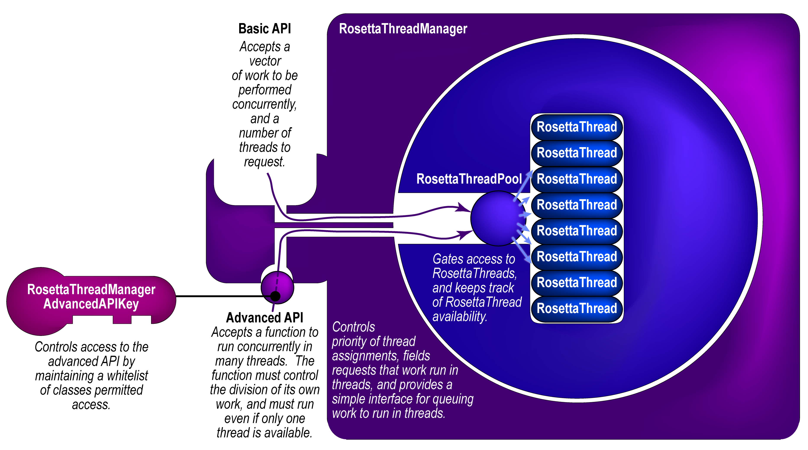
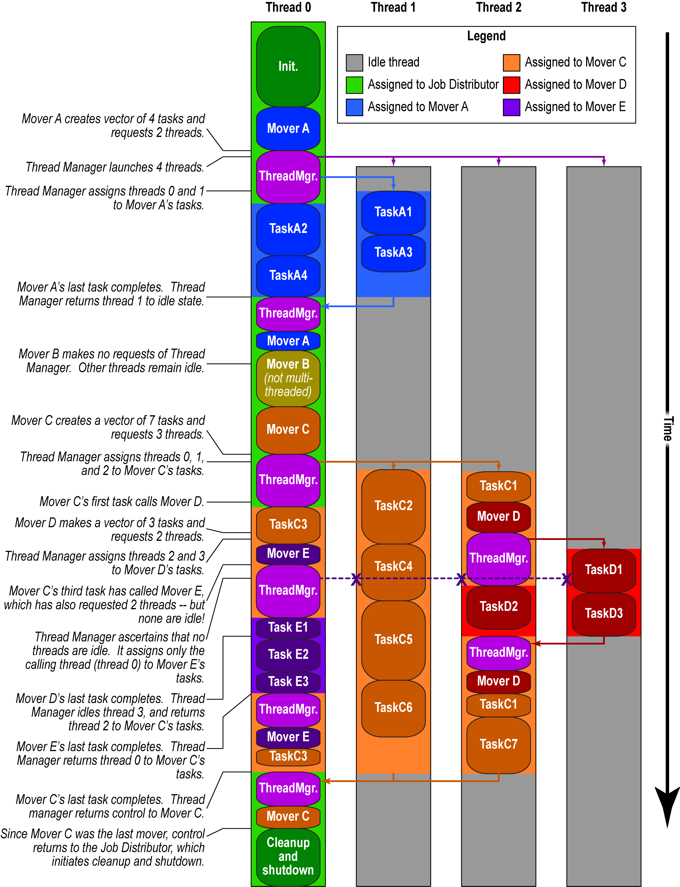

#El RosettaThreadManager

Esta página fue creada el 25 de julio de 2019 por Vikram K. Mulligan, Flatiron Institute (vmulligan@flatironinstitute.org).

[[_TOC_]]

##Introducción

El RosettaThreadManager es un singleton global que gestiona un conjunto de hilos y permite que módulos de muchos niveles distintos de la jerarquía de Rosetta asignen trabajo a hilos, evitando los bloqueos mutuos (deadlock), las explosiones de hilos y otros problemas que se describen más abajo.

##Los problemas que el RosettaThreadManager pretende resolver

Históricamente, Rosetta se ha construido en torno a un paradigma de un solo hilo: una instancia de Rosetta se ejecutaba en una CPU y ejecutaba una serie de instrucciones en secuencia lineal, produciendo una salida.  Solo se podían aprovechar varias CPU ejecutando instancias de Rosetta completamente separadas y en paralelo.  Esto crea varios problemas.

En primer lugar, aumenta de forma exagerada el uso de memoria de Rosetta, porque cada instancia en un nodo de cómputo debe cargar su propia copia independiente de la base de datos de Rosetta y mantenerla en memoria.  Dado que el uso base de memoria de una sola instancia de Rosetta ronda 1 GB, esto significa que, por ejemplo, un nodo de 64 núcleos debe mantener en memoria al menos 64 GB de datos en todo momento para aprovechar por completo los recursos de CPU -- y esto sin contar los requisitos de memoria propios de cada protocolo.  En sistemas con poca memoria, esto puede obligar a lanzar menos instancias de Rosetta que núcleos de CPU.

En segundo lugar, esto no aprovecha los recursos de cómputo de la forma más útil, sobre todo durante el desarrollo, la depuración y la prueba de un protocolo nuevo (_p. ej._ en el lenguaje de scripting RosettaScripts).  Con 64 CPU y, digamos, una tarea de diseño que produce una salida en una hora, se pueden producir 64 diseños en una hora -- pero si se detiene el proceso a los quince minutos, a la media hora o a los cuarenta y cinco minutos, se tienen 64 trabajos parcialmente completados y ninguna salida.  Sería mucho más útil que más núcleos significaran que un _único_ trabajo pueda ejecutarse N veces más _rápido_; es decir, que se pudiera producir 1 diseño en poco menos de un minuto usando los 64 núcleos.  De manera similar, en un entorno de producción con 10,000 CPU, quizá no se quieran 10,000 muestras, sino 2,500 muestras en la cuarta parte del tiempo.  Con procesos independientes esto no es posible.

Si las partes más lentas y que más CPU consumen de los protocolos de Rosetta pueden paralelizarse, tal vez logremos un aumento de muchas veces en la velocidad con que se completan los trabajos individuales, con muchos hilos trabajando en conjunto en un _único_ trabajo.  Sin embargo, hay ciertos problemas que deben resolverse para que esto sea posible.

### El problema de la granularidad del paralelismo

A diferencia de los procesos MPI, que mantienen sus propias copias de todos los objetos en memoria y se adaptan mejor a trabajar con piezas grandes de trabajo que cuestan de segundos a minutos de tiempo de CPU, los hilos funcionan mejor con piezas pequeñas de trabajo, pero que acceden a regiones de memoria similares (para evitar fallos de caché que obligan a acceder repetidamente a niveles de memoria más lentos).  Aunque el paralelismo a nivel de trabajo es el más fácil de implementar, un paralelismo de grano más fino exige paralelizar módulos de Rosetta de nivel más bajo.  Sin embargo, esto crea la posibilidad de solicitudes anidadas de ejecución multihilo de código.

### El problema de las solicitudes anidadas de multihilo: explosiones de hilos

Supongamos que un módulo de Rosetta de alto nivel lanza 16 hilos para llevar a cabo una serie de tareas, y que cada tarea llama a un módulo de Rosetta de nivel intermedio que _también_ lanza 16 hilos para llevar a cabo una serie de tareas.  Ahora hay 272 hilos en ejecución.  Si cada una de las tareas de nivel intermedio llama a un módulo de bajo nivel que lanza otros 16 hilos _adicionales_, el resultado serán 4,168 hilos en ejecución, lo que podría hacer caer incluso un nodo de cómputo potente.  Evidentemente, cualquier esquema de multihilo que permita paralelizar módulos de Rosetta de nivel intermedio y bajo debe limitar el número total de hilos que se lanzan.  Como veremos, esta es una de las funciones principales del RosettaThreadManager.

### El problema de evitar el bloqueo mutuo (deadlock)

Ciertos esquemas de limitación crean sus propios problemas, ya que pueden dar lugar a hilos que esperan a que otros hilos terminen su trabajo antes de programar el suyo.  En el peor caso, esto puede provocar un bloqueo mutuo: el hilo A podría estar esperando al hilo B mientras el hilo B espera al hilo A, de modo que ambos esperan para siempre.  El RosettaThreadManager también evita esto.

##Estructura del RosettaThreadManager

El RosettaThreadManager contiene un objeto RosettaThreadPool, que a su vez contiene un vector de objetos RosettaThread.  El RosettaThreadPool se inicializa (y lanza sus hilos) la primera vez que algo pide al RosettaThreadManager que ejecute código en hilos.  El conjunto de hilos y los hilos asociados persisten durante toda la sesión de Rosetta.  La estructura de contenedores se muestra en la figura siguiente.

El RosettaThreadManager acepta solicitudes (de cualquier módulo de Rosetta) para que se ejecute trabajo en hilos.  Junto con la solicitud recibe información sobre en qué parte del código de Rosetta se originó (_p. ej._ desde el distribuidor de trabajos, desde un mover o filtro, desde el packer, _etc._).  En este punto existe la posibilidad de decidir en qué medida se atenderán las solicitudes -- por ejemplo, podrían imponerse reglas como "las solicitudes de los módulos core nunca reciben más de la mitad de los hilos" o "limitar los movers a dos hilos".  Actualmente, el RosettaThreadManager impone una regla mucho más simple: el módulo solicitante obtiene tantos hilos como haya pedido, o los disponibles (lo que sea menor).  Como el hilo solicitante siempre se asigna a la tarea, siempre hay al menos un hilo disponible.

### API

#### Interfaz básica con vector de trabajo

Si se usa la API básica del RosettaThreadManager (que es la preferida), un módulo envía al RosettaThreadManager una solicitud de trabajo para ejecutar en hilos.  El módulo solicitante pasa al RosettaThreadManager un vector de piezas de trabajo, cada una de las cuales es una función empaquetada con sus argumentos mediante `std::bind`.  Estas funciones deben poder ejecutarse en cualquier orden, de forma concurrente o en secuencia, y todas deben devolver nada (`void`).  La función solicitante también especifica un número solicitado de hilos.  Opcionalmente, puede pasar un puntero propietario a un ***TODO CONTINUE HERE***

Al recibir una solicitud, el RosettaThreadManager construye un vector de mutex de la misma longitud que el vector de trabajo, y luego empaqueta ambos vectores con una función de trabajo que se ejecutará en paralelo.  Esta función se pasa al RosettaThreadPool, que la ejecuta en muchos hilos.  Las copias de la función en cada hilo toman trabajo del vector de trabajo y usan el vector de mutex correspondiente para asegurar que otras copias de la función en otros hilos no intenten hacer los mismos bloques de trabajo.  Como cada hilo reclama la siguiente pieza de trabajo disponible cuando termina la que estaba haciendo, la función equilibra su carga automáticamente.  Cuando ya no queda trabajo disponible, se bloquea hasta que todas sus copias hayan terminado, y luego devuelve el control al RosettaThreadManager, que lo devuelve al módulo que hizo la llamada.

##### Ejemplo general de código
    #include <basic/thread_manager/RosettaThreadAssignmentInfo.hh>
    #include <basic/thread_manager/RosettaThreadManager.hh>
    
    using namespace basic::thread_manager;
    
    // The thread manager will populate this object with information about the number of threads actually assigned:
    // The originating level allows future logic prioritizing thread assignments based on layer of Rosetta  from which a thread request comes.
    RosettaThreadAssignmentInfo thread_assignments( RosettaThreadRequestOriginatingLevel::PROTOCOLS_GENERIC );
    utility::vector1< RosettaThreadFunction > work_vector; /*The tasks that we'll be doing in some random order, in parallel.*/
    utility::vector1< some_type > result_vector( num_tasks ); /*A place to store the output.  Could be a vector of Reals, for example.*/
    for( core::Size i(1); i<=num_tasks; ++i ) {
        core::pose::PoseOP pose_copy( utility::pointer::make_shared< core::pose::Pose >() );
        pose_copy->detached_copy( *master_pose );
        work_vector.push_back(
            std::bind(
                my_thread_function, /*void function*/
                pose_copy,
                master_scorefxn->clone(),
                /*A place to store output, with each thread writing to a different place in the vector -- CAN'T RESIZE VECTOR WHILE THIS IS HAPPENING.*/
                std::ref(result_vector[i]), 
                ... /*any other things that my_thread_function takes as inputs*/
            )
        );
    }
    // The work will run in threads now.  The number of threads actually used will be 1 <= actual number <= number requested.
    // The requesting thread is always used to do the work, plus up to number requested-1 additional threads, as available.
    RosettaThreadManager::get_instance()->do_work_vector_in_threads( work_vector, num_threads_to_request, thread_assignments );
    // After the work runs in threads, the thread_assignments object will have information about how many threads were actually used.
    // It may be fewer than the number requested.  You can use this for summary messages and whatnot.  You can also pass the
    // thread_assignments object to your thread function if you want this information  to be available within a thread.

##### Algunas notas
* Cada hilo debe usar una instancia distinta de un objeto ScoreFunction y debe operar sobre una instancia distinta de un Pose.
* Los Pose deben clonarse con `Pose::detached_copy()` antes de pasarlos a subhilos. El `Pose::clone()` normal produce un objeto nuevo que comparte datos con el anterior, lo que puede dar lugar a comportamiento no seguro para hilos.
* Las aplicaciones multihilo de Rosetta deben compilarse con `extras=cxx11thread` y ejecutarse con `-multithreading:total_threads #`, donde # es el número de hilos que se lanzan y se mantienen en el conjunto de hilos (a menudo igual al número de CPU que tienes, aunque puede ser menor si lanzas varias instancias de Rosetta por nodo). El valor por defecto es 1 hilo por instancia de Rosetta.

#### Interfaz avanzada de funciones paralelas

****TODO****

##### Clase RosettaThreadManagerAdvancedAPIKey

##Ejemplo de distribución del trabajo entre hilos en una sesión típica de Rosetta

**TODO**

##Véase también

* [[Multithreading]]
* [[PackRotamersMover]]
* [[FastRelaxMover]]
* [[FastDesignMover]]
