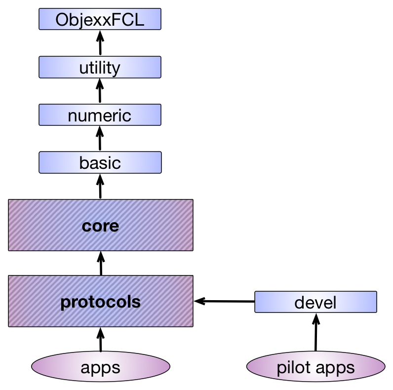
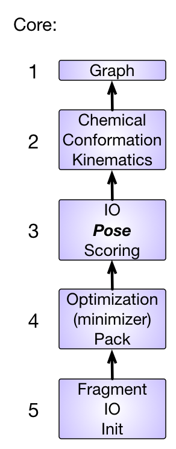

#Resumen del directorio src

Desde un punto de vista conceptual, el directorio src contiene todo el código C++ específico de Rosetta. 
La estructura de directorios dentro de Rosetta delimita las dependencias conceptuales. 
Un desarrollador de Rosetta debe tener presente la arquitectura en capas que se muestra en la figura siguiente. 
Las flechas representan los flujos de dependencia permitidos. 
No se permite ninguna dependencia de código hacia directorios a los que no se pueda llegar siguiendo las flechas. 
Hasta ahora se ha respetado una dependencia vertical estricta al escribir código de Rosetta. 
Esta figura muestra las relaciones entre las bibliotecas:

<<RawHtml(

<map name="RosettaLibraries">
	<area shape=rect coords="350,425,525,450" href=src-index-page#devel-library>
	<area shape=rect coords="10,385,295,465" href=src-index-page#protocols-library>
	<area shape=rect coords="10,285,295,365" href=src-index-page#core-library>
	<area shape=rect coords="55,220,227,250" href=src-index-page#basic-library>
	<area shape=rect coords="55,150,226,175" href=src-index-page#numeric-library>
	<area shape=rect coords="55,80,226,110" href=src-index-page#utility-library>
	<area shape=rect coords="55,10,225,50" href=src-index-page#objexxfcl-library>
</map>
)>>

##Biblioteca ObjexxFCL

La biblioteca `ObjexxFCL` proporciona la infraestructura necesaria para emular Fortran en el código que se ha traducido de Fortran 77 a C++. 
Hoy se usa poco en Rosetta, pues fue desapareciendo gradualmente a medida que Rosetta se volvió más orientado a objetos: la transición [[de Rosetta a Rosetta++ y a Rosetta3|Rosetta timeline]]. 
Sigue existiendo para dar soporte a parte del código heredado.

##Biblioteca utility

[[Biblioteca utility|namespace-utility]] 

El directorio utility contiene clases de utilidad que (al menos en teoría) no son específicas de Rosetta, como [[utility::vector1|vector1]] (una clase hija de std::vector con índices que empiezan en 1 y algunas adiciones extra) e izstream (un flujo de entrada de archivos que permite leer archivos comprimidos). 
En términos generales, estas clases se implementan de una manera independiente del proyecto (es decir, no tienen por qué ser específicas de Rosetta). 
Las clases de este directorio a veces tienen métodos de clase matemáticos, pero los algoritmos para cálculos complicados es mejor colocarlos en el directorio numeric.

###Espacios de nombres dentro de utility
* [[utility|namespace-utility]]
* [[utility::io|namespace-utility-io]]
* [[utility::factory|namespace-utility-factory]] **YA NO EXISTE**
* [[utility::keys|namespace-utility-keys]]
* [[utility::options|namespace-utility-options]]

###Clases útiles dentro de utility
* [[Puntero propietario|owning-pointers]]
* [[Puntero de acceso|access-pointers]]
* Clases derivadas de std::vector
  * [[vector0]]
  * [[vector1]]
  * [[vectorL]]
* [[xyzVector]]
* [[xyzMatrix]]

##Biblioteca numeric

[[Biblioteca numeric|namespace-numeric]]

El directorio numeric contiene funciones de bajo nivel que realizan operaciones matemáticas. 
Aunque algunas pueden ser matemáticas generales (calcular una transformada rápida de Fourier, por ejemplo, o realizar un análisis de componentes principales sobre un conjunto de datos), otras pueden ser cálculos específicos de Rosetta o pueden estar implementadas de una manera específica de Rosetta.

##Biblioteca basic <a name="basic" />

El directorio basic contiene clases de organización y mantenimiento específicas del proyecto Rosetta. 
Aquí residen, por ejemplo, las funciones para acceder a la base de datos de Rosetta, y también el código del sistema de opciones de Rosetta. 
Ciertas herramientas específicas de Rosetta, como el [[tracer]], también se encuentran en la biblioteca basic.

##Biblioteca core <a name="core" />

<<RawHtml(

<map name="RosettaCores">
        <area shape=rect coords="98,627,274,726" href=src-index-page#core-library_core-5>
        <area shape=rect coords="98,479,274,578" href=src-index-page#core-library_core-4>
        <area shape=rect coords="98,330,274,431" href=src-index-page#core-library_core-3>
        <area shape=rect coords="98,182,274,281" href=src-index-page#core-library_core-2>
        <area shape=rect coords="98,99,274,132" href=src-index-page#core-library_core-1>
</map>
)>>

El directorio core contiene clases que gestionan la mayor parte de la maquinaria interna de Rosetta. 
Esto incluye temas como las representaciones químicas de los modelos, las representaciones conformacionales de los modelos, las operaciones de bajo nivel sobre conformaciones y la evaluación energética ([[puntuación|scoring-explained]]) de los modelos.
La estructura actual se estableció en un evento de una semana de duración, [[XRW1|Glossary#xrw1]].

###Core.1
Lo único importante de este nivel de la biblioteca son las clases `graph` (grafo en el sentido de las ciencias de la computación).

###Core.2
Esta biblioteca contiene tres secciones importantes:

####Chemical
El directorio chemical, que contiene clases importantes como `ResidueType`, es la manera en que Rosetta entiende qué átomos hay en una entidad química y cómo están conectados.

####Kinematics
El directorio kinematics, que contiene clases como `AtomTree`, `MoveMap` y `FoldTree`, es la manera en que Rosetta propaga el movimiento a través de una estructura.  TODO linky internal coordinate kinematics
 
####Conformation
La clase `Conformation` es lo que resulta cuando se enhebran clases `Residue` (basadas en `ResidueType`s) según la cinemática dictada por el `AtomTree`: ¡básicamente, una estructura!

###Core.3

####Scoring
Bastante evidente: ahora que `Conformation` nos da una estructura, ¿cómo la puntuamos?
Aquí están todas las `ScoreFunction` y todos los términos comunes que entran en ellas, y un objeto `Energies` para guardar el resultado de una operación de puntuación.

####Pose
Aquí vive `Pose`, una de las dos clases más importantes de Rosetta.
[[Pose|RosettaEncyclopedia#pose]] es la unión de una `Conformation` y un objeto `Energies` que guarda sus puntuaciones.

###Core.4
Core.4 se ocupa de los algoritmos de optimización: formas de minimizar la energía del Pose. 
`optimization` contiene el "minimizador", que encuentra de forma eficiente mínimos locales de energía.
`pack` contiene el packer, que busca de forma eficiente mínimos de secuencia y rotámeros para una cadena principal dada.
Fíjate en el uso repetido de eficiente: ¡este código está estrechamente integrado con otras clases de `core` para ganar velocidad!

###Core.5
Esta biblioteca contiene varios elementos, el más importante de los cuales es la maquinaria `init` que inicializa cada ejecución de Rosetta (lee las opciones de la línea de comandos, configura el generador de números aleatorios, etc.)

###Documentación por espacio de nombres (incompleta)

* [[core::chemical|namespace-core-chemical]]
* [[core::conformation|namespace-core-conformation]]
  * [[core::conformation::idealization|namespace-core-conformation-idealization]] **YA NO EXISTE**
* [[core::io::pdb|namespace-core-io-pdb]]
* [[core::scoring|namespace-core-scoring]]

###Archivos README, tutoriales y documentos de referencia de la biblioteca core

Para un resumen general de los conceptos de Rosetta (incluidos muchos conceptos de core), consulta la página [[Rosetta overview]].

- chemical
    - [[Descripción de chemical|Rosetta-overview#chemical]]
- conformation
    - [[Descripción de conformation|Rosetta-overview#conformation]]
    - [[Symmetry]]
- pose
    - [[Descripción breve de pose|Rosetta-overview#pose]]
- kinematics
    - [[Resumen y conceptos de AtomTree|atomtree-overview]]
    - [[Resumen y conceptos de FoldTree|foldtree-overview]]
- optimization
    - [[Resumen y conceptos de la minimización|minimization-overview]]
- pack
    - [[Cómo usar el PackerTask|packer-task]]
    - [[Sintaxis y convenciones de los resfiles|resfiles]]
    - [[Cómo escribir nuevos comandos de resfile|resfile-reader]]
- scoring
    - [[Explicación de la puntuación en Rosetta|scoring-explained]]
    - [[Score types]]
      * [[Tipos de puntuación adicionales|score-types-additional]]
    - [[Cómo añadir un nuevo término de puntuación|new-energy-method]]
    - [[Formatos de archivo de restricciones|constraint-file]]
 
##Biblioteca protocols

[[/images/protocols_structure.png]]

El directorio protocols contiene código de nivel más alto que usa los componentes del directorio core para realizar tareas de modelado. 
El código de este directorio debe estar en un estado que lo haga utilizable por un público general.
Se espera que los desarrolladores proporcionen documentación adecuada de todo el código que se coloque en este directorio. 
Una de las principales clases base que conviene conocer es la clase [[Mover]]. 
Esta clase es la interfaz de la que heredan la mayoría de los desarrolladores de Rosetta al crear nuevos protocolos de modelado. 
La mayoría de los desarrolladores interactuarán con el código de Rosetta en este nivel, a menos que necesiten ampliar las capacidades de representación de modelos de Rosetta.

Como el directorio core, el directorio protocols se ha dividido en varios niveles de biblioteca, y el código de cada nivel solo puede depender de los niveles inferiores. 

La organización de la biblioteca protocols se controla mediante una serie de archivos protocols_X.#.src.settings en `src/`, donde X es una letra y # es un número. 
Los números son el nivel de dependencia de cada biblioteca, y las letras agrupan las subbibliotecas de nivel similar en un grupo lateralmente equivalente. 
En otras palabras, las bibliotecas del mismo nivel numérico tienen las mismas dependencias, pero no dependen unas de otras: de hecho, tienen prohibido depender unas de otras.

Cuando se dividió la biblioteca protocols en [[XRW2|Glossary#xrw2]], intentábamos en parte establecer orden y en parte resolver un problema.
La biblioteca protocols (la más grande de Rosetta) había crecido hasta el punto de que el enlazado era **muy lento** y requería, en el paso de enlazado, más memoria (>2GB; recuerda que esto fue hace tiempo) de la que tenían los ordenadores de muchos desarrolladores. 
Al final, el primer objetivo, la organización, resultó esquivo o imposible, pero cumplimos el segundo objetivo al dividir los protocols, antes monolíticos, en *muchas* bibliotecas.
Como consecuencia, en gran medida la organización existe solo por decreto.
[[Esta página|XRW2 email archive]] documenta las decisiones tomadas en su momento.
La descripción de los niveles de biblioteca es mucho más profunda que aquí, pero solo parcial.

Si intentas determinar "dónde va tu código" y más abajo no hay una buena respuesta, la respuesta es "busca algo parecido y ponlo en la misma subbiblioteca", siempre que las dependencias sean por lo demás legales (que solo apunten a números más bajos).
Las dependencias laterales dentro de una subbiblioteca son legales.

###Niveles importantes de la biblioteca protocols:

####Protocols.1
Aquí viven muchas cosas valiosas, entre ellas [[el distribuidor de trabajos|JD2]], la clase base [[Mover]] y algunos de los Movers simples, la clase base [[Filter|filters-rosettascripts]] y Filters simples, y la maquinaria de [[RosettaScripts]].

####Protocols.2
Casi seguro que tu código no debe ir aquí.

####Protocols.3
Este nivel contiene la gran mayoría de los Movers y Filters que hacen cosas simples (en oposición a los Movers complejos o muy específicos, que viven directamente con su protocolo).
También contiene la maquinaria de `loops` y `toolbox`, que guarda muchas herramientas genéricas para detectar y manipular clases o grupos de residuos (por ejemplo, la maquinaria de detección de interfaces, etc.).

####Protocols.4-6
Cada uno de estos niveles tiene muchas subbibliotecas con letras, organizadas por una vaga similitud y por el número de archivos, pero es un poco un desorden. Lamento no poder ayudar más.

####Protocols.7
Esto no es una biblioteca, es solo la capa `init` de protocols.
Tiene una enorme cantidad de Registrators y Creators para las clases de Rosetta gestionadas con [[Factory|http://en.wikipedia.org/wiki/Factory_method_pattern]] (enlace a Wikipedia).

##Biblioteca devel

El directorio devel es una zona de preparación para protocolos en desarrollo, que NO se incluye en las versiones de Rosetta. 
El código de esta zona no se considera maduro. 
Los estándares de documentación son laxos. 
Documentar el código a posteriori es mucho más difícil, así que se recomienda ENCARECIDAMENTE que el desarrollador proporcione buena documentación incluso para el código que cambia con rapidez. 
Te facilitará la vida y te hará más productivo, y tus colegas apreciarán tu minuciosidad.

##Añadir código nuevo o subdirectorios

En general no conviene añadir código directamente en `src`.  
Se pueden añadir nuevos subdirectorios en uno de los directorios existentes anteriores con mucha más facilidad, sin dañar la estructura general de la biblioteca. Primero determina en qué nivel de la biblioteca encajan los nuevos conceptos. Si no estás seguro de dónde debe colocarse el código nuevo, consulta a desarrolladores de Rosetta con experiencia. Puedes hacerlo en tu laboratorio o (mejor aún) enviar un mensaje a la lista de correo de desarrolladores (quizá descubras que otra persona tiene una idea complementaria con un punto de partida ya disponible).

##Véase también

* [[Estructura de directorios de Rosetta|rosetta-library-structure]]: Descripciones del contenido de los principales subdirectorios del directorio `main` de Rosetta
* [[Glossary]]: Definiciones breves de términos de Rosetta
* [[RosettaEncyclopedia]]: Descripciones detalladas de conceptos adicionales de Rosetta.
* [[Rosetta overview]]: Resumen de los conceptos principales de Rosetta
* [[Development Documentation]]: La página principal de la documentación para desarrolladores

<!---- SEO
code structure
code structure
code structure
code structure
library structure
library structure
library structure
library structure
---->
