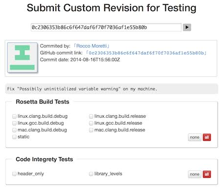
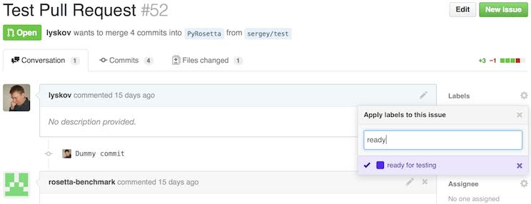
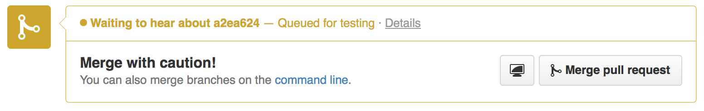
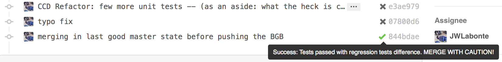
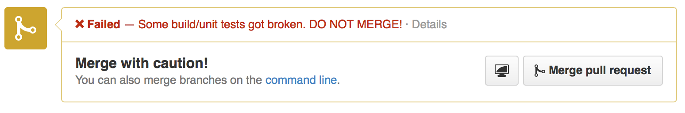
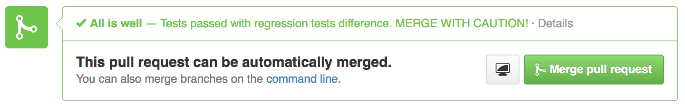

#Ejecutar pruebas en el servidor de pruebas

El [[servidor de pruebas|testing server]] de Rosetta te permite programar pruebas personalizadas, además de probar automáticamente tu código después de una fusión (merge) a `master`. 
Esto es muy útil para ejecutar pruebas con recursos remotos o de RosettaCommons en lugar de tu pobre portátil sobrecargado.

Enviar a prueba una revisión, rama o pull request cualquiera
============================================================

Puedes visitar http://benchmark.graylab.jhu.edu/submit (o hacer clic en el enlace 'Submit' del sitio web de Benchmark) y enviar tus commits a prueba. 
Necesitarás un sha1 de commit de git, el nombre de tu rama o el id de un [[pull request|pull requests]] para identificar qué probar.
Después de hacer clic en el botón de flecha, el servidor de pruebas consultará a GitHub la información del commit.
Si se encuentra el commit, se te mostrará la información del commit (para confirmarla) y una lista de pruebas que se pueden programar para esa revisión. 
Si usaste el nombre de una rama, el servidor de pruebas usará el head actual de la rama especificada.
Para un pull request, no usará un único commit, sino la fusión entre la rama base y la rama de destino, y mostrará el sha1 de git que se usaría en las fusiones:

Después de seleccionar las pruebas que quieres ejecutar, puedes hacer clic en `Run tests for this commits` para programar las pruebas seleccionadas. 
Al elegir las pruebas, evita ejecutar las que no necesitas de verdad. 
Ten cuidado al usar el botón 'select all', ya que algunas pruebas pueden tardar bastante en ejecutarse. 
Al depurar una prueba concreta, probablemente conviene ejecutar solo esa prueba en lugar de todo un conjunto, lo que reducirá la carga del servidor y el tiempo de respuesta. 
Para tu comodidad hay un botón verde 'select standard tests' que ejecutará las mismas pruebas que se ejecutan en las fusiones a master.

Después de programar las pruebas, el servidor de pruebas te llevará a una página de revisión en la que aparecerán los resultados. 
Además, te enviará un correo de confirmación del commit con un enlace a la página de resultados.
Cuando las pruebas hayan terminado, otro correo te avisará de los resultados. 

Las pruebas de regresión, como las [[de integración|integration tests]] o las [[de puntuación|score tests]], programadas de esta manera tendrán sus resultados comparados con la última ejecución exitosa de la misma prueba en la rama master. 
Esto te permite, en la práctica, hacerte una idea de qué pruebas cambiarán cuando fusiones este commit a la rama master.

Pruebas automáticas de pull requests 
====================================
Cuando tu [[pull request]] (de cualquier rama, no necesariamente master) está casi listo para fusionarse, conviene probarlo antes de fusionar para evitar romper alguna prueba. 
El servidor de pruebas ahora es capaz de seguir y probar automáticamente cada push a la rama asociada con un pull request abierto. 
Solo tienes que marcar este pull request con la etiqueta 'ready for testing'. 
Para hacerlo, abre la página de tu pull request en GitHub, haz clic en 'labels' en la parte superior derecha de la página y selecciona la etiqueta 'ready for testing':

Una vez hecho esto, el servidor de pruebas programará automáticamente pruebas para la fusión del pull request actual, así como para todas las fusiones posteriores. 
Si quieres indicar al servidor de pruebas que deje de seguir este pull request, simplemente quita la etiqueta 'ready for testing'.

Después de que se ejecuten las pruebas programadas por el servidor de pruebas, el botón de fusión de tu pull request debería cambiar al 'estado pendiente' y el enlace 'Details' te llevará a la página de esta revisión en el sitio web de benchmark:

En cuanto terminen las pruebas del pull request, el servidor de pruebas publicará los resultados en GitHub junto con un mensaje breve. 
Y cada commit probado del pull request tendrá una marca de verificación verde o una cruz roja, según los resultados de las pruebas. 
También puedes pasar el cursor sobre este icono para mostrar el mensaje asociado a esta fusión, o hacer clic en el icono para ver la página de la revisión con los resultados de las pruebas en el sitio web de Benchmark:

Además, según los resultados de las pruebas, el botón de fusión de tu pull request se pondrá rojo si hay alguna prueba rota:

O el botón de fusión se pondrá verde si todo está bien:

Cancelar pruebas programadas
============================
Si programaste por error las pruebas equivocadas, o enviaste varias revisiones seguidas a la rama de tu pull request, quizá quieras cancelar las pruebas programadas que ya no son relevantes (por ejemplo, porque ya hay programada también para prueba una revisión más reciente de la misma rama). 
Puedes cancelar todas las pruebas programadas de una revisión dada (excepto de `master`) en la página web de la revisión, o puedes cancelar pruebas individuales en la página web de la prueba. 
Para ello, pulsa el botón rojo 'cancel all queued test'. 
De manera similar, más tarde puedes volver a poner en cola todas las pruebas o algunas concretas con el botón blanco 'queue canceled test'. 

Pruebas de ramas personalizadas
===============================
Es posible indicar al servidor de pruebas que siga cualquier rama personalizada de nuestro repositorio principal de GitHub y ejecute un conjunto personalizado de pruebas en cada push, como hacemos con `master` y otras ramas. 
Esto te permitirá vigilar las diferencias de código, el estado de las pruebas de compilación y los cambios en las pruebas de regresión en cada push. 
Si trabajas en un proyecto para el que esto parezca apropiado (por ejemplo, un proyecto en el que varios desarrolladores trabajan en el mismo protocolo, o simplemente quieres seguir la rama de tu laboratorio), avisa a [[Sergey Lyskov|Rosetta-People]] y él añadirá tu rama a la lista de seguimiento.

##Véase también

* [[Testing server]]: Información sobre el servidor de pruebas
* [[Integration tests]]: Información general sobre las pruebas de integración de Rosetta
* [[Build Documentation]]: Aquí encontrarás instrucciones para compilar ejecutables mpi de Rosetta
* [[Testing server]]: Servidor que se puede usar para ejecutar automáticamente las pruebas de integración de Rosetta
  * [[Running Tests on the Test Server]]: Instrucciones para usar el servidor de pruebas
* [[Página de inicio de las pruebas|rosetta-tests]]
* [[Página de inicio de la documentación para desarrolladores|Development-Documentation]]
* [[RosettaEncyclopedia]]
* [[Glossary]]
