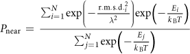

Benchmarks científicos
======================

Página añadida el 22 de octubre de 2018 por Julia Koehler Leman.

Los benchmarks científicos son pruebas que comparan las predicciones de estructura generadas por Rosetta
con observaciones experimentales. Evaluar la precisión de las
predicciones de Rosetta permitirá

-   Informar a los investigadores sobre la fiabilidad de Rosetta como
    modelador molecular
-   Orientar el ajuste de Rosetta para mejorar las predicciones estructurales

Los benchmarks científicos sirven para medir el realismo físico de la
función de energía y lo bien que un protocolo muestrea estructuras
físicamente realistas.

[[_TOC_]]

## Cómo configurar una prueba de benchmark científico
### Estructura de directorios de las pruebas científicas
Varias pruebas están ubicadas en el directorio `Rosetta/main/tests directory`. La estructura de directorios es la siguiente:

* `Rosetta/main/tests/integration` contiene las pruebas de integración
* `Rosetta/main/tests/benchmark` contiene los archivos necesarios para el servidor de pruebas de benchmark, es decir, el marco que ejecuta las pruebas científicas; quizá tengas que revisarlos al depurar
* `Rosetta/main/tests/scientific` contiene las pruebas científicas
* `Rosetta/main/tests/scientific/tests` contiene las implementaciones de las pruebas, un directorio por prueba
* `Rosetta/main/tests/scientific/data` submódulo que contiene los datos de entrada si superan 5 MB por prueba
* `Rosetta/main/tests/scientific/tests/_template_` directorio de plantilla con todos los archivos de entrada necesarios

### Dónde y cómo añadir tu prueba
1.	Para configurar un benchmark científico, tendrás que pensar en
    * cuáles son tus datos de entrada
        * conviene tener un conjunto de benchmark diverso y realista, y no solo estructuras que den la mejor salida posible
    * la línea de comandos que ejecutas
        * asegúrate de ejecutar un protocolo de referencia (por ejemplo, predicción de estructura de novo, ddg_monomer, etc.) que muchas personas hayan ejecutado durante muchos años, o un protocolo de vanguardia: como estas pruebas son costosas computacionalmente, tenemos que asegurar que lo que probamos tenga sentido
    * cómo son los datos de salida
        * en muchos casos analizamos archivos de puntuación, pero quizá quieras mirar algo distinto
    * cuáles son tus medidas de calidad
        * ¿son razonables las medidas de calidad que usas? ¿Existen mejores medidas? 
    * qué umbrales quieres definir para que la prueba sea de tipo aprobado/suspendido
        * deberías tener una idea general cuando ejecutes la prueba localmente, pero si todavía no conoces los umbrales concretos, no te preocupes; puedes fijarlos más tarde (ver más abajo)
        * sin embargo, conviene pensar en CÓMO defines un aprobado/suspendido. Se recomienda definirlo respecto de umbrales que tú definas, es decir, ejecutar una sola prueba autocontenida define los umbrales iniciales. No prohibimos umbrales que se definan con el tiempo, por ejemplo ejecutarla 10 veces y comparar con ejecuciones anteriores (de forma similar a las pruebas de regresión), pero este comportamiento no se fomenta necesariamente. 
        * muchas pruebas evalúan la calidad de los embudos de plegamiento (gráficos de energía frente a RMSD respecto de la nativa) y pueden usar herramientas ya desarrolladas para evaluarlos que son insensibles a cambios estocásticos en la posición de los puntos, como la métrica PNear (ver la nota más abajo).
    * la prueba completa no debe ejecutarse durante más de 1000-2000 horas de CPU
        * el tiempo de ejecución depende del número de estructuras con las que ejecutes el benchmark, del número de modelos de salida y del tiempo de ejecución del protocolo por modelo de salida
2.	`cd Rosetta/main/tests/scientific`
3.	ejecuta `git submodule update --init --recursive` para obtener el submódulo que contiene los datos de entrada. Ahora verás un directorio ` Rosetta/main/tests/scientific/data`
4.	si tus datos de entrada superan 5 MB, crea un directorio en el directorio del submódulo de datos donde coloques tus archivos de entrada; de lo contrario, puedes mantenerlos en el directorio de pruebas (ver más abajo)
    * haz commit de tus cambios en ese submódulo
    * sal del directorio de datos (`cd ..`) y haz commit de tus cambios otra vez
    * [durante ese proceso: si usas zsh o compruebas `git status`, notarás cuándo git se queja de archivos sin confirmar]
5.	`cd Rosetta/main/tests/scientific/tests`
6.	copia el contenido del directorio de plantilla para crear tu propio directorio de prueba científica con `cp -r Rosetta/main/tests/scientific/tests/_template_ <my_awesome_test>`
7.	`cd <my_awesome_test>`: las pruebas se configuran en pasos individuales numerados secuencialmente, de modo que puedan ejecutarse por separado sin tener que volver a ejecutar toda la secuencia. No ejecutes nada todavía (llegaremos a eso más adelante). 
8.	Arma tu prueba, sin ejecutar nada todavía: edita cada archivo de este directorio donde encuentres las etiquetas `==> EDIT HERE`. 
    * si no ejecutas un protocolo de RosettaScripts, puedes eliminar el archivo fast_relax.xml
    * `0.compile.py`: este script es para la compilación; probablemente no necesites editar este archivo
    * `1.submit.py`: contiene la línea de comandos y las proteínas objetivo que ejecutas. La opción debug no se refiere a la ejecución release frente a debug de Rosetta, sino a la versión de depuración de la ejecución de la prueba científica, para una configuración más rápida. 
    * `2.analyze.py`: este script analiza los resultados de los archivos de puntuación o de los archivos que te interesen. Lee el archivo de umbrales y compara los resultados de esta ejecución con ellos. Escribirá el archivo `result.txt` para facilitar la lectura. Al final de este script hay algunas funciones básicas de análisis de datos. Si necesitas tu función especializada, añádela allí. 
    * `3.plot.py`: este script representará gráficamente los resultados con matplotlib en `plot_results.png`, con subgráficos para cada proteína. Dibuja líneas verticales y horizontales para los umbrales. 
    * `9.finalize.py`: este script reúne toda la información del readme, el gráfico de resultados y los resultados, y crea una página html `index.html` que lo muestra todo
    * añade todos los artículos relevantes al archivo `citation`
    * edita el archivo `cutoffs`; la línea de encabezado empieza con `#` y tiene una proteína por fila, con las distintas medidas en columnas 
    * asegúrate de añadir tu correo electrónico a `observers`
    * rellena todas las secciones de `readme.md` con el mayor detalle posible. Ten en cuenta que, cuando hayas dejado tu laboratorio, otra persona de la comunidad debería poder entender, ejecutar y mantener tu prueba. Esto se enlaza automáticamente con el wiki Gollum. 
    * añade tu prueba a la función `run` al final de `Rosetta/main/tests/benchmark/tests/scientific/command.py` para conectarla al marco del servidor de pruebas
    * un par de notas sobre la prueba:
        * buscamos que haya gráficos que muestren los datos, no solo tablas. Incluye tablas y/o los datos en formato `json`, pero se recomiendan mucho los gráficos, ya que digerir los datos visualmente es más rápido y fácil para nosotros al depurar. 
        * nos gusta el formato `json` porque es fácil leer los datos directamente en diccionarios de python. 
        * idealmente una prueba debe ser autocontenida para obtener los umbrales. Como se describió antes, intenta evitar un comportamiento tipo prueba de regresión en el que se compara con resultados anteriores o se reúnen resultados de varias ejecuciones a lo largo del tiempo. 
        * sé coherente con el nombre de la prueba: conserva un único nombre, que sea también el nombre del directorio de la prueba. Aparece en varios archivos y la coherencia facilita la depuración
9.	Instala python3.6 o posterior si aún no lo has hecho; cualquier versión anterior no funcionará. Asegúrate de tener configurado un alias con el que puedas especificar la versión de python, por ejemplo `python3`. ¡Todos los scripts de python de las pruebas científicas necesitarán el prefijo `python3` para ejecutarse correctamente!

## Ejecuta tus pruebas localmente

1.  Configura una ejecución en varios núcleos
    * Si quieres ejecutar localmente con varios núcleos, copia `main/tests/benchmark/benchmark.ini.template` a `benchmark.linux.ini` (o como corresponda a tu arquitectura).  Ajusta los valores de este archivo (es decir, `cpu_count` y `memory`) según corresponda a tu entorno.  Si `hpc_driver = MultiCore`, esto enviará trabajos hasta `cpu_count` sin usar un distribuidor de trabajos HPC.

2.  Configura la ejecución
    * `cd Rosetta/main/tests/benchmark`
    *`python3 benchmark.py --compiler <clang or else> --skip \`
     `--debug scientific.<my_awesome_test>`
        * la opción `--skip` sirve para omitir la compilación; solo se recomienda si tienes compilada en modo release una versión actualizada de master (Sergey aconseja no omitirla)
        * la opción `--debug` sirve para ejecutar en modo de depuración, algo muy recomendable para depurar (es decir, creas 2 decoys en lugar de miles)
    * esto crea un directorio `Rosetta/main/tests/benchmark/results/<os>.scientific.<my_awesome_test>`, donde crea enlaces simbólicos a los archivos de `Rosetta/main/tests/scientific/tests/<my_awesome_test>`, y luego probablemente fallará de una forma u otra

3.  Empieza a depurar
    * para depurar paso a paso, haz `cd Rosetta/main/tests/benchmark/results/<os>.scientific.<my_awesome_test>` y depura cada script individualmente, empezando por el número más bajo, ejecutando por ejemplo `python3 1.submit.py`
    * ten en cuenta que en el proceso se crean varios otros archivos y carpetas: 
        * `config.json`, que contiene los valores de configuración
        * se crea un directorio `output` que contiene los subdirectorios de cada proteína
        * se crea un directorio `hpc-logs` que contiene los registros de ejecución de Rosetta. Quizá tengas que revisarlos para depurar tu ejecución si falló en el paso de ejecución de Rosetta. 
        * cada script numerado también tendrá un archivo `.json` asociado que contiene las variables que quieres llevar al paso siguiente
        * `9.finalize.output.json` contiene todas las variables y resultados guardados
        * `plot_results.png` con los resultados
        * `index.html` con los resultados reunidos, los fallos y los detalles que hayas escrito en el readme. Aunque todos los archivos serán accesibles después en el servidor de pruebas, este archivo es el resumen de resultados que mirará la gente
        * `output.results.json` te dirá si las pruebas pasaron o fallaron

## Envía tu rama

1.  Cuando termines de depurar localmente, haz commit de todos tus cambios en tu rama
    * crea un pull request
    * ejecuta la prueba en el servidor de pruebas
        * como las pruebas científicas requieren una enorme cantidad de tiempo de cómputo, quizá quieras reducir tu `nstruct` para depurar tu ejecución en el servidor de pruebas. Si lo haces, no olvides aumentarlo después, cuando las pruebas se ejecuten correctamente

2.  Cuando las pruebas se ejecuten como quieres, fusiona tu rama en `master`
    * La rama `scientific` es una rama adicional que toma la última versión de master cada pocas semanas para ejecutar en ella todas las pruebas científicas. **¡¡¡NO FUSIONES TU RAMA EN LA RAMA SCIENTIFIC!!!**
    * avisa a Sergey Lyskov (sergey.lyskov@gmail.com) de que tu prueba está lista para ejecutarse de forma continua en la rama scientific

  ¡Celébralo! Felicidades, has añadido una nueva prueba científica y has contribuido a la grandeza de Rosetta. :D

## Un problema frecuente: evaluar la calidad de un embudo de plegamiento ####

Con frecuencia, una prueba científica busca evaluar la calidad de un embudo de plegamiento (un gráfico de la energía de Rosetta frente al RMSD respecto de una estructura nativa o diseñada).  Muchas de las formas más simples de hacerlo sufren los efectos de cambios estocásticos en el muestreo: el movimiento de una sola muestra puede alterar drásticamente la métrica de bondad del embudo.  Por ejemplo, un enfoque habitual consiste en dividir el embudo en una región "nativa" (con un RMSD por debajo de cierto valor umbral) y una región "no nativa" (con un RMSD por encima del umbral), y preguntar si hay una gran diferencia entre la energía más baja de la región "nativa" y la más baja de la región "no nativa".  Un único punto de baja energía que se desplace a través del umbral desde la región "nativa" a la región "no nativa" puede convertir un embudo de alta calidad en uno de baja calidad, según esta métrica.

Con este fin se desarrolló la métrica PNear.  PNear es una estimación de la probabilidad, ponderada por Boltzmann, de encontrar un sistema en su estado nativo o cerca de él, donde el carácter "nativo" se define de forma difusa y no con un umbral rígido.  La expresión de PNear es:

Intuitivamente, el denominador es la función de partición, mientras que el numerador es la suma de la probabilidad de Boltzmann de las muestras individuales multiplicada por un factor de ponderación del carácter "nativo" de cada muestra, que decae como una gaussiana con el RMSD.  La expresión toma dos parámetros: lambda (λ), que determina la amplitud de la gaussiana del carácter "nativo" (con valores mayores se admite una noción más permisiva de lo que está cerca de la nativa), y kB\*T, que determina cómo las energías altas se traducen en probabilidades (con valores mayores se permite que estados con pequeñas diferencias de energía se consideren más próximos en probabilidad).  Los valores recomendados son lambda = 2 a 4, kB\*T = 1.0 (para ref2015) o 0.63 (para talaris2013).

Para más información, consulta los Methods (en línea) de <a href="https://www.ncbi.nlm.nih.gov/pmc/articles/PMC5161715/">Bhardwaj, Mulligan, Bahl _et al._ (2016). _Nature_ 538(7625):329-35</a>.

<b>Actualización:</b> A fecha de 10 de octubre de 2019, hay disponible un script de Python en el repositorio `tools` (en `tools/analysis`) para calcular PNear.  Las instrucciones de uso están en los comentarios al principio del script.  Además, la función `calculate_pnear()`, en `Rosetta/main/tests/benchmark/util/quality_measures.py`, puede usarse para calcular PNear.

## La ciencia detrás de tu prueba: plantilla de prueba científica
Usa esta plantilla para describir tu prueba científica en el `readme.md`, como se describió antes. Mira también la prueba `fast_relax` para ver ideas de lo que buscamos. 

\## AUTOR Y FECHA
\#### ¿Quién configuró el benchmark? Añade nombre, correo electrónico, PI, mes y año

\## PROPÓSITO DE LA PRUEBA
\#### ¿Qué prueba el benchmark y por qué?

\## CONJUNTO DE DATOS DEL BENCHMARK
\#### ¿Cuántas proteínas hay en el conjunto?
\#### ¿Qué conjunto de datos usas? ¿Está publicado? Si es así, añade una cita.
\#### ¿Cuáles son los archivos de entrada? ¿Cómo se crearon?

\## PROTOCOLO
\#### Indica y describe brevemente el protocolo.
\#### ¿Hay una publicación que describa el protocolo?
\#### ¿Cuántas horas de CPU requiere aproximadamente este benchmark?

\## MÉTRICAS DE RENDIMIENTO
\#### ¿Qué métricas de rendimiento se usan y por qué se eligieron?
\#### ¿Cómo defines un aprobado/suspendido para esta prueba?
\#### ¿Cómo se definieron los umbrales?

\## RESULTADOS CLAVE
\#### ¿Cuál es la referencia con la que comparar: datos experimentales o un protocolo anterior de Rosetta?
\#### Describe los valores atípicos del conjunto de datos. 

\## DEFINICIONES Y COMENTARIOS
\#### Indica cualquier cosa que consideres importante para que otra persona replique tus resultados. 

\## LIMITACIONES
\#### ¿Cuáles son las limitaciones del benchmark? Considera el conjunto de datos, las medidas de calidad, el protocolo, etc. 
\#### ¿Cómo se podría mejorar el benchmark?
\#### ¿Qué objetivos habría que alcanzar para que este sea un "buen" benchmark?
