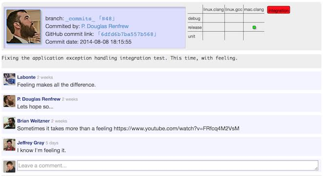

#Servidor de pruebas

TODO: Esta página es un trabajo en curso, armado a partir de correos privados, y debería reescribirse de una forma más presentable.

El servidor de pruebas se encuentra en [[http://benchmark.graylab.jhu.edu/]]. 
Tiene dos propósitos:
-	probar automáticamente cada revisión de master para asegurar que nada se rompa sin que todos lo noten, y
-	probar automáticamente los commits en las ramas de otras personas (fusionando master en ellas), para reducir la carga de trabajo del desarrollo y mantener un registro del estado de desarrollo de cada rama.

En última instancia, el servidor de pruebas está pensado para limitar la frecuencia con la que se rompe master.
Consulta [[Running-Tests-on-the-Test-Server]] para ver todos los detalles sobre cómo usar el servidor de pruebas.

A continuación hay secciones que deben completarse o escribirse.

### Orientación (cómo interpretar el servidor de pruebas)
El servidor de pruebas ofrece datos extensos: se puede ver cada archivo de entrada y de salida involucrado, tanto en la revisión de master que sirve de base de comparación de una prueba dada como en el commit que se prueba.
Si tu commit provoca una prueba fallida, primero comprueba si el último commit (o el último commit a master) rompió la misma prueba. Si es así, quizá no seas el responsable, aunque debes ser cuidadoso. De lo contrario, la prueba rota es CULPA TUYA. Esto no es acusatorio; ¡la atribución de la culpa no tiene por qué estar cargada emocionalmente! El hecho de que tu código haya cambiado algo que cubre una prueba es un elogio para nuestra cobertura de pruebas y para la ambición del código que escribiste.

Aun así, implica algo de lo que eres responsable. Debes arreglar la prueba o demostrar que su cambio es algo bueno, diseñado y deseado.
Esto no es tan obvio en el flujo de trabajo del desarrollo de Rosetta como quizá debería: eres responsable no solo de tu protocolo favorito, sino también de las consecuencias que quizá no anticipes.
Esto es lo que complica el desarrollo.

### Qué hacer en caso de una prueba fallida
Si una prueba no se ejecuta, usa GDB o LLDB (según tu compilador) para recorrer paso a paso la ejecución de esa prueba y localizar el error.
Si una prueba se ejecuta con éxito pero hay una desviación respecto de los resultados anteriores, _necesitas_ rastrear exactamente dónde comienza la desviación.
En las pruebas de integración de trayectorias cortas y en las pruebas unitarias, esto es en principio muy fácil: hay un número que no es el que debería ser, y hay un grupo muy pequeño de razones por las que podría haber cambiado.
El enfoque más simple es inundar todo lo involucrado con instrucciones de tracer o std::cout: si puedes volcar cada variable a la salida estándar, puedes hacerte una idea de lo que va mal.
Por supuesto, es posible lograr todo esto con una depuración sencilla, pero a veces las instrucciones de tracer pueden resultar más flexibles, más rápidas o más fáciles de entender.

Hay algunos casos _limitados_ en que las desviaciones en las pruebas son aceptables, aunque no puedas explicarlas perfectamente.
Si ves desviaciones en trayectorias muy largas (p. ej. relax) pero no en trayectorias cortas, PUEDE que alguna diferencia en el orden de multiplicación de dos números de punto flotante acabe teniendo un efecto. Pero tienes que dejarlo claro: tienes que identificar el momento exacto de la desviación.

######Comentarios sobre las revisiones
Ahora es posible añadir comentarios a cualquier revisión reconocida. 
Para añadir un comentario, simplemente inicia sesión con tu cuenta de github y escribe el texto de tu comentario. 
Al publicarlo, también puedes marcar la casilla 'notify the list' si quieres que el aviso de este comentario se envíe no solo al autor de la revisión y a las personas que ya han comentado esa revisión, sino también a la lista de correo asociada a esta rama (la lista rosetta-log en el caso de la rama master). 
También puedes borrar tus comentarios existentes (debes haber iniciado sesión) pulsando el botón X en la parte superior derecha de tu comentario. 

¡Los comentarios son una excelente manera de enmendar de forma simulada los malos mensajes de commit!
Nuestros repositorios de GitHub solo acumulan historial y no permiten reescribirlo, así que si subiste una revisión con un mensaje de commit equivocado, vacío o de fusión, no hay forma de deshacer esa acción. 
En su lugar, usa la función de comentarios para aportar información adicional para futuros registros, o simplemente para comunicarte con los demás desarrolladores:

##Véase también

* [[Integration tests]]: Información general sobre las pruebas de integración de Rosetta
 * [[Running Tests on the Test Server]]: Instrucciones para usar el servidor de pruebas
* [[Página de inicio de las pruebas|rosetta-tests]]
* [[Página de inicio de la documentación para desarrolladores|Development-Documentation]]
* [[RosettaEncyclopedia]]
* [[Glossary]]
