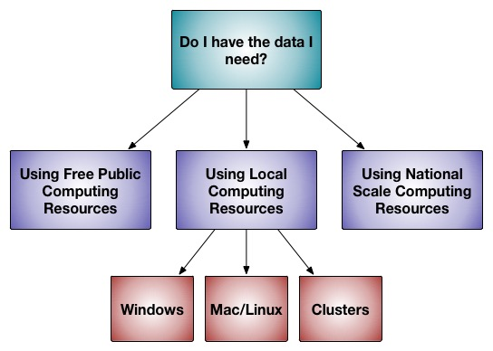

Primeros pasos
===========

Esta página está escrita para un público de científicos nuevos en Rosetta: quizá un estudiante de posgrado de primer año o un posdoc joven que ha recibido/iniciado un proyecto que necesita "algo de modelado por computadora".
En otras palabras, una persona que llega a Rosetta partiendo de cero.
¿Es Rosetta una buena herramienta para el modelado que necesitas hacer? Si es así, ¿cómo se obtiene y se usa Rosetta?
Si ya te sientes cómodo con los conceptos, puedes saltar directamente a lo que sigue.

Rosetta es una suite de software muy grande para el modelado macromolecular.
Por suite de software entendemos que es una gran colección de código informático (sobre todo en C++, algo en Python, un poco en otros lenguajes), pero no es un único programa monolítico.
Por [[modelado macromolecular|Resources-for-learning-biophysics-and-computational-modeling]] entendemos el proceso de evaluar y clasificar la plausibilidad física de distintas estructuras de macromoléculas biológicas (normalmente proteínas, aunque los ácidos nucleicos y los ligandos cuentan con un soporte considerable y el soporte para membranas lipídicas implícitas va en aumento).
Por lo general, el usuario [[elegirá un protocolo concreto dentro de Rosetta|Solving-a-Biological-Problem]] y le proporcionará a ese protocolo las entradas para A) en qué estructura trabajar y B) qué opciones del protocolo son adecuadas para las necesidades del usuario.

<<RawHtml(

<map name="GraffleExport">
	<area shape="rect" coords="330,305,421,376" href="Getting-Started#local-installation-and-use-of-rosetta_use-on-supercomputer-clusters">
	<area shape="rect" coords="226,305,317,376" href="Getting-Started#local-installation-and-use-of-rosetta_installation-on-mac-linux">
	<area shape="rect" coords="122,305,213,376" href="Getting-Started#local-installation-and-use-of-rosetta_windows">
	<area shape="rect" coords="377,166,532,253" href="Getting-Started#use-of-rosetta-on-national-scale-supercomputing-resources">
	<area shape="rect" coords="11,166,166,253" href="Getting-Started#public-rosetta-servers">
	<area shape="rect" coords="194,166,349,253" href="Getting-Started#local-installation-and-use-of-rosetta">
	<area shape="rect" coords="189,11,354,97" href="Getting-Started#do-i-have-what-i-need">
</map>
)>>

[[_TOC_]]

¿Tengo lo que necesito?
-----------------
Hacer bien el modelado macromolecular, es decir, hacer buena ciencia, requiere considerar con cuidado tus entradas, cómo se realiza el modelado y el análisis de tus salidas.
Rosetta puede manejarse como una ["caja negra"](https://en.wikipedia.org/wiki/Black_box), pero te estás haciendo un flaco favor a ti y a tu ciencia si lo usas así.

1) Entradas de Rosetta

La entrada principal de Rosetta es la estructura de entrada.
Por lo general, si tienes una o varias estructuras de alta resolución (mejor que 2 Å) de tu molécula, se pueden usar con Rosetta con [[pocos cambios|preparing-structures]].
Si tienes una estructura de menor resolución, una estructura de RMN, un modelo por homología o ninguna estructura, tu tarea será mucho más difícil.
Aun así, deberías [[preparar tu estructura para el modelado|preparing-structures]], pero ten en cuenta que el modelado es menos eficiente y eficaz cuando se parte de estructuras de mala calidad y que [[interpretar los resultados|Analyzing-Results]] es más difícil.

2) Elegir el protocolo de Rosetta

Las otras entradas son la elección de [[qué protocolo de Rosetta|Solving-a-Biological-Problem]] usar y de [[qué opciones|running-rosetta-with-options#specifying-options]] o [[archivos de entrada|file-types-list#commonly-used-input-files]] emplear.

3) Recursos computacionales

El software Rosetta, en su conjunto, está escrito para ejecutarse en supercomputadoras, pero puede ejecutarse a [[muchas escalas distintas|Rosetta-on-different-scales]].
La mayoría de las aplicaciones permiten "ejecuciones de prueba" en cualquier computadora.
Unas pocas aplicaciones pueden ejecutarse en computadoras portátiles.
Hay aplicaciones que pueden ejecutarse en computadoras potentes a escala de laboratorio (rango de 12-30 núcleos).
La mayoría de las aplicaciones suponen que tienes acceso a decenas de miles de horas de cómputo para acumular suficientes resultados que respondan tu pregunta.
Las secciones posteriores de este documento describen cómo instalar o usar Rosetta a esas distintas escalas.

Servidores públicos de Rosetta
----------------------

RosettaCommons mantiene varios [[servidores públicos|Rosetta-Servers]] para **USO EXCLUSIVAMENTE NO COMERCIAL**.  Aquí se mencionan los servidores de interés más amplio, pero consulta [[aquí|Rosetta-Servers]] y [[aquí|https://www.rosettacommons.org/software/servers]] para ver listas más completas.

Para uso comercial, consulta la sección siguiente y la página [[Rosetta Servers]].

* [ROSIE](http://rosie.rosettacommons.org/) es un servidor que ofrece varias aplicaciones de Rosetta mediante una interfaz web sencilla.
Es perfecto para quienes son nuevos en Rosetta.
A pesar de la variedad de ROSIE, solo ofrece una parte de toda la funcionalidad de Rosetta.

* [ROBETTA](http://robetta.bakerlab.org/) (Robot-Rosetta) es un servidor que ofrece plegamiento _ab initio_ y predicción de estructuras, así como selección de fragmentos para ejecuciones locales de Rosetta.

Servidores comerciales de Rosetta
--------------------------

* [Cyrus Biotechnology](https://cyrusbio.com) es una empresa que ofrece Bench, un servidor para usuarios comerciales que cuenta con herramientas de modelado por homología (como Robetta), diseño de proteínas (RosettaDesign), cálculo de ddG y otras herramientas de modelado como la relajación y la minimización.  (Cyrus Biotechnology es una licenciataria comercial de Rosetta que ofrece a sus clientes una interfaz gráfica de usuario basada en la web para Rosetta.  Las tarifas de licencia que las licenciatarias comerciales de Rosetta pagan a la Universidad de Washington se usan para apoyar a RosettaCommons, invirtiendo en el mantenimiento y el desarrollo futuro de Rosetta.)

Instalación y uso locales de Rosetta
--------------------------------------

Rosetta se puede descargar desde <https://rosettacommons.org/software/download/>.
A los usuarios académicos y no comerciales se les concede automáticamente con la descarga una licencia de uso exclusivamente no comercial.
El uso comercial requiere una licencia de pago que se puede obtener en [UW CoMotion](https://els2.comotion.uw.edu/product/rosetta).

Ten en cuenta que la descarga viene como un [[archivo tar|http://en.wikipedia.org/wiki/Tar_(computing)]].
Hay ejecutables precompilados disponibles para algunas plataformas. También hay [[código fuente|http://en.wikipedia.org/wiki/Source_code]] disponible, de modo que puedes [[compilar|http://en.wikipedia.org/wiki/Compiler]] en las plataformas donde no haya ejecutables precompilados.

Tutoriales introductorios de Rosetta
------------------------------
Tras descargar Rosetta, sigue [estos tutoriales detallados](https://www.rosettacommons.org/demos/latest/Home#tutorials) para empezar. Cuando termines los tutoriales introductorios, deberías poder realizar con Rosetta la mayoría de las tareas habituales de modelado molecular.

=======
###Instalación en Mac/Linux

La instalación local implica que usarás Rosetta mediante una [[interfaz de línea de comandos (o terminal)|http://en.wikipedia.org/wiki/Command-line_interface]].
Para los usuarios locales, es poco probable que quieras instalar Rosetta en todo el sistema.
Rosetta se compila e instala sin problemas por usuarios normales sin derechos de administrador; así es como lo usan los desarrolladores.
Puede que necesites derechos de administrador para instalar las [[dependencias|Build-Documentation#dependencies]].

* Primero descomprime (untar) tu copia descargada del código (`tar -xvzf Rosetta[releasenumber].tar.gz`).

* Luego, ve al directorio `source`: `cd main/source`.

* Rosetta usa [[SCons|http://www.scons.org]] como asistente de compilación. Rosetta incluye una copia de SCons, que debería funcionar en la mayoría de los sistemas.  

* El comando básico de compilación es `./scons.py -j<number_of_processors_to_use> mode=release bin`.
Sustituye <number_of_processors_to_use> por un número que sea un procesador menos de los que tiene tu computadora.
Prepárate para que la compilación tarde un rato (horas con un solo procesador).

Consulta nuestra extensa [[documentación de compilación|Build-Documentation#compiling-rosetta-3]] para ver más instrucciones y la resolución de problemas.

###Windows
Por desgracia, actualmente no podemos dar soporte a todo Rosetta en Windows.
Hay pocos compiladores de C++ gratuitos y fáciles de usar para Windows, y usan estándares de C++ ligeramente distintos.
El [[arranque dual|http://en.wikipedia.org/wiki/Multi-booting#Windows_and_Linux]] o las [[máquinas virtuales|https://en.wikipedia.org/wiki/Virtual_machine]] con Linux/MacOS son opciones.
No podemos ayudar a configurar el arranque dual de Windows/Linux, pero sí podemos ayudar con Rosetta en la partición de Linux.
Un subconjunto de Rosetta que requiere
[[PyRosetta|scripting_documentation/PyRosetta/PyRosetta]], una interfaz de Rosetta basada en Python, tiene soporte en Windows y está disponible en http://www.pyrosetta.org.

###Uso en clústeres de supercomputación
Si vas a ejecutar Rosetta en un clúster de cómputo científico, puede que ya haya una versión de Rosetta instalada para uso general.
Habla con el administrador de tu clúster para saber si hay una versión provista de forma centralizada que puedas usar.

Si tu clúster no tiene Rosetta instalado, o quieres usar una versión distinta de la instalada de forma centralizada, no te preocupes: Rosetta está diseñado para que usuarios normales lo compilen e instalen sin derechos de administrador.
Mientras tengas a tu disposición las herramientas de compilación de uso habitual, deberías poder compilar y ejecutar Rosetta en tu directorio de usuario sin la intervención del administrador del clúster.
Trátalo simplemente como una [[instalación local en el espacio de usuario|Getting-Started#local-installation-and-use-of-rosetta_installation-on-mac-linux]].

Uso de Rosetta en recursos de supercomputación de escala nacional
---------------------------------------------------------

Como parte de la iniciativa XSEDE, el clúster [[TACC/Stampede|TACC]] tiene instalados de forma centralizada Rosetta y [[PyRosetta|scripting_documentation/PyRosetta/PyRosetta]] para usuarios autorizados.
Consulta la página [[TACC]] para más detalles.

Cómo actualizar esta documentación
-------------------------
Los desarrolladores pueden actualizar estas páginas de documentación a través de nuestro [wiki interactivo](https://www.rosettacommons.org/docs/wiki/Home) [nota: requiere iniciar sesión en Github], o cualquier persona puede sugerir cambios a través del [repositorio de Github](https://github.com/RosettaCommons/documentation).

##Véase también

* [Tutoriales introductorios de Rosetta](https://www.rosettacommons.org/demos/latest/Home#tutorials)
* [[Resources for learning biophysics and computational modeling]]
* [[Build Documentation]]: información sobre cómo configurar Rosetta
* [[I want to do x]]: guías para tipos específicos de perturbaciones estructurales con RosettaScripts
* [[Application Documentation]]: enlaces a la documentación de diversas aplicaciones de Rosetta
* [[Analyzing Results]]: consejos para analizar los resultados generados con Rosetta
* [[Comparing structures]]: ensayo sobre la comparación de estructuras
* [[Commands collection]]: una lista de líneas de comandos de ejemplo para ejecutar los archivos ejecutables de Rosetta
* [[Rosetta Servers]]: servidores web para aplicaciones de Rosetta
* [[Scripting Documentation]]: interfaces de scripting para Rosetta
* [[Rosetta overview]]: visión general de los conceptos principales de Rosetta
* [[FAQ]]: preguntas frecuentes
* [[Glossary]]: definiciones breves de términos de Rosetta
* [[RosettaEncyclopedia]]: descripciones detalladas de términos de Rosetta

