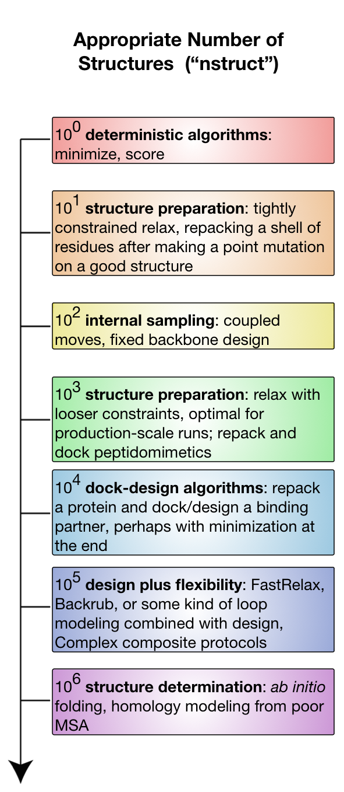

# Rosetta a distintas escalas

Rosetta es un programa muy hambriento en términos de tiempo de cómputo.
Esto se debe en parte a que el modelado de proteínas es prácticamente el [[problema más difícil|http://xkcd.com/1430/]] que conocemos.
También se debe en parte a que Rosetta está escrito en gran medida por biofísicos profesionales que tienen menos experiencia en ingeniería de software y ninguna en [[optimizar|https://en.wikipedia.org/wiki/Program_optimization]] algoritmos para ganar velocidad.
(Dicho esto, ¡los [[bucles internos|https://en.wikipedia.org/wiki/Inner_loop]] sí están bastante optimizados por personas que sabían lo que hacían!)

Esta página habla de Rosetta en términos tanto de `nstruct` (la opción de Rosetta que controla el **n**úmero de **struct**uras, es decir, de estructuras generadas) como del tiempo de cómputo necesario para generar esas estructuras.
Lo ideal es ejecutar siempre suficientes modelos como para muestrear suficiente espacio de búsqueda y responder tu pregunta de modelado.
En el mundo real, los experimentadores están limitados por el tiempo de cómputo.
Además, la cuestión de cuántos nstruct son necesarios es heurística y específica de cada problema.
Este documento intenta abordar, en un sentido más estricto, cuántos modelos nstruct se quieren para distintos tipos de experimentos (¡y por qué!), y, en un sentido más flexible, aproximadamente cuánto tiempo de cómputo estamos hablando.
La página de [[análisis de resultados|Analyzing-Results]] también aborda el tema.

En términos generales, el número de modelos que se necesita para abordar un problema está relacionado con el tamaño del espacio de búsqueda, que a su vez está relacionado con el número y el tipo de grados de libertad.
Las principales clases de grados de libertad, en orden de complejidad, son:
* libertad de rotámeros de las cadenas laterales (se mueven pocos átomos)
* libertad de diseño de las cadenas laterales (funcionalmente un superconjunto de la libertad rotamérica: algunos rotámeros simplemente tienen átomos distintos)
* libertad de cuerpo rígido (problemas de docking)
* libertad de la cadena principal (mover los átomos de la cadena principal unos respecto de otros)
La libertad de la cadena principal es la más costosa porque es un espacio de búsqueda muy rugoso (los átomos muy empaquetados deben moverse con cuidado) y, como consecuencia del [[plegamiento en coordenadas internas|internal coordinates]], los movimientos grandes pueden producir efectos de brazo de palanca que perturban grandes partes de los modelos.

El diagrama esboza los distintos experimentos disponibles en una escala logarítmica de nstruct.
Supón que el tiempo de cómputo se correlaciona positivamente con nstruct.

<!--- NOTA: el mapa de la imagen está al revés por alguna razón --->
<<RawHtml(

<map name="GraffleExport">
	<area shape=rect coords="89,1100,574,1200" href="Rosetta-on-different-scales#106-and-up">
	<area shape=rect coords="89,930,574,1080" href="Rosetta-on-different-scales#105">
	<area shape=rect coords="89,760,574,905" href="Rosetta-on-different-scales#104">
	<area shape=rect coords="89,620,574,750" href="Rosetta-on-different-scales#103">
	<area shape=rect coords="89,500,574,570" href="Rosetta-on-different-scales#102">
	<area shape=rect coords="89,310,574,450" href="Rosetta-on-different-scales#101">
	<area shape=rect coords="89,190,574,270" href="Rosetta-on-different-scales#100">
</map>
)>>

##100
En esta escala logarítmica, con un único modelo, podemos usar protocolos de Rosetta que son deterministas: protocolos que no emplean una búsqueda de Monte Carlo.
Las entradas más notables aquí son la [[puntuación|scoring-explained]] y la [[minimización|minimization-overview]].
Ejecutar el minimizador directamente sobre una estructura de entrada es relativamente raro (quedará atrapado de inmediato en un mínimo local), pero plausible.
Puntuar una estructura es algo muy habitual.
Esta escala será generalmente rápida y puede ejecutarse en una computadora portátil.

##101
En esta escala podemos considerar protocolos pensados para un espacio de búsqueda muy pequeño y aquellos que pueden muestrearse por completo.
De 10 a 100 modelos es razonable para la mayoría de los trabajos de [[preparación de estructuras|preparing-structures]], porque estos trabajos deben ceñirse estrechamente al modelo inicial y solo corregir errores graves.
Este rango también es razonable para experimentos menores de [[reempaquetado|fixbb]].
El reempaquetado es factible porque muestrea *de manera muy extensa* dentro del protocolo, así que se necesitan relativamente pocos nstruct.
Esta escala será generalmente rápida y puede ejecutarse en una computadora portátil.

##102
En esta escala podemos considerar experimentos más pequeños que muestrean sobre todo grados de libertad internos que no son de la cadena principal: las cadenas laterales.
Muestrear solo las cadenas laterales da lugar a un espacio de búsqueda relativamente pequeño y menos frustrado, en parte porque muy pocos átomos se mueven a la vez y nunca hay movimientos concertados (o no concertados) grandes de muchos átomos.
La aplicación arquetípica aquí es el [[diseño con cadena principal fija|fixbb]].
De nuevo, fixbb puede ejecutarse a pequeña escala porque el núcleo del algoritmo de empaquetado está muy optimizado y ejecuta muchos ciclos internamente.
Fixbb suele ser rápido y se ejecuta en una computadora portátil, aunque los trabajos de diseño grandes pueden requerir más memoria de la que tendrán las computadoras menos potentes.

Los movimientos acoplados (coupled moves), disponibles como ejecutable (coupled_moves) o como mover de RosettaScripts (CoupledMover), incorporan una cantidad limitada de flexibilidad acoplada (de ahí el nombre) de la cadena principal y las cadenas laterales mediante el BackrubMover; también tienen herramientas para manipular ligandos.
Es importante señalar que usa el BoltzmannRotamerMover para seleccionar rotámeros para cada posición, en lugar del packer, lo que mejora la velocidad y puede dar lugar a una mayor diversidad de secuencias, por lo que es una gran opción para diversificar la estructura inicial.
Como considera y descarta muchas soluciones por cada decoy que finalmente produce, se necesitan relativamente pocos decoys, aunque el tiempo necesario para producir cada uno es considerablemente mayor que en todos los trabajos de fixbb salvo los más grandes.
De nuevo, nótese la tendencia hacia el muestreo repetido *dentro* de una trayectoria.

##103
En esta escala empezamos a considerar experimentos que introducen grados de libertad que no son de las cadenas laterales.
Introducir flexibilidad de la cadena principal es muy costoso en términos de espacio de búsqueda, así que a continuación introducimos libertades de cuerpo rígido, lo que permite problemas de docking pequeños.  
Por ejemplo, es muy común realizar los llamados algoritmos de dock-design, en los que se ejecutan ciclos repetidos de docking con refinamiento de cuerpo rígido alternados con reempaquetado y diseño.
Estos algoritmos son particularmente valiosos para optimizar interfaces proteína-péptido y proteína-peptidomimético.  
Los péptidos tienen relativamente pocos diedros de la cadena principal, así que las perturbaciones pequeñas no inflan demasiado el problema del muestreo.
Aún mejor es el caso de uso de los peptidomiméticos, que son moléculas estrechamente derivadas de los péptidos o relacionadas con ellos, con propiedades farmacológicas y, normalmente, conformacionales mejoradas.
Una molécula peptidomimética podría tener solo una o dos conformaciones estables por subunidad de residuo, lo que significa que incluso un muestreo completo del espacio conformacional peptidomimético es compatible con el docking de cuerpo rígido, el empaquetado y el diseño.
Esta escala también es útil para ejecuciones de [[relax]] moderadamente restringidas, usadas como parte de la [[preparación de estructuras|preparing-structures]] o al final de la [[predicción de estructuras ab initio|abinitio-relax]].
En este régimen, generalmente querrás algo más potente que tu computadora de escritorio: ya sea un caballo de batalla de laboratorio con muchos núcleos o una ejecución pequeña en un clúster a escala de laboratorio.

##104
En esta escala podemos empezar a muestrear en serio problemas de docking de mayor escala mientras reempaquetamos e incluso rediseñamos.
También es razonable para protocolos de muestreo de la cadena principal más bien pequeños, como el [[modelado de loops|loopmodel]] de un solo loop de longitud moderada.
Este es también el mínimo imprescindible de muestreo necesario para el [[docking|docking-protocol]] local, en el que la configuración inicial de la proteína está cerca de la configuración biológica.
Para este tipo de problemas necesitarás hardware serio: ya sean periodos largos (de una noche a días) en los caballos de batalla del laboratorio, ejecuciones pequeñas en clústeres a escala de laboratorio (cientos de CPU) o ejecuciones diminutas en grandes supercomputadoras.

##105
En esta escala ganamos la capacidad de empezar a muestrear la flexibilidad de la cadena principal, sin dejar de considerar los grados de libertad de las cadenas laterales y de cuerpo rígido.
Podemos muestrear lo suficiente como para empezar a pensar en conjuntos de [[backrub]] o de [[FastRelax|relax]].
Este régimen también se considera un muestreo razonable para la mayoría de los protocolos de diseño de interfaces con cadena principal flexible.
Los protocolos de secuencia fija son más rápidos que los protocolos de diseño en este espacio.
El [[docking|docking-protocol]] global, en el que hay que explorar amplias extensiones del espacio de cuerpo rígido, se vuelve plausible.
Los recursos de cómputo necesarios van desde el uso intensivo de un clúster de laboratorio de 500 CPU hasta ejecuciones moderadamente grandes en grandes supercomputadoras (cientos de procesadores durante muchos días).

##106 y más
En esta escala podemos intentar abordar cualquier problema que te imagines.
La [[predicción de estructuras|abinitio-relax]] _ab initio_ implica empezar sin ningún modelo, solo con una secuencia, por lo que su espacio de búsqueda conformacional de la cadena principal debe muestrearse muy bien.
Esta es la escala ideal para el [[docking|docking-protocol]].
Los protocolos con todos los átomos a esta escala son *muy* costosos computacionalmente y requieren un uso serio de recursos de supercomputación a escala nacional.
La predicción de estructuras a menudo no usa todos los átomos: la mayoría de las etapas usan en su lugar [[centroides|centroid-vs-fullatom]].
Esto es mucho más rápido, así que algunos experimentos de este régimen pueden ser sorprendentemente rápidos y necesitar mucho menos que un orden de magnitud más de tiempo (o incluso menos tiempo en sentido absoluto) que los niveles anteriores.

##Véase también

* [[Challenges in Macromolecular Modeling]]: trata los problemas del muestreo y la puntuación en el modelado de proteínas.
* [[Analyzing Results]]: consejos para analizar los resultados generados con Rosetta
* [[Comparing structures]]: ensayo sobre la comparación de estructuras
* [[I want to do x]]: guía para realizar distintas formas de muestreo en Rosetta
* [[Resources for learning biophysics and computational modeling]]
* [[Getting Started]]: una página para quienes empiezan con Rosetta
* [[Solving a Biological Problem]]: guía para abordar problemas biológicos con Rosetta
