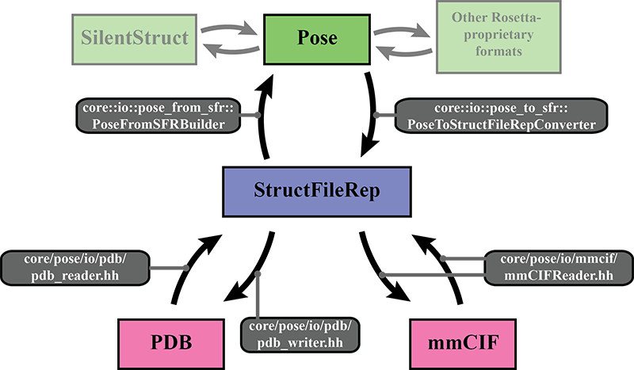

#Resumen de la E/S de archivos de estructuras moleculares

Documento creado el 31 de enero de 2016 por Vikram K. Mulligan (vmullig@uw.edu) como parte del Chemical XRW (eXtreme Rosetta Workshop) de 2016.

## Formatos de archivo de estructuras moleculares compatibles con Rosetta

Rosetta admite actualmente el formato Protein Data Bank (PDB).  Recientemente se agregó compatibilidad con el nuevo formato macromolecular Crystallographic Information File (mmCIF).  Existen varias aplicaciones de terceros para visualizar y manipular estos formatos.  Algunos ejemplos son <a href="https://www.pymol.org/">PyMOL</a>, <a href="https://www.cgl.ucsf.edu/chimera/">Chimera</a> y <a href="https://spdbv.unil.ch/">Swiss-PDB Viewer</a>.

Además, Rosetta tiene un formato propio de archivo de estructuras llamado formato "silent".  Los silent files de Rosetta tienen la ventaja de ser un medio compacto para almacenar varias estructuras, con toda la información necesaria para reconstruir un Pose de Rosetta, con la precisión numérica completa de la máquina.  (En cambio, volver a importar una estructura que se exportó a un formato de terceros puede provocar pérdida de información.)  Sin embargo, los silent files deben convertirse a un formato de terceros (<i>p. ej.</i> formato PDB) para ver las estructuras con visualizadores de terceros (<i>p. ej.</i> PyMOL).

## Control de la entrada por parte del usuario

<b>-in:file:s \<filename\></b>: importa una estructura desde un formato de terceros (PDB, mmCIF).  Rosetta detecta el formato a partir del archivo. 
<b>-in:file:l \<list file\></b>: importa estructuras a partir de una lista de archivos contenida en un archivo de texto ASCII (un archivo por línea).  Rosetta detecta el formato de cada archivo al importarlo. 

## Control de la salida por parte del usuario

TODO

## Resumen del código

El manejo de los formatos de archivo de terceros en Rosetta se rehízo en gran medida en enero de 2016, durante el Chemical XRW (eXtreme Rosetta Workshop).

Para la importación de archivos, todos los formatos de terceros son analizados por módulos separados de Rosetta y convertidos en un objeto <b>StructFileRep</b> (espacio de nombres core::io), que es una clase de almacenamiento de datos que sirve de intermediario entre la representación estructural interna de Rosetta (el <b>Pose</b>) y el formato de terceros.  Luego el Pose se construye a partir del StructFileRep con la clase <b>core::io::pose_from_sfr::PoseFromSFRBuilder</b>.  Las funciones para analizar archivos PDB y producir un StructFileRep se encuentran en <b>core/io/pdb/pdb_reader.hh</b>, y las funciones para analizar archivos mmCIF y producir un StructFileRep se encuentran en <b>core/io/mmcif/mmCIFReader.hh</b>.  Se puede agregar compatibilidad con formatos de archivo adicionales con facilidad escribiendo un conversor del nuevo formato al StructFileRep.

Para la exportación de archivos, el proceso ocurre a la inversa: el Pose se convierte en un StructFileRep con la clase <b>core::io::pse_to_sfr::PoseToStructFileRepConverter</b>.  Las funciones para escribir archivos PDB a partir de un StructFileRep se encuentran en <b>core/io/pdb/pdb_writer.hh</b>, y las funciones para escribir archivos mmCIF a partir de un StructFileRep se encuentran en <b>core/io/mmCIFReader.hh</b> (aunque esto podría trasladarse a un archivo específico de escritura).  Para agregar compatibilidad de escritura con formatos de archivo adicionales, un desarrollador solo necesita agregar un conversor del StructFileRep al nuevo formato de archivo.

<<RawHtml(

)>>

La conversión de un Pose a otros formatos propios de Rosetta (<i>p. ej.</i> el formato silent file) la gestionan otros módulos y <i>no</i> pasa por el objeto StructFileRep.  El objeto StructFileRep está pensado únicamente para la salida a formatos de terceros, en los que puede no haber una correspondencia 1:1 entre la forma en que se almacenan los datos en el Pose y la forma en que se almacenan en el archivo.
