# Mover Grid Dock

[[_TOC_]]

# Descripción

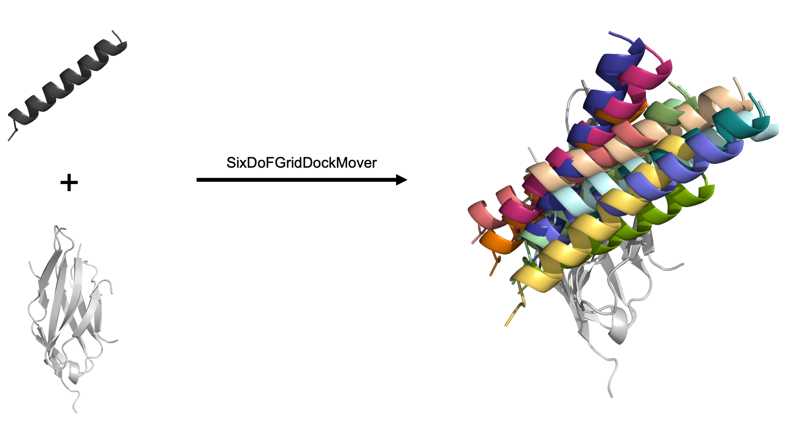

El mover Grid Dock utiliza los seis grados de libertad (DoF) básicos para acoplar una proteína en el espacio 3D: traslada y rota un dominio alrededor de tres ejes definidos por el usuario, conocidos habitualmente como eje x, eje y y eje z. El usuario define tanto el sistema de coordenadas como el espacio de muestreo, lo que da un sistema de docking fácil de usar y muy personalizable. Al terminar, este mover genera archivos pdb de salida de cada Pose recién acoplado.

Este mover fue escrito por Alice Peng y Odessa Goudy, del laboratorio de Brian Kuhlman en la Universidad de Carolina del Norte en Chapel Hill. Los autores quieren dar las gracias especialmente a Steven Lewis y Andrew Leaver-Fay por toda su ayuda y sus ideas.

Esta documentación se actualizó por última vez en abril de 2022. Envía cualquier pregunta a Brian Kuhlman en [bkuhlman@email.unc.edu](mailto:bkuhlman@email.unc.edu).


# Definición


```xml
<SixDoFGridDockMover 
name = "(&string;)"
dof_residue_selector_1 = "(&string residue_selector;)"
dof_residue_selector_2a = "(&string residue_selector;)"
dof_residue_selector_2b = "(&string residue_selector;)"
values_trans_axis_1 = "(&real_cslist;)"
values_trans_axis_2 = "(&real_cslist;)"
values_trans_axis_3 = "(&real_cslist;)"
values_rot_axis_1 = "(&real_cslist;)"
values_rot_axis_2 = "(&real_cslist;)"
values_rot_axis_3 = "(&real_cslist;)" 
range_trans_axis_1 = "(&real_cslist;)"
range_trans_axis_2 = "(&real_cslist;)"
range_trans_axis_3 = "(&real_cslist;)"
range_rot_axis_1 = "(&real_cslist;)"
range_rot_axis_2 = "(&real_cslist;)"
range_rot_axis_3 = "(&real_cslist;)" 
max_samples = "(10000 &non_negative_integer;)"
degree_check = "(true &bool;)" />
```


* **dof_residue_selector_1:** selector de residuos que, junto con otros dos residuos, especifica las coordenadas iniciales de la rejilla.
* **dof_residue_selector_2a:** selector de residuos que, junto con otros dos residuos, especifica las coordenadas iniciales de la rejilla. Ten en cuenta que el usuario selecciona 3 residuos que forman un ángulo de 90° con res_2a como vértice.
* **dof_residue_selector_2b:** selector de residuos que, junto con otros dos residuos, especifica las coordenadas iniciales de la rejilla.
* **values_trans_axis_1**: lista separada por comas de valores de traslación a lo largo del Eje 1, en Å. No puede usarse con range_trans_axis_1.
* **values_trans_axis_2**: lista separada por comas de valores de traslación a lo largo del Eje 2, en Å. No puede usarse con range_trans_axis_2.
* **values_trans_axis_3**: lista separada por comas de valores de traslación a lo largo del Eje 3, en Å. No puede usarse con range_trans_axis_3.
* **values_rot_axis_1:** lista separada por comas de valores de rotación alrededor del Eje 1, en grados. No puede usarse con range_rot_axis_1.
* **values_rot_axis_2:** lista separada por comas de valores de rotación alrededor del Eje 2, en grados. No puede usarse con range_rot_axis_2
* **values_rot_axis_3:** lista separada por comas de valores de rotación alrededor del Eje 3, en grados. No puede usarse con range_rot_axis_3.
* **range_trans_axis_1**: lista separada por comas con el mínimo, el máximo y el tamaño de paso de la traslación a lo largo del Eje 1, en Å. No puede usarse con values_trans_axis_1.
* **range_trans_axis_2**: lista separada por comas con el mínimo, el máximo y el tamaño de paso de la traslación a lo largo del Eje 2, en Å. No puede usarse con values_trans_axis_2.
* **range_trans_axis_3**: lista separada por comas con el mínimo, el máximo y el tamaño de paso de la traslación a lo largo del Eje 3, en Å. No puede usarse con values_trans_axis_3.
* **range_rot_axis_1:** lista separada por comas con el mínimo, el máximo y el tamaño de paso de la rotación alrededor del Eje 1, en grados. No puede usarse con values_rot_axis_1.
* **range_rot_axis_2:** lista separada por comas con el mínimo, el máximo y el tamaño de paso de la rotación alrededor del Eje 2, en grados. No puede usarse con values_rot_axis_2.
* **range_rot_axis_3:** lista separada por comas con el mínimo, el máximo y el tamaño de paso de la rotación alrededor del Eje 3, en grados. No puede usarse con values_rot_axis_3.
* **max_samples:** el número máximo previsto de estructuras de salida; por defecto 10,000. Para beneficio del usuario, esta opción se ofrece para ayudar a evitar ejecuciones enormes sin querer.
* **degree_check:** true (por defecto) indica que el mover terminará cuando los selectores de residuos no estén dentro del rango ideal de 60-120° (con res_2a en el vértice). Para anular esta comprobación, ponlo en false.


# Parámetros obligatorios


## Selectores de residuos

El usuario debe seleccionar 3 residuos que, idealmente, formen un ángulo de 90° con ```res_2a``` como vértice, según el Pose de entrada inicial. Las coordenadas de los átomos de carbono alfa de los 3 residuos crean 3 vectores ortogonales. Estos vectores definen entonces los ejes del sistema de coordenadas de docking. 

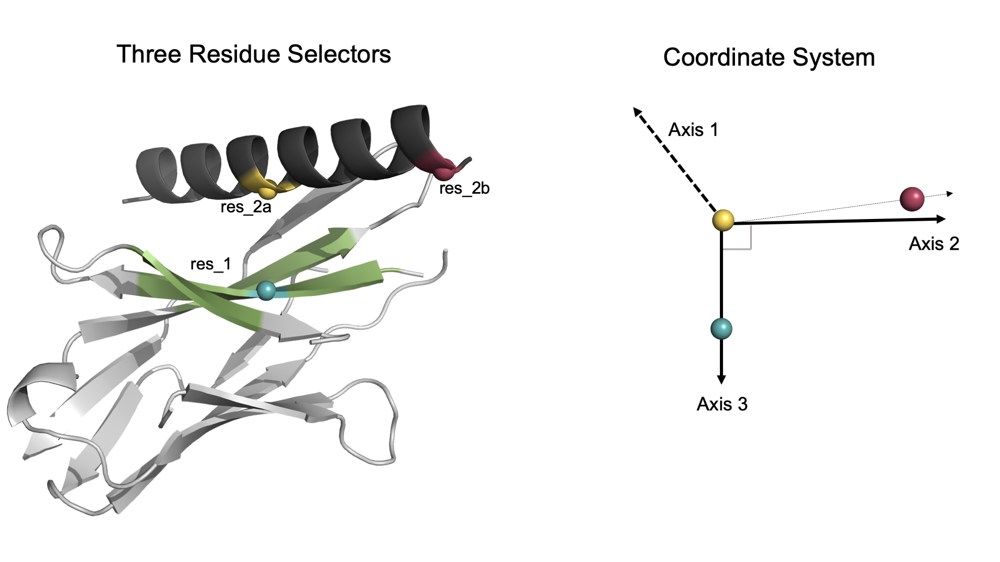


**Los residuos seleccionados por el usuario generan un sistema de coordenadas ortogonal intuitivo.** En este modelo, la hélice gris oscuro se acoplará dentro de la región verde de la proteína gris claro. Las tres esferas de color (azul, amarillo, frambuesa) representan los residuos seleccionados por el usuario. _Izquierda_: el usuario selecciona 3 residuos. Un residuo está en el dominio estático dentro del espacio de docking verde y los otros dos residuos están en el dominio helicoidal móvil. _Derecha_: dados los átomos CA de cada residuo, se genera un sistema de coordenadas ortogonal. Ten en cuenta que el Eje 1 es ortogonal tanto al Eje 2 como al Eje 3 (que se crean primero a partir de las coordenadas de los residuos seleccionados por el usuario).

💡 Consejo para el usuario: fija ```res_1``` como un residuo del dominio **estático** en el **centro** de la interfaz de docking. 

💡 Consejo para el usuario: fija ```res_2a``` como un residuo **central** del dominio **móvil** que esté justo enfrente de ```res_1```.

💡 Consejo para el usuario: fija ```res_2b``` como un residuo del dominio **móvil**, procurando que el carbono alfa apunte **en la misma dirección** que el de ```res_2a```.

Aunque se puede elegir cualquier combinación de 3 selectores de residuos, seguir las recomendaciones anteriores da al usuario una intuición de cómo se moverá el dominio incluso antes de ejecutar el mover. Cuanto más cerca de un ángulo de 90° (con ```res_2a``` en el vértice), mejor se alinean los residuos seleccionados con el sistema de coordenadas resultante.

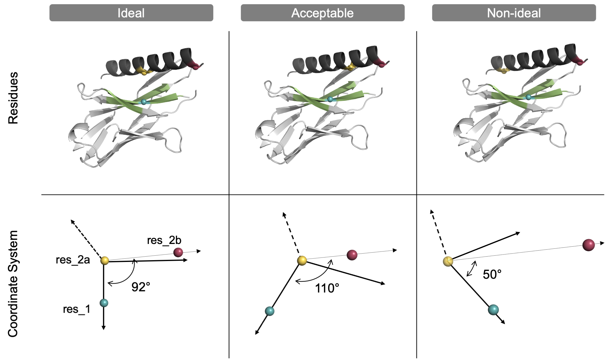

**Los residuos seleccionados por el usuario forman idealmente un ángulo de 90°.** En este sistema modelo, la hélice gris oscuro se acoplará dentro de la región verde de la proteína gris claro. Las tres esferas de color (azul, amarillo, frambuesa) representan la ubicación de los tres residuos seleccionados por el usuario dentro de las proteínas (arriba) y el sistema de coordenadas resultante (abajo). _Izquierda_: el usuario selecciona 3 residuos que forman un ángulo de 90° con res_2a (amarillo) como vértice. _Centro_: los 3 residuos forman un ángulo de 110°, que es aceptable pero no ideal, ya que el Eje 2 no se alinea bien con res_2b. _Derecha_: los 3 residuos forman un ángulo de 50°, que no es ideal y hará que el mover termine a menos que el usuario desactive la opción degree_check. Ten en cuenta que, aunque en todos los casos se generará un sistema de coordenadas ortogonal, el usuario tendrá una intuición más precisa del sistema de coordenadas, en concreto del Eje 2, si los residuos seleccionados forman un ángulo de 90°.


## Dimensiones del espacio de búsqueda para los seis grados de libertad

Este mover utiliza los seis DoF básicos: traslación y rotación alrededor de tres ejes. Para ejecutar el mover, el usuario debe proporcionar **o bien** un rango especificado por el usuario **o bien** una lista de valores para **cada** DoF. Con la **opción de rango**, el usuario proporciona una lista separada por comas con el mínimo, el máximo y el tamaño de paso (en ese orden). Por ejemplo, si el usuario da ```2, 8, 1```, el mover devolverá el siguiente espacio de búsqueda: [2, 3, 4, 5, 6, 7, 8].

Alternativamente, con la **opción de valores**, el usuario proporciona una lista separada por comas de valores específicos para el espacio de búsqueda. Si el usuario da ```1, 2, 3```, el mover solo muestreará esos valores concretos para ese DoF concreto. 

💡 Consejo para el usuario: el usuario puede combinar las opciones de rango o de valores para cualquiera de los seis DoF. Sin embargo, el usuario debe proporcionar una sola opción para cada DoF.

💡 Consejo para el usuario: para desactivar un DoF concreto, se recomienda poner la opción de valores en cero.

A continuación hay una configuración de ejemplo para los 6 DoF, que genera 504 Poses (es decir, el producto de cada dimensión para todos los DoF).

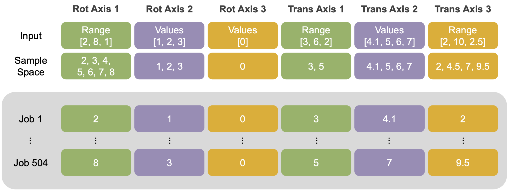

**Entradas de búsqueda personalizadas dadas por el usuario para los seis grados de libertad.** En esta configuración de ejemplo, el usuario combinó las opciones de rango y de valores para los seis DoF. Bajo la entrada se enumera el espacio de búsqueda convertido. Para ilustrar cómo el mover recorre el espacio de muestreo y asigna los índices de trabajo, se enumeran (recuadro gris) los valores de DoF resultantes del primer y el último trabajo.  


# Parámetros opcionales


## Comprobación de max samples

max_samples: número máximo de estructuras de salida esperadas. (El valor por defecto es 10,000.) Fija ```max_samples``` en un valor mayor o igual que el número de estructuras de salida esperadas. El mover terminará si el espacio de búsqueda es mayor que el máximo. (Por ejemplo, si el usuario da una combinación de opciones de rango y de valores que produce un espacio de búsqueda de docking mayor que 10,000, el mover terminará.) Para beneficio del usuario, esta opción se ofrece para ayudar a evitar espacios de búsqueda enormes sin querer. 

Ten en cuenta que Multistage Rosetta Scripts requiere un parámetro parecido pero distinto, llamado ```num_runs_per_input_struct```, que debe fijarse en el valor _exacto_ del tamaño de muestra esperado (el producto de cada dimensión para los seis DoF).


## Desactivar la comprobación de ángulo

degree_check: booleano. Si se pone en «true» (el valor por defecto), el mover terminará automáticamente el trabajo si los tres residuos seleccionados forman un ángulo fuera del rango ideal de 60-120° con ```res_2a``` en el vértice. El usuario puede poner la comprobación de ángulo en «false» para desactivarla, lo que hace que el mover continúe incluso cuando el ángulo está fuera del rango ideal. Solo se recomienda desactivar esta opción si el usuario tiene pocos residuos entre los que elegir, como podría ocurrir al acoplar un péptido pequeño.

Si el usuario desactiva la comprobación de ángulo, se recomienda encarecidamente comprobar primero cómo se mueve el dominio móvil en el sistema de coordenadas.


# Descripción avanzada


## Información importante

Una ventaja principal del grid docking es encontrar pozos de energía estrechos que los enfoques tradicionales de docking Monte Carlo en modo centroide podrían pasar por alto debido a una función de puntuación centroide sesgada. Además, este mover permite al usuario controlar explícitamente el [giro (roll)](https://upload.wikimedia.org/wikipedia/commons/thumb/7/7d/Roll_pitch_yaw_mnemonic.svg/440px-Roll_pitch_yaw_mnemonic.svg.png) del dominio móvil, una rotación que se ha observado de forma anecdótica, sin comprobación exhaustiva, que está inframuestreada en otros protocolos de docking. Sin embargo, las desventajas de este sistema incluyen un espacio de muestreo predeterminado y el gran número de estructuras de salida.

Para abordar esta limitación y reducir el número de estructuras de salida, este mover se diseñó para funcionar dentro de la plataforma [Multistage Rosetta Scripts](https://www.rosettacommons.org/docs/latest/scripting_documentation/RosettaScripts/multistage/MultistageRosettaScripts), de modo que la salida pueda filtrarse fácilmente y dirigirse a un paso de diseño posterior.

Al inicio del protocolo Six Degree of Freedom Grid Dock, este mover extrae primero las coordenadas de los átomos de carbono alfa de 3 residuos para crear un sistema de coordenadas definido por el usuario. Con este sistema de coordenadas, un dominio móvil (el segundo dominio del archivo pdb, generalmente la cadena B) se acopla en el espacio 3D. Las traslaciones son en Å y las rotaciones en grados. Los DoF rotacionales se aplican primero para reducir el efecto de brazo de palanca. 

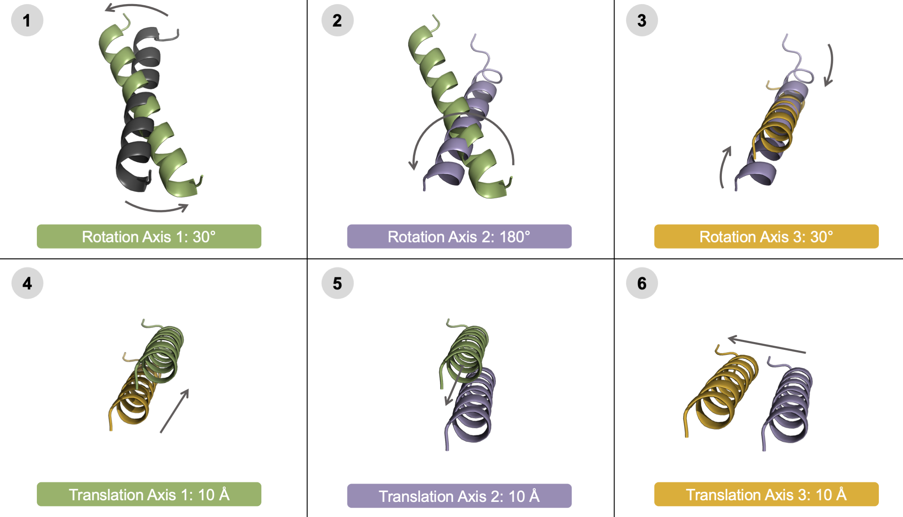

**El orden en que se aplican los seis parámetros de docking**. En este sistema modelo, la hélice inicial (gris oscuro) se rota primero alrededor de tres ejes (pasos 1-3) y luego se traslada (pasos 4-6). En cada panel sucesivo se muestran los Poses N y N-1 con flechas para mostrar el movimiento; el Pose N coincide con el color de la etiqueta del parámetro de docking. El Pose de salida se genera solo después de aplicar los seis parámetros. Para mayor claridad, el sistema de coordenadas se genera originalmente a partir de la hélice inicial (gris oscuro); cada rotación y traslación sucesiva se aplica iterativamente al Pose de entrada según el sistema de coordenadas original. 

Para cada Pose de salida, los valores de DoF muestreados se informan en el scorefile de salida con los siguientes nombres de columna: ```axis1_rot```, ```axis2_rot```, ```axis3_rot```, ```axis1_trans```, ```axis2_trans```, ```axis3_trans```. Tras el docking, la puntuación se informa en el scorefile como defaultscorename. Incluir el mover [FilterReportAsPoseExtraScoresMover](https://new.rosettacommons.org/docs/latest/scripting_documentation/RosettaScripts/Movers/movers_pages/FilterReportAsPoseExtraScoresMover) permite al usuario informar del valor del filtro en el momento en que se llama, para su posterior salida al scorefile.


## Archivos XML de ejemplo

Como complemento a esta documentación, se proporcionan ejemplos de Multistage Rosetta Scripts en ```Rosetta/main/rosetta_scripts_scripts/scripts/public/docking/grid_docking/```.

El directorio principal contiene cuatro subdirectorios que se corresponden con la documentación: [visualizar el sistema de coordenadas](#2-visualize-the-coordinate-system), [un grid dock de grano grueso](#3-set-a-coarse-grain-grid-dock-search-space), [seguir el grid dock con un docking local](#4-expand-the-best-grid-docked-poses-with-local-docking) y [combinar docking con diseño](#5-follow-docking-with-design). Cada subdirectorio contiene los archivos de entrada (pdb y archivos de opciones) y el script xml necesarios para ejecutar cada trabajo. 

## Cómo funciona por dentro

Como complemento al código fuente, esta sección detalla cómo el mover asigna cada combinación de DoF al índice de trabajo correcto.

El espacio de búsqueda de docking total es el producto cartesiano de los valores de los seis DoF. El mover almacena el espacio de búsqueda en un vector de vectores. Después, cada trabajo asigna exactamente un conjunto de DoF al pdb de entrada. Los índices de trabajo se asignan a cada conjunto de DoF mediante un proceso similar a un bucle for. Luego se hace aritmética modular sobre estos índices de trabajo para aplicar a cada Pose el conjunto correcto de DoF. 


# Cómo ejecutar el mover


## 1: Preparar el PDB de entrada y seleccionar los residuos con PyMol

Antes de usar el mover, coloca los dos dominios de proteína uno justo enfrente del otro con PyMOL. Orienta los dos dominios para elegir fácilmente residuos ideales según las [recomendaciones anteriores](#residue-selectors). A continuación hay algunos consejos útiles para mover objetos en PyMOL.

Primero, extrae el dominio móvil a un objeto separado.

💡 Consejo para el usuario: para ello, haz clic en la vista de secuencia. Luego resalta el dominio deseado. Después haz clic en Action/extract object, para la selección.

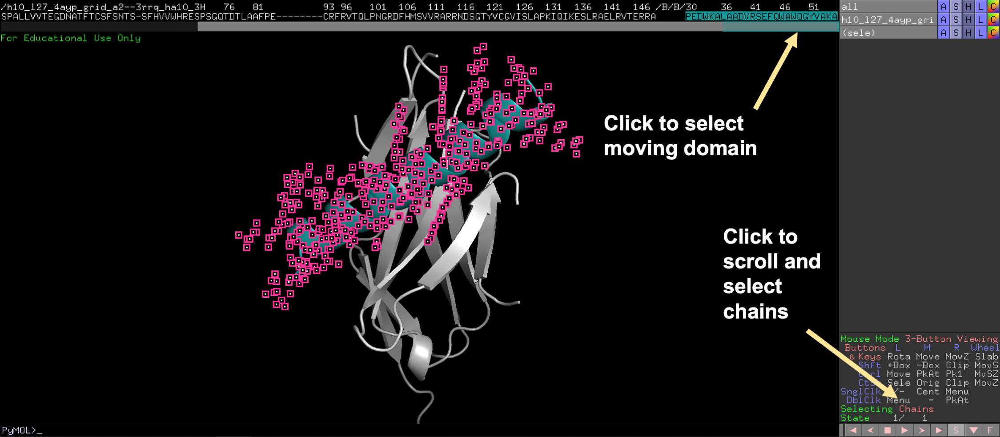

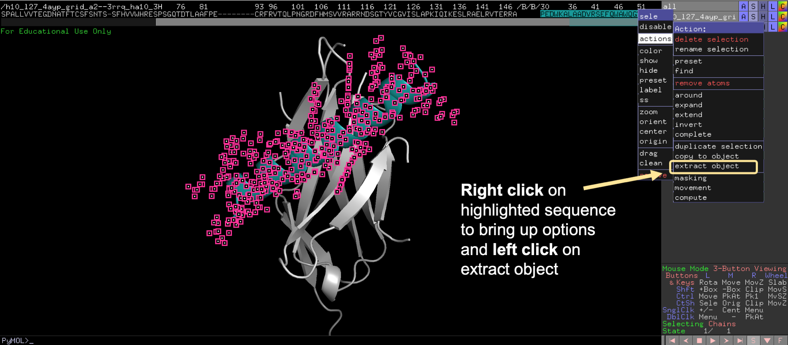

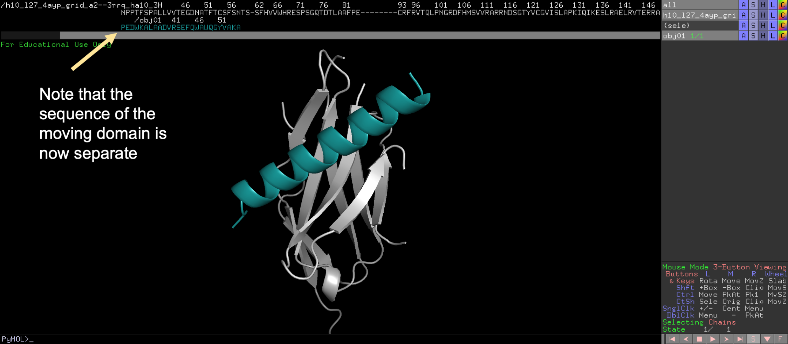

Segundo, localiza el panel «Mouse Mode» en la parte inferior derecha de la pantalla y haz clic para cambiar a 3-Button Editing. 

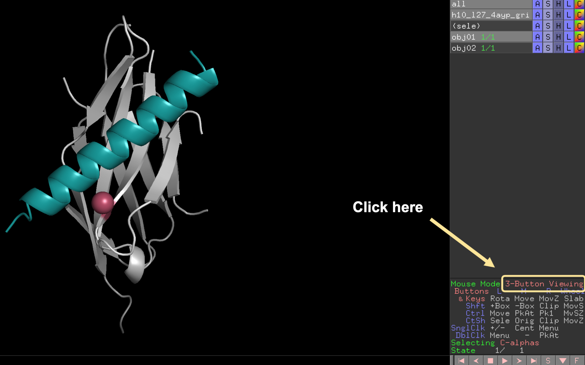

En el modo 3-Button Editing, el objeto extraído puede trasladarse hacia dentro y hacia fuera de la pantalla y rotarse. Para rotar el dominio, pulsa la tecla shift y haz clic izquierdo con el ratón. Usa estos dos movimientos para mover el dominio extraído hasta que el centro de la proteína móvil esté en el centro de la proteína estática. 

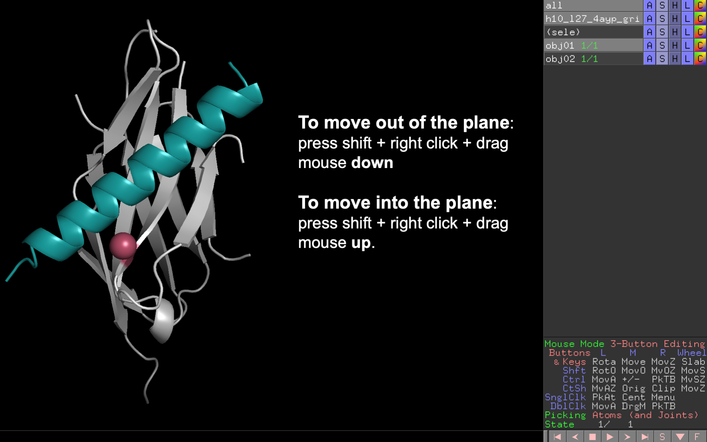

💡 Consejo para el usuario: para **trasladar** hacia dentro y hacia fuera de la pantalla, pulsa **la tecla shift + clic derecho + arrastra el ratón hacia arriba o hacia abajo**.

💡 Consejo para el usuario: para **rotar** el dominio, pulsa **la tecla shift + clic izquierdo + mueve el ratón en cualquier dirección**.

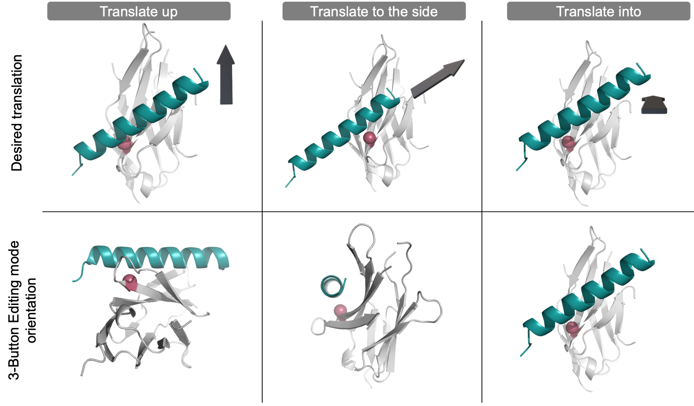

**Traslada objetos en PyMOL para crear una estructura de entrada personalizada.** El modo 3-Button Editing de PyMOL solo puede trasladar el objeto de la hélice verde azulado «hacia dentro y hacia fuera» del «plano z». Para trasladar el objeto de la hélice verde azulado en cualquier plano (véase el panel superior, indicado por la flecha 3D gris), primero coloca la estructura (véanse los paneles inferiores) de modo que el objeto de la hélice verde azulado esté en el «plano z» antes de trasladar el objeto hacia dentro y hacia fuera del «plano z». Para ayudar a visualizar la orientación de la estructura global, se ha coloreado de rosa un residuo de la proteína gris claro. 

Desde esta orientación, configura el sistema de coordenadas personalizado según [estas recomendaciones](#residue-selectors). 

Cuarto, exporta el nuevo Pose de entrada como un nuevo archivo .pdb.

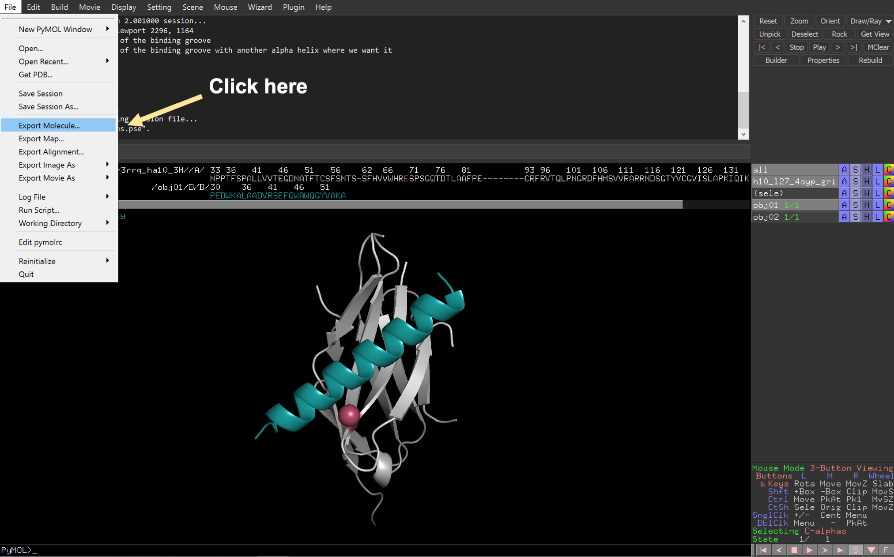

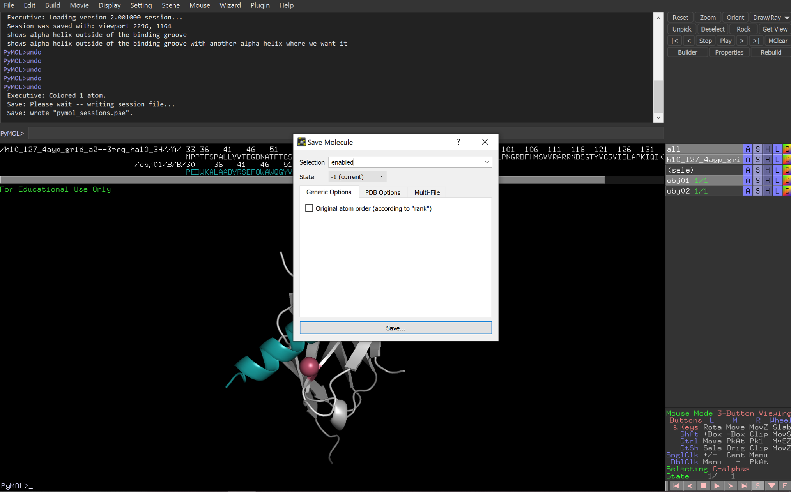

## 2: Visualizar el sistema de coordenadas

El usuario debería tener ahora un archivo pdb de entrada que contiene los dominios estático y móvil, y saber qué tres residuos se usarán para generar el sistema de coordenadas. A continuación, para entender el sistema de coordenadas basado en residuos, el usuario debe hacer seis ejecuciones de prueba simplificadas. Cada ejecución de prueba solo moverá el dominio móvil a lo largo de un grado de libertad. Estas ejecuciones rápidas ayudarán al usuario a entender el movimiento independiente de cada parámetro de docking en el espacio 3D.  

Multistage Rosetta Scripts se usa para dirigir fácilmente la salida del docking a una etapa de diseño. A continuación hay algunos consejos útiles para configurar un Multistage Rosetta Script básico. Puedes saber más sobre Multistage Rosetta Scripts [aquí](https://www.rosettacommons.org/docs/latest/scripting_documentation/RosettaScripts/multistage/MultistageRosettaScripts). Aunque esta ejecución inicial usa un Multistage Rosetta Script sencillo de una sola etapa, este script puede usarse como base para construir un script más complejo.

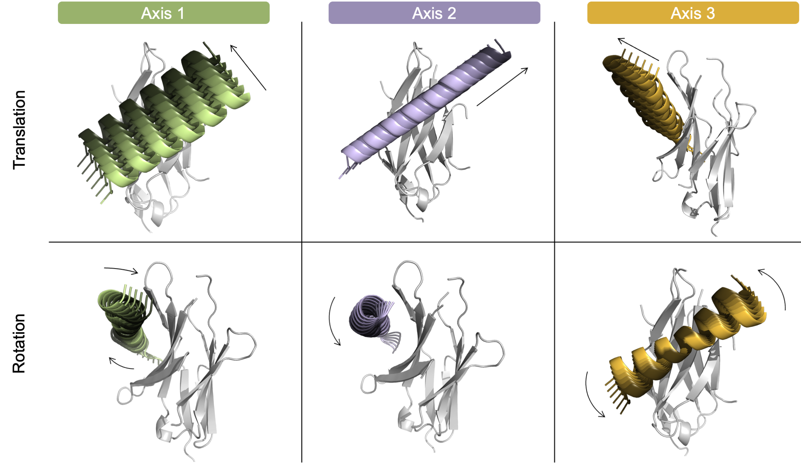

**Movimiento controlado por el usuario de cada grado de libertad individual.** Para destacar que el usuario puede controlar de forma independiente la dirección de cada parámetro de docking, arriba se muestra cada uno de los seis grados de libertad en un sistema modelo. Traslación (arriba) y rotación (abajo) del dominio móvil helicoidal alrededor de tres ejes: Eje 1 (verde, izquierda), Eje 2 (morado, centro) y Eje 3 (naranja, derecha). Cada hélice está coloreada de claro a oscuro para representar los valores de negativos a positivos. Para mayor claridad, las imágenes no se muestran desde el mismo ángulo; en su lugar, las imágenes destacan el movimiento de cada DoF.


### Formato XML de ejemplo

A continuación hay un extracto de un Multistage Rosetta Script de ejemplo de una sola etapa que prueba el rango de traslación de -10 a 10 con un tamaño de paso de 2 Å para el Eje 2. Para «desactivar» los otros cinco DoF, se dio una opción de valor de 0. Se ejecutan las 11 trayectorias posibles y se conservan todos los Poses de salida si superan el filtro. 

Ten en cuenta que este docking usa una función de puntuación basada en centroide. La puntuación en modo centroide se informa en el scorefile de salida mediante [FilterReportAsPoseExtraScoresMover](https://new.rosettacommons.org/docs/latest/scripting_documentation/RosettaScripts/Movers/movers_pages/FilterReportAsPoseExtraScoresMover) como cen_total_score .

```xml
<RESIDUE_SELECTORS>

	<Index name="res_1" resnums="66A"/>
	<Index name="res_2a" resnums="43B"/>
	<Index name="res_2b" resnums="54B"/>

</RESIDUE_SELECTORS>
```    

```xml
<MOVERS>

	<SixDoFGridDockMover name = "test_one_DoF"
		dof_residue_selector_1 = "res_1"
		dof_residue_selector_2a = "res_2a"
		dof_residue_selector_2b = "res_2b"
		values_trans_axis_1 = "0"
		range_trans_axis_2 = "-10,10,2"
		values_trans_axis_3 = "0"
		values_rot_axis_1 = "0"
		values_rot_axis_2 = "0"
		values_rot_axis_3 = "0" />

	<FilterReportAsPoseExtraScoresMover name="save_f_cen_total_score" report_as="cen_total_score" filter_name="f_total_score"/>

</MOVERS>
```

```xml
<PROTOCOLS>

	<Stage num_runs_per_input_struct="11" total_num_results_to_keep="11">
	       <Add mover="test_one_DoF"/>
	       <Add mover="save_f_cen_total_score"/>
	       <Sort negative_score_is_good="true" filter="f_total_score"/>
	</Stage>

</PROTOCOLS>
```


## 3: Fijar un espacio de búsqueda de grid dock de grano grueso

El usuario debería entender ya cómo se mueve el dominio móvil respecto al dominio estático dentro del sistema de coordenadas personalizado por el usuario. Para probar el espacio de búsqueda de docking con los seis DoF activados, configura una ejecución de docking de grano grueso. Este paso es importante para comprobar que los parámetros de muestreo crean un espacio de búsqueda de grano grueso razonable: es fácil crear sin querer un espacio de búsqueda demasiado grande. 

Una ventaja de un protocolo personalizado por el usuario es controlar el [giro (roll)](https://upload.wikimedia.org/wikipedia/commons/thumb/7/7d/Roll_pitch_yaw_mnemonic.svg/440px-Roll_pitch_yaw_mnemonic.svg.png) (o la rotación del Eje 2 en este ejemplo) de una buena conformación que podría beneficiarse de un muestreo de rotación adicional para probar distintas caras de la hélice, por ejemplo.

💡 Consejo para el usuario: para iniciar una búsqueda de grano grueso, se recomienda muestrear con un tamaño de paso de traslación de 5 Å y un tamaño de paso de rotación de 10-20°.

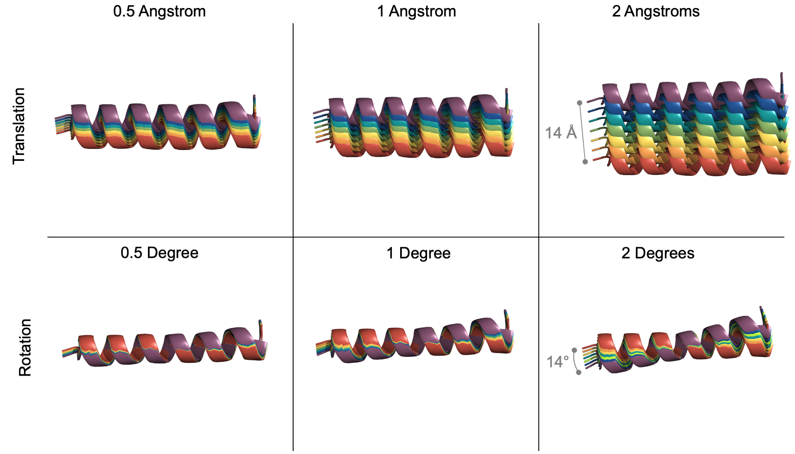

**Granularidad controlada por el usuario para cada grado de libertad.** Para ayudar al usuario a visualizar el tamaño de paso de cada parámetro de docking, arriba se muestra una traslación (arriba) y una rotación (abajo) de ejemplo con varios tamaños de paso (0.5, 1, 2). En cada ejemplo, 7 hélices están coloreadas de rojo a morado para representar un nuevo Pose en cada paso sucesivo.


### Formato XML de ejemplo

A continuación hay un extracto de un Multistage Rosetta Script de ejemplo de una sola etapa que prueba distintas combinaciones de los seis DoF, usando la opción de rango. Tal como está escrito, este espacio de muestreo genera 2,430 archivos de salida. Se ejecutan las 2,430 trayectorias posibles, pero solo se conservan los 1,000 mejores Poses ordenados por puntuación.

Este protocolo de docking usa una función de puntuación basada en centroide. Por ello, durante la etapa se guardan las cadenas laterales del Pose de entrada y el Pose se convierte a modo centroide.

💡 Consejo para el usuario: una vez que el usuario ha configurado los DoF, puede que no sepa cuántas trayectorias son posibles. Para determinar el espacio de búsqueda de un trabajo, busca la salida impresa en pantalla durante la ejecución: ```Dim sizes: 3 3 3 3 10 3```, por ejemplo. Para esta ejecución, esto significa que hay 3x3x3x3x10x3, es decir, 2,430 trayectorias posibles.

💡 Consejo para el usuario: para muestrear el [giro (roll)](https://upload.wikimedia.org/wikipedia/commons/thumb/7/7d/Roll_pitch_yaw_mnemonic.svg/440px-Roll_pitch_yaw_mnemonic.svg.png) (o la rotación del Eje 2 en este ejemplo), el usuario fijó el rango de rotación de 0 a 180 con un tamaño de paso de 20 grados.


```xml                                                                                                                                                                                                                                                                                            
<RESIDUE_SELECTORS>

	<Index name="res_1" resnums="66A"/>
	<Index name="res_2a" resnums="43B"/>
	<Index name="res_2b" resnums="54B"/>

</RESIDUE_SELECTORS>                                                                                                                                                                                                                                                                             
```

```xml
<MOVERS>

	<SixDoFGridDockMover name = "coarse_grid_dock"
		dof_residue_selector_1 = "res_1"
		dof_residue_selector_2a = "res_2a"
		dof_residue_selector_2b = "res_2b"
		range_trans_axis_1 = "-5,5,5"
		range_trans_axis_2 = "-5,5,5"
		range_trans_axis_3 = "0,10,5"
		range_rot_axis_1 = "-10,10,10"
		range_rot_axis_2 = "0,180,20"
		range_rot_axis_3 = "-10,10,10" />
		
	<FilterReportAsPoseExtraScoresMover name="save_f_cen_total_score" report_as="cen_total_score" filter_name="f_total_score"/>

</MOVERS>
```

```xml
<PROTOCOLS>

	<Stage num_runs_per_input_struct="2430" total_num_results_to_keep="1000">
	       <Add mover="sr_side_chains"/>
	       <Add mover="full_centro"/>
	       <Add mover="coarse_grid_dock"/>
	       <Add mover="save_f_cen_total_score"/>
	       <Add mover="centro_full"/> 
	       <Add mover="sr_side_chains"/>
	       <Sort negative_score_is_good="true" filter="f_total_score"/>        
	</Stage>

</PROTOCOLS>
```


💡 Consejo para el usuario: las ejecuciones grandes pueden tardar. Para comprobar rápidamente el progreso de la ejecución, mira la salida más reciente impresa en pantalla: ```protocols.simple_moves.SixDoFGridDockMover: dof_sample_index547```, por ejemplo. En ese momento, por ejemplo, la ejecución estaría en la trayectoria 547. 


## 4: Ampliar los mejores Poses del grid dock con docking local

El usuario puede usar un Multistage Rosetta Script de dos etapas para explorar más el espacio de docking ampliando los mejores diseños de la primera etapa, permitiendo ligeras rotaciones y traslaciones aleatorias.

### Formato XML de ejemplo

A continuación hay un extracto de un script de ejemplo de dos etapas que selecciona los mejores Poses de la etapa anterior y luego multiplica cada Pose por 10. Los Poses resultantes se hacen únicos mediante ligeros movimientos aleatorios de rotación y traslación con el mover [DockingInitialPertubation](https://new.rosettacommons.org/docs/latest/scripting_documentation/RosettaScripts/Movers/movers_pages/DockingInitialPerturbationMover). 

En este ejemplo, la primera etapa generó 2,430 Poses de salida. Como máximo, los 1,000 mejores Poses podían pasar a la siguiente etapa, donde se les dan 10 oportunidades de ampliación con docking local con rotaciones de 5 grados y traslaciones de 1 Å. Los 100 mejores Poses resultantes se conservan al final de la segunda etapa, ordenados por puntuación.

```xml
<RESIDUE_SELECTORS>

	<Index name="res_1" resnums="66A"/>
	<Index name="res_2a" resnums="43B"/>
	<Index name="res_2b" resnums="54B"/>

</RESIDUE_SELECTORS>
```

```xml
<MOVERS>

	<SixDoFGridDockMover name = "coarse_grid_dock"
		dof_residue_selector_1 = "res_1"
		dof_residue_selector_2a = "res_2a"
		dof_residue_selector_2b = "res_2b"
		range_trans_axis_1 = "-5,5,5"
		range_trans_axis_2 = "-5,5,5"
		range_trans_axis_3 = "0,10,5"
		range_rot_axis_1 = "-10,10,10"
		range_rot_axis_2 = "0,180,20"
		range_rot_axis_3 = "-10,10,10" />

	<FilterReportAsPoseExtraScoresMover name="save_f_cen_total_score" report_as="cen_total_score" filter_name="f_total_score"/>

	<FilterReportAsPoseExtraScoresMover name="save_f_cen_total_score_2" report_as="cen_total_score_2" filter_name="f_total_score"/>

	<DockSetupMover name="local_dock_setup" partners="A_B"/>

	<DockingInitialPerturbation dock_pert="1" name="local_dock" randomize2="0" rot="5" trans="1"/>

</MOVERS>
```

```xml
<PROTOCOLS>

	<Stage num_runs_per_input_struct="2430" total_num_results_to_keep="1000">
	       <Add mover="sr_side_chains"/>
	       <Add mover="full_centro"/>
	       <Add mover="coarse_grid_dock"/>
	       <Add mover="save_f_cen_total_score"/>
	       <Add mover="centro_full"/> 
	       <Add mover="sr_side_chains"/>
	       <Sort negative_score_is_good="true" filter="f_total_score"/>        
	</Stage>

	<Stage num_runs_per_input_struct="10" total_num_results_to_keep="100">
	       <Add mover="sr_side_chains"/>
	       <Add mover="full_centro"/>
	       <Add mover="local_dock_setup"/>
	       <Add mover="local_dock"/>
	       <Add mover="save_f_cen_total_score_2"/>
	       <Add mover="centro_full"/> 
	       <Add mover="sr_side_chains"/>
	       <Sort negative_score_is_good="true" filter="f_total_score"/>        
	</Stage>

</PROTOCOLS>
```

💡 Consejo para el usuario: tras terminar la ejecución, comprueba cómo cambia la puntuación en modo centroide entre la etapa 1 y la etapa 2 (grid docking y refinamiento con docking local, respectivamente) de una misma construcción, que se informan como ```cen_total_score``` y ```cen_total_score_2```, respectivamente. 


## 5: Continuar el docking con diseño

El usuario debería tener ahora un espacio de muestreo de docking optimizado, listo para integrarse en un protocolo de diseño. El siguiente Multistage Rosetta Script de tres etapas puede servir de plantilla para combinar varios protocolos de docking con un protocolo de diseño final. Multistage Rosetta Scripts es un método eficiente en tiempo para diseñar solo los mejores Poses acoplados. 

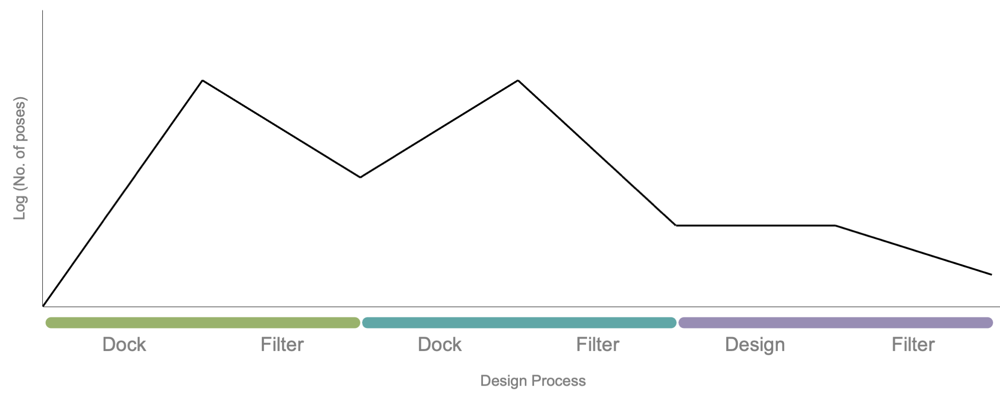

**Etapas de docking y diseño con Multistage Rosetta Scripts.** En este ejemplo, un Pose de entrada se acopla y se diseña con un Multistage Rosetta Script de tres etapas. La primera etapa (verde) contiene un paso de docking que amplía el número de Poses (línea negra) y termina con un paso de filtro que elimina los Poses con mala puntuación. Los Poses restantes se canalizan hacia la siguiente etapa. La segunda etapa (verde azulado) contiene un paso de docking que de nuevo amplía el número de Poses y termina con un paso de filtrado. La salida restante se dirige a una etapa de diseño (morado) que termina con un paso de filtrado final.


### Filtros de etapa sugeridos

Multistage Rosetta Scripts permite al usuario aplicar filtros dentro de la etapa (opcional) y al final de cada etapa, lo que se conoce como [ordenación (sorting)](https://www.rosettacommons.org/docs/latest/scripting_documentation/RosettaScripts/multistage/StageOptions#stage-options_sort). En general, las métricas de filtrado y ordenación recomendadas incluyen la puntuación total, las [restricciones de distancia](https://www.rosettacommons.org/docs/latest/DistanceConstraintGenerator), el [número de contactos dentro de una región dada](https://www.rosettacommons.org/docs/latest/scripting_documentation/RosettaScripts/Filters/filter_pages/ResidueCountFilter) y/o la [complementariedad de forma](https://www.rosettacommons.org/docs/latest/scripting_documentation/RosettaScripts/Filters/filter_pages/ShapeComplementarityFilter). Además, se recomienda encarecidamente incluir el [InterfaceAnalyzerMover](https://www.rosettacommons.org/docs/latest/scripting_documentation/RosettaScripts/Movers/movers_pages/analysis/InterfaceAnalyzerMover) después del paso de diseño.


### Formato XML de ejemplo

A continuación hay un extracto de un script de ejemplo de tres etapas que selecciona los mejores Poses de las dos etapas de docking anteriores y luego los envía a una etapa de diseño que utiliza [FastDesign](https://www.rosettacommons.org/docs/latest/scripting_documentation/RosettaScripts/Movers/movers_pages/FastDesignMover). Los 10 mejores Poses resultantes se conservan al final de la segunda etapa, ordenados por puntuación.

```xml
<RESIDUE_SELECTORS>

	<Index name="res_1" resnums="66A"/>
	<Index name="res_2a" resnums="43B"/>
	<Index name="res_2b" resnums="54B"/>
	
</RESIDUE_SELECTORS>
```
    
```xml
<MOVERS>

	<SixDoFGridDockMover name = "coarse_grid_dock"
		dof_residue_selector_1 = "res_1"
		dof_residue_selector_2a = "res_2a"
		dof_residue_selector_2b = "res_2b"
		range_trans_axis_1 = "-5,5,5"
		range_trans_axis_2 = "-5,5,5"
		range_trans_axis_3 = "0,10,5"
		range_rot_axis_1 = "-10,10,10"
		range_rot_axis_2 = "0,180,20"
		range_rot_axis_3 = "-10,10,10" />

	<FilterReportAsPoseExtraScoresMover name="save_f_cen_total_score" report_as="cen_total_score" filter_name="f_total_score"/>

	<FilterReportAsPoseExtraScoresMover name="save_f_cen_total_score_2" report_as="cen_total_score_2" filter_name="f_total_score"/>

	<DockSetupMover name="local_dock_setup" partners="A_B"/>

	<DockingInitialPerturbation dock_pert="1" name="local_dock" randomize2="0" rot="5" trans="1"/>

	<FastDesign name="fast-design-1" relaxscript="MonomerDesign2019" repeats="1" scorefxn="sfxn_high-res" task_operations="NO_design_to,designable_to,ifcl_to,extra_chi"/>

	<InterfaceAnalyzerMover name="IfaceAnalyzer" scorefxn="sfxn_basic" packstat="1" interface_sc="false" pack_input="false" pack_separated="1" ligandchain="B" tracer="false" />

</MOVERS>
```

```xml
<PROTOCOLS>

	<Stage num_runs_per_input_struct="2430" total_num_results_to_keep="1000">
	       <Add mover="sr_side_chains"/>
	       <Add mover="full_centro"/>
	       <Add mover="coarse_grid_dock"/>
	       <Add mover="save_f_cen_total_score"/>
	       <Add mover="centro_full"/> 
	       <Add mover="sr_side_chains"/>
	       <Sort negative_score_is_good="true" filter="f_total_score"/>        
	</Stage>

	<Stage num_runs_per_input_struct="10" total_num_results_to_keep="10">
	       <Add mover="sr_side_chains"/>
	       <Add mover="full_centro"/>
	       <Add mover="local_dock_setup"/>
	       <Add mover="local_dock"/>
	       <Add mover="save_f_cen_total_score_2"/>
	       <Add mover="centro_full"/> 
	       <Add mover="sr_side_chains"/>
	       <Sort negative_score_is_good="true" filter="f_total_score"/>        
	</Stage>

	<Stage num_runs_per_input_struct="1" total_num_results_to_keep="10" >
	       <Add mover="bb_cst"/>
	       <Add mover="fast-design-1"/>
	       <Add mover="IfaceAnalyzer"/>
	       <Sort negative_score_is_good="true" filter="f_total_score"/>
	</Stage>

</PROTOCOLS>
```


# Analizar las estructuras de salida

El scorefile de salida contiene los siguientes encabezados para los seis DoF: ```axis1_rot```, ```axis1_trans```, ```axis2_rot```, ```axis2_trans```, ```axis3_rot``` y ```axis3_trans```. Ten en cuenta que los encabezados aparecen en orden alfabético en el scorefile, no en el orden en que se recorren.  


# Posibles errores y sus soluciones

Esta sección detalla algunos de los errores comunes que pueden ocurrir al usar este mover. 

**Selección de los selectores de residuos:**


* El usuario debe proporcionar exactamente tres residuos al mover, que se usan para generar un sistema de coordenadas único.

    ```
    ERROR: Please declare three residue selectors in the mover option.
    ```

* Al proporcionar selectores de residuos, el mover terminará cuando los selectores de residuos no estén dentro del rango ideal de 60-120° con ```res_2a``` en el vértice. Para anular esta comprobación, pon ```degree_check``` en false.

    ```
    ERROR: Poorly chosen residue selectors. Angle is outside the range of 60-120 degrees.
    ```
    
**Definición de la opción de rango/valor:**


* Al usar la opción de rango, el usuario debe proporcionar un tamaño de paso mayor que cero.

    ```
    ERROR: User has entered 0 for the step size. Change step size to a non-zero value.
    ```

    ```
    ERROR: User has entered a value less than 0 for the step size. Change step size to a positive value greater than zero.
    ```

* Al usar la opción de rango, el usuario debe proporcionar una lista separada por comas con el mínimo, el máximo y el tamaño de paso (en ese orden).

    ```
    ERROR: User has not provided three values for the range option as: minimum, maximum, and step size.
    ```
    
* El usuario debe proporcionar una opción de rango o de valor para cada DoF.


    ```
    ERROR: User cannot provide *both* a range option and a value option for a single DOF.
    ```

    ```
    ERROR: User must provide at least one option (either range option or value option) for each DOF to be sampled.
    ```
    
**Definición de los parámetros de Multistage Rosetta Script:**


* Al usar Multistage Rosetta Scripts junto con este mover, es importante que el número de ejecuciones por estructura de entrada (```num_runs_per_input_struct```) no supere el número de trayectorias dados los valores de DoF. De lo contrario, la ejecución fallará al final con los siguientes errores:

    ```
    ERROR: Assertion `static_cast&lt; size_type >( i - l_ ) &lt; super::size()` failed.
    ```
    
    ```
    ERROR:: Exit from: src/utility/vectorL.hh line: 431
    ```

    Ten en cuenta que, si ```num_runs_per_input_struct``` es menor que el número de trayectorias, el trabajo no fallará, pero tampoco ejecutará las trayectorias restantes. Por tanto, es importante fijar ```num_runs_per_input_struct``` igual al número previsto de trayectorias.

* Al usar Multistage Rosetta Scripts junto con este mover, se puede conservar parte o la totalidad de los Poses de salida. Para conservar todos los Poses de salida, fija el número total de resultados que se conservan (```total_num_results_to_keep```) en el mismo valor usado para ```num_runs_per_input_struct```.

**Fijación del tamaño de la muestra:**


* El usuario debe proporcionar un espacio de búsqueda que genere menos de 10,000 Poses acoplados. Alternativamente, el usuario debe fijar ```max_samples``` en un valor mayor que el espacio de búsqueda generado. Más información sobre ```max_samples``` [aquí](#max-samples-check).

    Ten en cuenta que Multistage Rosetta Scripts requiere un parámetro parecido pero distinto, llamado ```num_runs_per_input_struct```, que debe fijarse en el valor _exacto_ del tamaño de muestra esperado (el producto de cada dimensión para los seis DoF).

    ```
    ERROR: Based on user input DoF values, the scope of the search exceeds either the user input or default value (of 10,000) for the maximum number of samples. Exiting. Change max samples with the max_samples option.
    ```

**Ejecución en Rosetta tradicional:**


* El usuario debe usar la opción ```-run:reinitialize_mover_for_each_job``` para muestrear todo el espacio cuando se usan los scripts de Rosetta tradicionales.

    ```
    ERROR: When using the SixDoFGridDockMover with the jd2 job distributor, the user must include the -run:reinitialize_mover_for_each_job flag or the mover will not enumerate the full set of combinations.
    ```


# Véase también

[Multistage Rosetta Scripts](https://www.rosettacommons.org/docs/latest/scripting_documentation/RosettaScripts/multistage/MultistageRosettaScripts)

[Protocolo de docking (RosettaDock)](https://www.rosettacommons.org/docs/latest/application_documentation/docking/docking-protocol)

[Mover DockingInitialPertubation](https://new.rosettacommons.org/docs/latest/scripting_documentation/RosettaScripts/Movers/movers_pages/DockingInitialPerturbationMover)

[FilterReportAsPoseExtraScoresMover](https://new.rosettacommons.org/docs/latest/scripting_documentation/RosettaScripts/Movers/movers_pages/FilterReportAsPoseExtraScoresMover)

[Mover FastDesign](https://www.rosettacommons.org/docs/latest/scripting_documentation/RosettaScripts/Movers/movers_pages/FastDesignMover)

[Mover InterfaceAnalyzerMover](https://www.rosettacommons.org/docs/latest/scripting_documentation/RosettaScripts/Movers/movers_pages/analysis/InterfaceAnalyzerMover)
