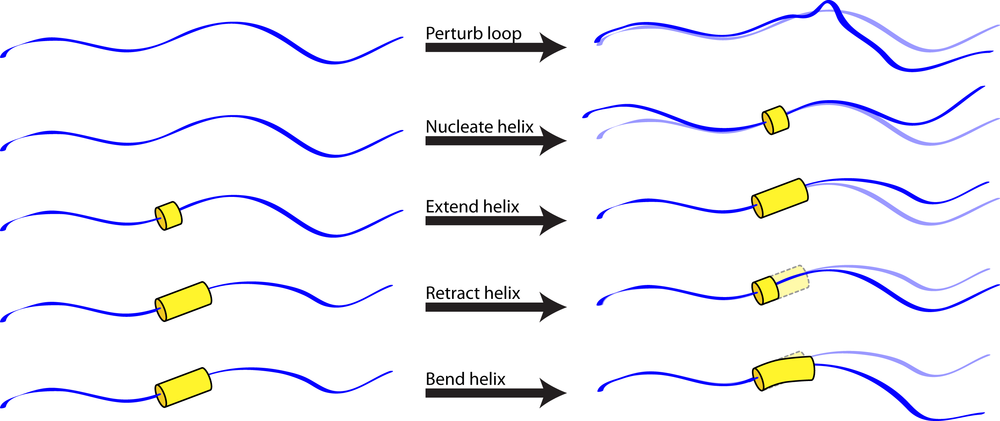
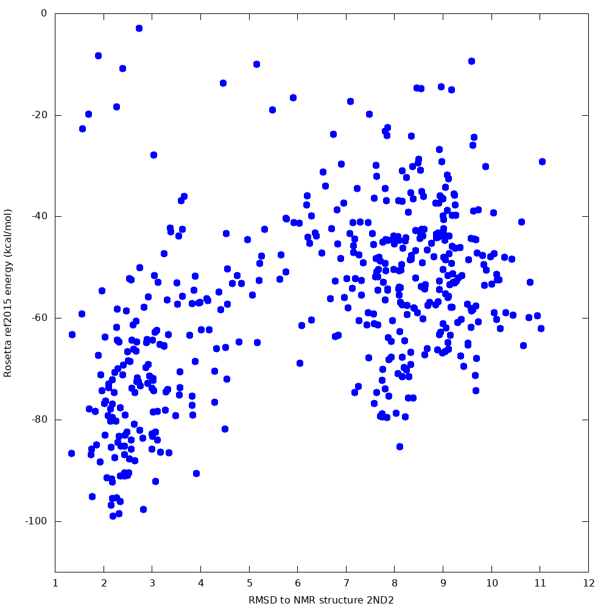
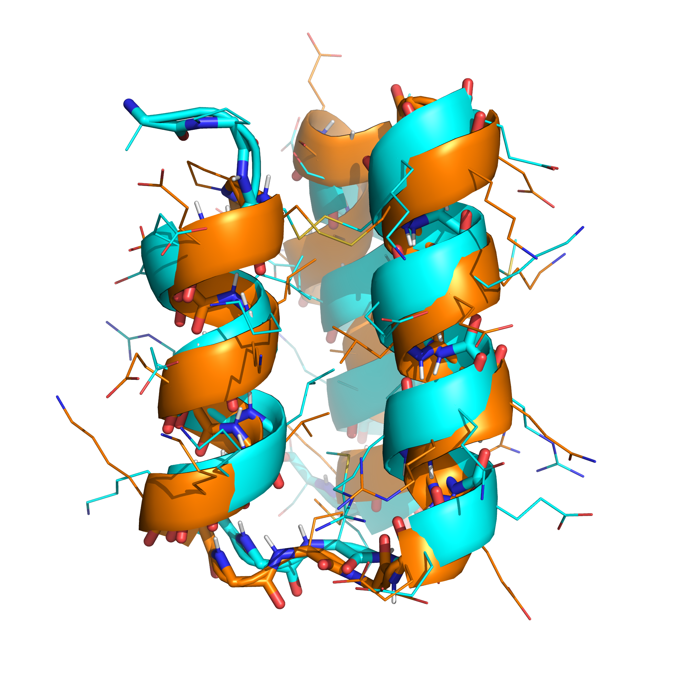

# Predicción de estructuras de haces helicoidales sin fragmentos con la aplicación helical\_bundle\_predict

Volver a [[Application Documentation]].

Creado el 21 de agosto de 2019 por Vikram K. Mulligan, Flatiron Institute (vmulligan@flatironinstitute.org).  Última actualización: 14 de noviembre de 2020.<br/><br/>
<b><i>¡Esta aplicación todavía no está publicada!  Si usas esta aplicación, incluye al desarrollador en la lista de autores de tu artículo.</i><br/>

[[_TOC_]]

## Descripción

La aplicación de predicción de estructuras más utilizada de Rosetta, [[Rosetta ab initio|abinitio-relax]], se basa en fragmentos de proteínas de estructura conocida para guiar la búsqueda en el espacio de conformaciones y para limitarla al subconjunto, muy pequeño, del espacio que se parece a las estructuras de proteínas conocidas.  Esto funciona razonablemente bien para proteínas naturales, pero impide predecir estructuras construidas con bloques de construcción no naturales.  En 2015 presentamos la aplicación [[simple_cycpep_predict]] para permitir la predicción de estructuras de heteropolímeros pequeños construidos con cualquier mezcla de bloques de construcción químicos, sin secuencias plantilla conocidas.  La aplicación [[simple_cycpep_predict]] usa el algoritmo de [[cierre cinemático generalizado|GeneralizedKIC]] para confinar la búsqueda a conformaciones cerradas de un macrociclo, lo que limita eficazmente el espacio de búsqueda sin depender de bases de datos de estructuras conocidas.  Por desgracia, esto solo funciona para moléculas relativamente pequeñas (de menos de unos 15 residuos), moléculas con regiones de estructura secundaria conocida (con menos de unos 10 residuos de loop) o moléculas con simetría interna (con menos de unos 8 residuos en la unidad repetida), y requiere absolutamente una unión covalente entre los extremos de la molécula.  Hace falta una estrategia de predicción para heteropolímeros lineales más grandes construidos con bloques de construcción no naturales.

La aplicación helical\_bundle\_predict se creó para cubrir este nicho.  Partiendo de la hipótesis de que los fragmentos son útiles sobre todo para muestrear los giros permitidos de estructuras secundarias conocidas (que se pueden muestrear con [[enfoques paramétricos|MakeBundleMover]], dadas unas estructuras secundarias del heteropolímero que se pueden predecir _a priori_) o las conformaciones de loop permitidas (que se pueden muestrear con perturbaciones aleatorias o con [[enfoques cinemáticos|GeneralizedKIC]]), esta aplicación realiza una búsqueda Monte Carlo en el espacio de conformaciones en la que los movimientos permitidos incluyen:
- Aleatorización de una posición de loop (sesgada por el mapa de Ramachandran de ese residuo).
- Pequeña perturbación aleatoria de una posición de loop.
- Nucleación de una vuelta de hélice (con el [[mover MakeBundle|MakeBundleMover]]).
- Elongación de una región helicoidal (con posible fusión de dos regiones helicoidales).
- Contracción de una región helicoidal.
- Pequeña perturbación aleatoria de los parámetros de Crick que describen una hélice dada (con el [[mover PerturbBundle|PerturbBundleMover]]), para permitir que las hélices se doblen y formen superenrollamientos.



Ten en cuenta que, como las hebras son casos especiales de hélices en las que el giro por residuo es de unos 180 grados, este enfoque debería ser suficientemente general para cualquier estructura secundaria de proteína o heteropolímero.

## Ejemplos

### Predicciones con un solo núcleo

La compilación predeterminada de Rosetta permite al usuario lanzar una instancia de la aplicación helical\_bundle\_predict que usará un núcleo de CPU para calcular una trayectoria (o, si se piden muchas trayectorias con la opción `-nstruct`, se ejecutarán muchas trayectorias en secuencia).

Supongamos que queremos predecir la estructura de una miniproteína pequeña de haz de 3 hélices diseñada _de novo_, como el [PDB ID 2ND2](https://www.rcsb.org/structure/2ND2) (diseñada por Chris Bahl).  La siguiente línea de comandos generaría 500 estructuras muestreadas:

```sh
<path_to_rosetta>/Rosetta/main/source/bin/helical_bundle_predict.default.linuxgccrelease -in:file:fasta inputs/seq.txt -nstruct 500 -in:file:native inputs/2nd2.cif -in:file:fullatom -helical_bundle_predict:helix_assignment_file inputs/2nd2.helix_assignments -helical_bundle_predict:num_steps_per_simulated_annealing_round_centroid 1000 -helical_bundle_predict:num_simulated_annealing_rounds_centroid 5 -out:file:silent output.silent
```

Esto supone que, en un subdirectorio `inputs/` de tu directorio de trabajo, tienes un archivo de secuencia en formato FASTA `seq.txt` que contiene la secuencia de 2ND2, la estructura nativa de 2ND2 (`2nd2.cif`) y un archivo de asignación de hélices (`2nd2.helix_assignments`) que especifica las regiones helicoidales esperadas de la estructura.  Consulta la sección *Entradas*, más abajo, para ver un ejemplo de este archivo para 2ND2.  Ten en cuenta que la estructura nativa es opcional.  Sin ella, no se calcularán los valores de RMSD respecto a la nativa.  Todas las estructuras muestreadas se escribirán en output.silent.

Cuando probamos este protocolo, 500 muestras produjeron una muestra de energía más baja a 2.4 ångström de la nativa, con un embudo claro hacia el estado nativo:



La muestra de energía más baja (en naranja, abajo) tenía una topología muy parecida a la de la estructura nativa (en cian), y se encontró la conectividad correcta de los puentes disulfuro:



### Predicciones en paralelo en un clúster

Normalmente se dispone de muchos núcleos para la predicción.  La forma habitual de aprovecharlos es ejecutar muchas instancias independientes de Rosetta en paralelo; en este caso, lanzar tantas copias de la aplicación helical\_bundle\_predict como núcleos se tengan.  Sin embargo, esto no es ideal por varios motivos:
- Las instancias independientes no equilibran necesariamente bien sus cargas.  (Si la primera instancia termina su trabajo en cinco minutos y la segunda aún tiene una larga lista de trabajos por hacer, esta no puede transferir parte de su trabajo a la primera.  Un núcleo se queda inactivo mientras otro hace mucho trabajo.)
- Las instancias independientes no pueden analizar el conjunto de estructuras generadas.  Todo análisis debe hacerse a posteriori.
- Cada instancia independiente carga en memoria una copia distinta de la base de datos de Rosetta, lo que puede impedir usar todos los núcleos en sistemas con poca memoria.
- Las instancias independientes leen y escriben en disco de forma independiente, lo que puede crear cuellos de botella cuando muchos procesos independientes acceden al hardware compartido en clústeres grandes.

Las compilaciones MPI y multihilo resuelven estos problemas.

#### Paralelismo con procesos de Message Passing Interface (MPI)

Con la compilación MPI de Rosetta (que se obtiene añadiendo `extras=mpi` al comando `scons` durante la compilación), se pueden lanzar muchos procesos helical\_bundle\_predict en paralelo.  Estos procesos pueden comunicarse entre sí, lo que permite equilibrar la carga, distribuir datos (reduciendo las lecturas de disco), que un proceso dedicado se encargue de la salida (reduciendo las escrituras en disco) y analizar los datos de todo el conjunto de muestras.  En modo MPI, la aplicación helical\_bundle\_predict establece una jerarquía de procesos MPI en la que un proceso director distribuye trabajo a cualquier número de capas de procesos gestores intermedios, y recoge sus resultados; estos, a su vez, distribuyen trabajo a un gran número de procesos trabajadores y recogen sus resultados.  (Estas capas se llamaban antes "emperor", "master" y "slave", y pueden aparecer así en versiones antiguas de Rosetta.)  Los trabajadores ejecutan el mismo algoritmo de predicción de estructuras que ejecuta la versión de un solo proceso de la aplicación.  Durante la recogida de resultados también se realiza un análisis de datos para (a) calcular métricas como <b><i>PNear</b></i>, que sirve como estimación de la fracción de tiempo que una molécula pasa en el estado nativo o cerca de él (véase Bhardwaj, Mulligan, Bahl _et al_. (2016) _Nature_ 538(7625):329-335 y Hosseinzadeh, Bhardwaj, Mulligan _et al_. (2017) _Science_ 358(6369):1461-1466), y (b) ordenar las muestras según alguna métrica para que solo se escriba un subconjunto en disco.

Para ejecutar la versión MPI, sigue las instrucciones de tu clúster.  A menudo se usa el comando `mpirun`:

```sh
mpirun -np <# of processes> <path_to_Rosetta>/Rosetta/main/source/bin/helical_bundle_predict.mpi.linuxgccrelease @flags.txt`
```

En lo anterior, las opciones de ejecución están en el archivo `flags.txt`.  Deben incluirse `-MPI_batchsize_by_level` y `-MPI_processes_by_level`, documentadas en la lista completa de opciones, más abajo.  Como alternativa a `-MPI_processes_by_level`, la opción `-MPI_auto_2level_distribution` permite configurar automáticamente un esquema de distribución de dos niveles en el que, dados N procesos en total, 1 proceso director se comunica con N-1 procesos trabajadores.  Esta opción no admite valores.

#### Paralelismo con procesos MPI más hilos

También se admite la distribución de trabajos multihilo.  Para habilitar el paralelismo híbrido basado en procesos e hilos, compila con `extras=cxx11threads,mpi,serialization`.  En la compilación MPI/multihilo, la aplicación helica\l_bundle\_predict envía los trabajos por una jerarquía de director/gestor/trabajador, como antes.  Sin embargo, cada trabajador puede lanzar varios hilos con los que procesar muestras en paralelo (por lo que es importante que cada trabajador reciba un lote de trabajos mayor que el número de hilos de trabajo que ha lanzado).  El número de hilos se controla con la opción `-threads_per_worker`.  Ten en cuenta que un hilo se usará para la comunicación MPI y el control de trabajos, por lo que, por ejemplo, lanzar 8 hilos da como resultado 7 hilos de trabajo.

## Entradas

### Archivo de asignación de hélices

Las posiciones de las hélices y las opciones de muestreo de los parámetros de Crick deben proporcionarse con un archivo de asignación de hélices en formato ASCII.  Este se pasa a la aplicación con la opción de entrada `helical\_bundle\_predict:helix_assignment_file`.  Como hay muchas formas de predecir la estructura secundaria a partir de la secuencia primaria, y de predecir los posibles tipos de hélice dado un conjunto de bloques de construcción del polímero, se supone que se podrán producir algunas estimaciones de las posiciones y los tipos de hélice y proporcionarlas como entrada.  Como el algoritmo nuclea, extiende y retrae hélices de forma estocástica, los tipos y rangos de hélice solo sirven de guía; las posiciones finales de las hélices pueden ser distintas.  Ten en cuenta también que se pueden especificar hebras, ya que, como se señaló antes, son casos especiales de hélices.  (En los archivos de asignación de hélices se siguen llamando «hélices».)

#### Ejemplo de archivo de asignación de hélices

A continuación se muestra un ejemplo de archivo de asignación de hélices para predecir el PDB ID 2ND2.  El bloque `BEGIN_GLOBALS`...`END_GLOBALS` especifica que el giro helicoidal (omega0) debe ser compartido por todas las hélices, pero el radio del haz (r0) y la rotación (delta_omega1) no.  Las hélices no pueden extenderse más allá de los límites definidos por el usuario; los valores de giro válidos van de -3 grados a +3 grados, los valores de radio del haz válidos van de 5 A a 8 A, y los valores de rotación válidos van de 0 a 360 grados.  Todas las hélices son hélices alfa estándar, definidas en el archivo `alpha_helix_100.crick_params` de la [[base de datos de Rosetta|Crick-params-files]].  Los movimientos Monte Carlo tienen un 1 % de probabilidad de nuclear una hélice, un 5 % de extenderla y un 3 % de retraerla.

Después, las hélices se definen en bloques `BEGIN_HELIX`...`END_HELIX`.  La primera va de la posición 3 a la 3, la segunda, de la 17 a la 30, y la tercera, de la 32 a la 43.  Ten en cuenta que la segunda y la tercera hélice anulan algunos de los parámetros predeterminados definidos en la sección de globales.

```
BEGIN_GLOBALS
        COMMON_OMEGA0 TRUE
        COMMON_R0 FALSE
        COMMON_DELTA_OMEGA1 FALSE
        CONFINE_TO_USER_DEFINED_HELICES TRUE
        OMEGA0_MIN -3
        OMEGA0_MAX 3
        R0_MIN 5
        R0_MAX 8
        DELTA_OMEGA1_MIN 0
        DELTA_OMEGA1_MAX 360
        CRICK_PARAMS_FILE alpha_helix_100.crick_params
        NUCLEATION_PROB 0.01
        EXTENSION_PROB 0.05
        RETRACTION_PROB 0.03
END_GLOBALS

BEGIN_HELIX
        START_RES 3
        END_RES 13
END_HELIX

BEGIN_HELIX
        START_RES 17
        END_RES 30
        R0_MIN 6
        R0_MAX 7
        DELTA_OMEGA1_MIN 45
        DELTA_OMEGA1_MAX 135
END_HELIX

BEGIN_HELIX
        START_RES 32
        END_RES 43
        NUCLEATION_PROB 0.02
        EXTENSION_PROB 0.03
        RETRACTION_PROB 0.01
END_HELIX
```

#### Formato del archivo de asignación de hélices

##### Comentarios y espacios en blanco

Se pueden incluir líneas de comentario con una almohadilla (#).  Todo lo que sigue a una almohadilla se ignora.  Todos los espacios en blanco se tratan por igual dentro de una línea (_es decir_, los espacios o tabuladores iniciales o finales no tienen más significado que la legibilidad para las personas).

##### Bloque de globales

Los ajustes globales se definen en un bloque que empieza con `BEGIN_GLOBALS` y termina con `END_GLOBALS`.  Los ajustes definidos en los ajustes globales pueden anularse hélice por hélice en los bloques de cada hélice.

| Ajuste | Descripción | Ejemplo |
| ------- | ----------- | ------- |
| COMMMON_R0 | ¿El valor de r0 (el radio de una hélice respecto al eje del haz) es compartido por todas las hélices o independiente? Ten en cuenta que esto no se puede anular hélice por hélice. | COMMON_R0 FALSE #Las hélices tienen r0 independiente |
| COMMMON_OMEGA0 | ¿El valor de omega0 (el giro helicoidal principal) es compartido por todas las hélices o independiente? Ten en cuenta que esto no se puede anular hélice por hélice. | COMMON_OMEGA0 TRUE #Las hélices comparten omega0 |
| COMMON_DELTA_OMEGA1 | ¿El valor de delta_omega1 (la rotación de una hélice sobre su propio eje) es compartido por todas las hélices o independiente? (Esto afecta a las hélices con valores de omega0 distintos de cero, que siguen una trayectoria de sacacorchos en el espacio y en las que distintas caras de la hélice podrían apuntar hacia el centro del sacacorchos.) Ten en cuenta que esto no se puede anular hélice por hélice. | COMMON_DELTA_OMEGA1 FALSE #Las hélices tienen delta_omega1 independiente |
| CONFINE_TO_USER_DEFINED_HELICES | Si es true, las hélices no pueden extenderse más allá de los límites de hélice definidos por el usuario.  Ten en cuenta que esto no se puede anular hélice por hélice. | CONFINE_TO_USER_DEFINED_HELICES TRUE #Se aplican los límites definidos por el usuario |
| R0_MIN | El radio mínimo de una hélice respecto al eje de la superhélice.  Se puede anular hélice por hélice. | R0_MIN 3.5 #Radio mínimo de 3.5 ångström |
| R0_MAX | El radio máximo de una hélice respecto al eje de la superhélice.  Se puede anular hélice por hélice. | R0_MAX 7.5 #Radio máximo de 7.5 ångström |
| OMEGA0_MIN | El giro mínimo de la superhélice.  Se puede anular hélice por hélice. | OMEGA0_MIN -3.5 #Giro mínimo de la superhélice de -3.5 grados |
| OMEGA0_MAX | El giro máximo de la superhélice.  Se puede anular hélice por hélice. | OMEGA0_MAX 2.5 #Giro máximo de la superhélice de +2.5 grados |
| DELTA_OMEGA1_MIN | La rotación mínima de una hélice sobre su propio eje.  Se puede anular hélice por hélice. | DELTA_OMEGA1_MIN 0 #Rotación axial mínima de 0 grados |
| DELTA_OMEGA1_MAX | La rotación máxima de una hélice sobre su propio eje.  Se puede anular hélice por hélice. | DELTA_OMEGA1_MAX 360 #Rotación axial máxima de 360 grados |
| NUCLEATION_PROB | La probabilidad fraccionaria de nuclear una hélice como movimiento Monte Carlo.  Se puede anular hélice por hélice. | NUCLEATION_PROB 0.01 # 1 % de probabilidad de nuclear una hélice en cualquier movimiento dado |
| EXTENSION_PROB | La probabilidad fraccionaria de extender una hélice como movimiento Monte Carlo.  Se puede anular hélice por hélice. | EXTENSION_PROB 0.05 # 5 % de probabilidad de hacer crecer una hélice en cualquier movimiento dado |
| RETRACTION_PROB | La probabilidad fraccionaria de retraer una hélice como movimiento Monte Carlo.  Se puede anular hélice por hélice. | RETRACTION_PROB 0.03 # 3 % de probabilidad de encoger una hélice en cualquier movimiento dado |
| GLOBAL_PERTURBATION_PROB | La probabilidad fraccionaria de realizar una perturbación global de los parámetros de Crick como movimiento Monte Carlo.  No se puede anular hélice por hélice. | GLOBAL_PERTURBATION_PROB 0.02 # 2 % de probabilidad de perturbaciones globales de los parámetros de Crick |
| FRACTIONAL_PERTURBATION_MAGNITUDE | El tamaño de las perturbaciones de los parámetros de Crick globales.  No se puede anular hélice por hélice. | FRACTIONAL_PERTURBATION_MAGNITUDE 0.1 # Los parámetros de Crick se perturban hasta un 10 %. |
| CRICK_PARAMS_FILE | El archivo de parámetros de Crick que define el tipo de hélice (o hebra).  Se puede anular hélice por hélice. | CRICK_PARAMS_FILE 14_helix.crick_params #Una hélice 14 de beta-aminoácidos |

##### Bloques de hélices individuales

Los ajustes de hélices individuales se especifican en bloques que empiezan con `BEGIN_HELIX` y terminan con `END_HELIX`.

| Ajuste | Descripción | Ejemplo |
| ------- | ----------- | ------- |
|START_RES| El primer residuo de la región en la que podría existir esta hélice, según la numeración de Rosetta (que empieza en 1). | START_RES 5 #Esta hélice empieza en algún punto a partir del residuo 5. |
|END_RES| El último residuo de la región en la que podría existir esta hélice, según la numeración de Rosetta (que empieza en 1). | END_RES 15 #Esta hélice termina en algún punto antes del residuo 15 o en él. |
| R0_MIN | Valor mínimo del radio respecto al eje de superenrollamiento.  Anula cualquier ajuste global.  No se puede usar con COMMON_R0. | R0_MIN 3.65 # Esta hélice tiene un radio mínimo respecto al eje de superenrollamiento de 3.65 ångström. |
| R0_MAX | Valor máximo del radio respecto al eje de superenrollamiento.  Anula cualquier ajuste global.  No se puede usar con COMMON_R0. | R0_MAX 8.0 # Esta hélice tiene un radio máximo respecto al eje de superenrollamiento de 8.0 ångström. |
| OMEGA0_MIN | Valor mínimo del giro de superenrollamiento.  Anula cualquier ajuste global.  No se puede usar con COMMON_OMEGA0. | OMEGA0_MIN -1.0 # Esta hélice tiene un superenrollamiento mínimo de -1.0 grados. |
| OMEGA0_MAX | Valor máximo del giro de superenrollamiento.  Anula cualquier ajuste global.  No se puede usar con COMMON_OMEGA0. | OMEGA0_MAX +1.0 # Esta hélice tiene un superenrollamiento máximo de +1.0 grados. |
| DELTA_OMEGA1_MIN | Valor mínimo de la rotación de una hélice sobre su propio eje.  Anula cualquier ajuste global.  No se puede usar con COMMON_DELTA_OMEGA1. | DELTA_OMEGA1_MIN 45 # Esta hélice tiene una rotación mínima sobre su propio eje de 45 grados. |
| DELTA_OMEGA1_MAX | Valor máximo de la rotación de una hélice sobre su propio eje.  Anula cualquier ajuste global.  No se puede usar con COMMON_DELTA_OMEGA1. | DELTA_OMEGA1_MAX 135 # Esta hélice tiene una rotación mínima sobre su propio eje de 135 grados. |
| NUCLEATION_PROB | Probabilidad de nuclear una hélice en esta región en cualquier movimiento Monte Carlo dado.  Anula cualquier ajuste global. | NUCLEATION_PROB 0.08 # Esta región tiene una probabilidad de nucleación del 8 %.|
| EXTENSION_PROB | Probabilidad de extender una hélice en esta región en cualquier movimiento Monte Carlo dado.  Anula cualquier ajuste global. | EXTENSION_PROB 0.02 # Esta región tiene una probabilidad de crecimiento de la hélice del 2 %.|
| RETRACTION_PROB | Probabilidad de retraer una hélice en esta región en cualquier movimiento Monte Carlo dado.  Anula cualquier ajuste global. | RETRACTION_PROB 0.02 # Esta región tiene una probabilidad de encogimiento de la hélice del 2 %.|
| CRICK_PARAMS_FILE | El tipo de hélice.  Anula cualquier ajuste global. | CRICK_PARAMS_FILE beta_strand.crick_params #Esto es una hebra beta. |

### Archivo de predicción de estructura secundaria ss2 de PsiPred

Además de un archivo de asignación de hélices, la aplicación helical\_bundle\_predict puede aceptar un archivo ss2 de PsiPred.  Este tiene filas para cada posición de la proteína, con las probabilidades de coil, hélice y hebra en las columnas cuarta, quinta y sexta de cada fila.  Cualquier posición con una probabilidad de hélice superior a un umbral se asigna a una hélice alfa, y cualquier posición con una probabilidad de hebra superior a un umbral se asigna a una hebra beta.  Ten en cuenta que esto solo es útil para asignar estructuras secundarias canónicas a aminoácidos canónicos.

Para usar un archivo ss2 de PsiPred con esta aplicación, pásalo con la opción de línea de comandos `-helical_bundle_predict:psipred_file`.  Los umbrales para hélices alfa y hebras beta se pueden establecer con las opciones `-helical_bundle_predict:psipred_alpha_helix_prob_cutoff` y `-helical_bundle_predict:psipred_beta_strand_prob_cutoff`.  Ten en cuenta que esto se puede usar _además de_ un archivo de asignación de hélices.  Como el archivo de asignación de hélices es la única forma de proporcionar opciones globales, en general se recomienda incluir uno.

### Lista completa de opciones

|                        Opción |          Valor por defecto  |Tipo|  Descripción            |      
|-------------------------------|---------------------------|----|------------------------|
|                    in:<br/>&nbsp;&nbsp;&nbsp;&nbsp;file:<br/>&nbsp;&nbsp;&nbsp;&nbsp;&nbsp;&nbsp;&nbsp;&nbsp;fasta |                           | File | Archivo de secuencia en formato Fasta. |
| helical_bundle_predict:<br/>&nbsp;&nbsp;&nbsp;&nbsp;sequence_file | | File | Nombre de un archivo que especifica la secuencia, como una serie de nombres completos de residuos separados por espacios en blanco (p. ej., ALA LYS DARG DPRO HYP).  Entrada obligatoria para la aplicación simple_cycpep_predict, salvo que se proporcione -in:file:fasta. |
|                    in:<br/>&nbsp;&nbsp;&nbsp;&nbsp;file:<br/>&nbsp;&nbsp;&nbsp;&nbsp;&nbsp;&nbsp;&nbsp;&nbsp;native |                           |   File | Nombre del archivo PDB nativo. |
|                       out:<br/>&nbsp;&nbsp;&nbsp;&nbsp;nstruct |                         1 |   Int | Número de estructuras que se generan.  (Número de intentos de predicción de estructura) |
|     helical_bundle_predict:<br/>&nbsp;&nbsp;&nbsp;&nbsp;helix_assignment_file |                           |   File | Un archivo con información sobre los tipos de hélice y las regiones helicoidales dentro de un haz helicoidal. |
| helical_bundle_predict:<br/>&nbsp;&nbsp;&nbsp;&nbsp;psipred_file | | File | Un archivo producido por PsiPred, con columnas que indican la posición y las probabilidades de hélice alfa, hebra beta y coil aleatorio.  Una alternativa a helix_assignment_file para predicciones con aminoácidos canónicos. |
| helical_bundle_predict:<br/>&nbsp;&nbsp;&nbsp;&nbsp;psipred_alpha_helix_prob_cutoff | 0.75 | Real | El umbral de probabilidad por encima del cual una posición se asigna a hélice alfa al usar un archivo de PsiPred.  Por defecto, 0.75. |
| helical_bundle_predict:<br/>&nbsp;&nbsp;&nbsp;&nbsp;psipred_beta_strand_prob_cutoff | 0.75 | Real | El umbral de probabilidad por encima del cual una posición se asigna a hebra beta al usar un archivo de PsiPred.  Por defecto, 0.75. |
| helical_bundle_predict:<br/>&nbsp;&nbsp;&nbsp;&nbsp;num_steps_per_simulated_annealing_round_centroid |    1000 |   Int| Número de pasos en cada ronda de recocido simulado en modo centroide.|
| helical_bundle_predict:<br/>&nbsp;&nbsp;&nbsp;&nbsp;num_simulated_annealing_rounds_centroid |                3 |   Int | Número de rondas de recocido simulado en modo centroide. |
|helical_bundle_predict:<br/>&nbsp;&nbsp;&nbsp;&nbsp;centroid_max_temperature |                        50 |   Real| La temperatura máxima durante las rondas de recocido simulado en modo centroide. |
|helical_bundle_predict:<br/>&nbsp;&nbsp;&nbsp;&nbsp;centroid_min_temperature |                      0.62 |   Real| La temperatura mínima durante las rondas de recocido simulado en modo centroide. |
|helical_bundle_predict:<br/>&nbsp;&nbsp;&nbsp;&nbsp;do_final_fullatom_refinement | true |   Bool | Si es true, el modelo centroide inicial se convierte en un modelo de todos los átomos y se relaja con el protocolo FastRelax.  También pueden realizarse otros pasos de refinamiento, como la búsqueda de disulfuros.  Es true por defecto. |
|helical_bundle_predict:<br/>&nbsp;&nbsp;&nbsp;&nbsp;fast_relax_rounds | 3 |   Int | El número de rondas de FastRelax que se aplicarán.  No hace nada si do_final_fullatom_refinement es false.  Por defecto es 3. |
|helical_bundle_predict:<br/>&nbsp;&nbsp;&nbsp;&nbsp;find_disulfides | true |   Bool | Si es true, los pasos de refinamiento de todos los átomos incluyen probar permutaciones de disulfuros.  No hace nada si do_final_fullatom_refinement es false.  Es true por defecto. |
| helical_bundle_predict:<br/>&nbsp;&nbsp;&nbsp;&nbsp;ignore_native_residues_in_rmsd | (Lista vacía) | Int vector | Una lista, separada por espacios en blanco, de residuos del Pose proporcionado con -in:file:native que NO deben usarse para calcular el RMSD.  El alineamiento omitirá estos residuos.  Por ejemplo, si las estructuras generadas tienen 10 residuos, la nativa tiene 11 y se omite el residuo 5, los residuos 1-4 se alinearán con los residuos 1-4 de las estructuras generadas, y los residuos 6-11 de la nativa se alinearán con los residuos 5-10 de las estructuras generadas. |
| helical_bundle_predict:<br/>&nbsp;&nbsp;&nbsp;&nbsp;ignore_prediction_residues_in_rmsd | (Lista vacía) | Int vector | Una lista, separada por espacios en blanco, de residuos de los Poses generados que se ignorarán al alinear con el Pose proporcionado con -in:file:native.  Estos residuos se omiten en el alineamiento; así, si, por ejemplo, se especifican los residuos 3 y 4, y las estructuras generadas tienen 12 residuos y la estructura nativa tiene 10, los residuos 1-2 de ambas estructuras se alinearán, y los residuos 5-12 de las estructuras generadas se alinearán con los residuos 3-10 de la nativa. |
| cyclic_peptide:<br/>&nbsp;&nbsp;&nbsp;&nbsp;MPI_processes_by_level |                           | Int vect | El número de procesos en cada nivel de la jerarquía de comunicaciones en paralelo, usado solo por la versión MPI.  Por ejemplo, '1 10 100' significaría que un director se comunicaría con 10 gestores, que se comunicarían con 100 trabajadores (lo que implica que a cada gestor se le asignan 10 trabajadores).  De forma similar, '1 100' significaría que un gestor se comunicaría directamente con 100 trabajadores.  Obligatoria para la versión MPI. |
| cyclic_peptide:<br/>&nbsp;&nbsp;&nbsp;&nbsp;MPI_auto_2level_distribution | false  | Bool | Si es true, configurará automáticamente la distribución de trabajos con un director que se comunica con N-1 trabajadores, donde N es el número total de procesos.  No se puede usar con -MPI_processes_by_level.  Por defecto es false. |
| cyclic_peptide:<br/>&nbsp;&nbsp;&nbsp;&nbsp;MPI_batchsize_by_level | | Int vect | El número de trabajos que cada nivel de comunicación envía a la vez a sus hijos.  Dados N niveles, hay que especificar N-1 valores.  Por ejemplo, con 3 niveles de comunicación, '100 10' significaría que el director envía 100 trabajos a la vez a cada gestor, que envía 10 trabajos a la vez a cada trabajador.  Debe especificarse para la aplicación helical\_bundle\_predict en modo MPI. |
|cyclic_peptide:<br/>&nbsp;&nbsp;&nbsp;&nbsp;MPI_sort_by | "energy" |   String| La versión MPI de la aplicación helical\_bundle\_predict tiene la opción de escribir el N % superior de las soluciones.  Esto determina la métrica de ordenación. |
| cyclic_peptide:<br/>&nbsp;&nbsp;&nbsp;&nbsp;MPI_choose_highest | false |   Bool | Al escribir el N % superior de las soluciones, ¿se deben elegir las de mayor puntuación en la métrica elegida (energía, rmsd, hbonds, etc.) o las de menor puntuación?  False por defecto (elige las menores). |
| cyclic_peptide:<br/>&nbsp;&nbsp;&nbsp;&nbsp;MPI_output_fraction | 1 |   Real | La fracción del total de estructuras que se escribirán.  Se usa junto con 'MPI_sort_by' para escribir el N % superior de las salidas de los trabajos. Por ejemplo, '-MPI_output_fraction 0.05 -MPI_sort_by rmsd' significa que se escribirá el 5 % de las estructuras con los valores de RMSD más bajos. |
| cyclic_peptide:<br/>&nbsp;&nbsp;&nbsp;&nbsp;MPI_stop_after_time |  |   I| Si se usa esta opción, el nodo director enviará una señal de parada tras un periodo de tiempo transcurrido, dado en segundos.  Los trabajos de los trabajadores que se estén ejecutando en ese momento continuarán, pero los gestores intermedios no asignarán más trabajo.  Útil en clústeres de HPC con límites de tiempo, para asegurarse de que se recojan los trabajos completados al final.  No se usa si no se especifica. |
| cyclic_peptide:<br/>&nbsp;&nbsp;&nbsp;&nbsp;MPI_pnear_lambda | 0.5 |   Real | En modo MPI, al final se calcula automáticamente una métrica de calidad del embudo (PNear).  Este valor puede entenderse como la probabilidad, de 0 a 1, de que el péptido esté en la conformación nativa en un momento dado.  El parámetro lambda controla la anchura de la gaussiana (en unidades de RMSD, ångström) que se usa para determinar en qué medida un estado se parece al nativo.  Por defecto, 0.5 A. |
| cyclic_peptide:<br/>&nbsp;&nbsp;&nbsp;&nbsp;MPI_pnear_kbt | 1 |   Real | En modo MPI, al final se calcula automáticamente una métrica de calidad del embudo (PNear).  Este valor puede entenderse como la probabilidad, de 0 a 1, de que el péptido esté en la conformación nativa en un momento dado.  El parámetro kbt es la temperatura de Boltzmann, que determina en qué medida es probable que se muestreen estados de mayor energía.  Por defecto, 1.0 kcal/mol. |
| cyclic_peptide:<br/>&nbsp;&nbsp;&nbsp;&nbsp;compute_rmsd_to_lowest | false | Bool | Si es true, además del RMSD respecto a una nativa proporcionada por el usuario (si se proporciona una estructura nativa), se calcula el RMSD respecto a la mejor estructura (según el criterio de ordenación que sea).  False por defecto.  Solo se usa en la versión MPI de Rosetta. |
| cyclic_peptide:<br/>&nbsp;&nbsp;&nbsp;&nbsp;compute_pnear_to_this_fract | 0.0 | Real | Si se proporciona esta opción, se calculará PNear respecto a cada una de las muestras de energía más baja encontradas, para la fracción de menor energía especificada.  (Establecerla en 0.02 calcularía PNear respecto a cada una del 2 % de muestras de menor energía, por ejemplo).  No se usa por defecto.)  Solo se usa en la versión MPI de Rosetta. |
| cyclic_peptide:<br/>&nbsp;&nbsp;&nbsp;&nbsp;threads_per_worker | 1 |   I| En la compilación MPI multihilo, es el número de hilos que se lanzan por proceso trabajador.  Ten en cuenta que los procesos de la capa de director y de gestores no lanzan hilos.  Un valor de 1 (el predeterminado) significa que solo se usará el paralelismo estándar jerárquico basado en procesos.  En compilaciones sin MPI o sin hilos, esta opción no se usa. |

## Organización del código

### Protocolo base

La aplicación se encuentra en `src/apps/public/helical_bundle/helical_bundle_predict`.  El protocolo que ejecuta se encuentra en `src/protocols/helical_bundle_predict`, con clases definidas en el espacio de nombres `protocols::helical_bundle_predict`.

El protocolo principal está definido en la clase `protocols::helical_bundle_predict::HelicalBundlePredictApplication`, en `src/protocols/helical_bundle_predict/HelicalBundlePredictApplication.hh`.  La variante MPI/multihilo (que llama a `HelicalBundlePredictApplication` para las trayectorias de predicción individuales) está definida en la clase `protocols::helical_bundle_predict::HelicalBundlePredictApplication_MPI`, que deriva de la clase base `protocols::cyclic_peptide_predict::HierarchicalHybridJDApplication` y usa el mismo sistema jerárquico de distribución de trabajos y recogida de resultados MPI/multihilo que la [[aplicación simple_cycpep_predict|simple_cycpep_predict]].

### Clases de apoyo

En el espacio de nombres `protocols::helical_bundle_predict` también se definen varias clases de apoyo, en archivos de cabecera que corresponden al nombre de la clase.  Entre ellas están:

* `HBPHelixAssignments` -- Almacena las asignaciones de hélices de una tarea de predicción de estructuras.  Se usan instancias distintas de esta clase _tanto_ para las asignaciones de hélices definidas por el usuario _como_ para las asignaciones de hélices actuales en una etapa dada de una trayectoria.  Esta clase incluye funciones para leer asignaciones del disco.
* `HBP_MoveGenerator` -- Una clase base abstracta para generar [[ParsedProtocols|ParsedProtocolMover]] que representan movimientos en una trayectoria Monte Carlo.
* `HBP_HelixCoilMoveGenerator` -- Genera un [[ParsedProtocol|ParsedProtocolMover]] para un único movimiento en la trayectoria Monte Carlo en modo centroide, según el estado actual del Pose.  El movimiento se compone de una mezcla aleatoria de perturbaciones de loops, nucleaciones de hélice, elongaciones de hélice, contracciones de hélice y perturbaciones de parámetros de hélice (movimientos de doblado de hélice), con probabilidades establecidas por el usuario.  Deriva de `HBP_MoveGenerator`.
* `HBP_FinalFullatomRefinementMoveGenerator` -- Genera un [[ParsedProtocol|ParsedProtocolMover]] para el refinamiento final de todos los átomos de una estructura, al final de una trayectoria de muestreo conformacional en modo centroide.  Deriva de `HBP_MoveGenerator`.
* `HBP_TemperatureScheduleGenerator` -- Una clase base abstracta para clases que generan el programa de temperaturas de una trayectoria de recocido simulado.
* `HBP_SigmoidalTemperatureScheduleGenerator` -- Una clase para generar un programa de temperaturas sigmoidal para una trayectoria de recocido simulado, derivada de `HBP_TemperatureScheduleGenerator`.

## Limitaciones actuales

Esta aplicación se desarrolló para permitir la predicción de estructuras de heteropolímeros no canónicos.  En la actualidad, solo se ha probado con proteínas.  Una limitación actual es que el muestreo inicial se realiza en modo centroide, lo que requiere una función de puntuación en modo centroide compatible con los bloques de construcción del polímero que se usan.  Como las funciones de puntuación centroide actuales de Rosetta están fijadas en el código para aminoácidos canónicos, no se pueden usar con heteropolímeros no canónicos.

Se está desarrollando una nueva función de puntuación centroide general.

## Véase también
- [[Aplicación Rosetta ab initio|abinitio-relax]] -- Predicción de estructuras de proteínas basada en fragmentos.
- [[Aplicación Rosetta simple_cycpep_predict|simple_cycpep_predict]] -- Predicción de estructuras de macrociclos construidos con bloques de construcción canónicos o no canónicos.
- [[Cierre cinemático generalizado|GeneralizedKIC]] -- Un mover para muestrear conformaciones de una cadena cerrada de átomos, sin fragmentos.
- [[Mover MakeBundle|MakeBundleMover]] -- Un mover que genera de forma paramétrica una proteína o heteropolímero de hélices superenrolladas (coiled-coil), usando las ecuaciones de Crick.
- [[Mover PerturbBundle|PerturbBundleMover]] -- Un mover que altera los valores de los parámetros de Crick para perturbar la conformación de una hélice superenrollada (coiled-coil).
- [[Mover BundleGridSampler|BundleGridSamplerMover]] -- Un mover que muestrea en rejilla el espacio de parámetros de Crick para identificar conformaciones favorables de hélices superenrolladas (coiled-coil).
